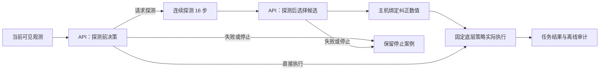
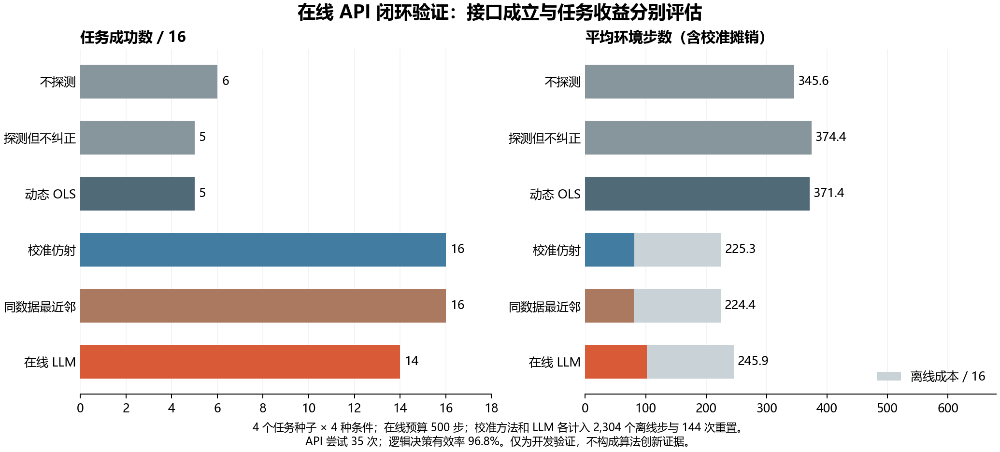

# 在线 API 探测与纠正闭环验证：中文结果报告

本轮完成了真实在线 API 与仿真执行的闭环：GLM-5.2 在探测前选择是否测量，在探测后选择主机生成的纠正候选。调用结果在执行前保存，执行器实际使用该选择。16 个新任务单元、六种方法，共 96 次方法执行，全部收集完成。

**工程接口门槛通过，任务收益未建立。** LLM 成功 14/16，校准仿射和同数据最近邻均为 16/16。LLM 相对仿射少成功两个任务单元，平均在线步数也更高。服务端报告的输出用量还超过了请求中的 512，因此不能宣称总输出资源上限已得到保证。本阶段没有达到 CCF A 发表所需的方法贡献与评估要求。

## API 参与的位置



API 最终选择了仿射 10 次、最近邻四次、动态 OLS 一次；另一个案例在探测前因超时停止。15 个有效纠正选择均形成了真实的“请求探测→观测→选择纠正→任务执行”链路。没有调用记忆模块、更新策略权重或给模型提供真实扰动、种子、随机数状态及未来结果。

15 个有效探测前输出全部请求探测，未观察到选择直接执行或主动停止，因此本轮也没有证明自适应节省探测成本。

## 完整对照

16 单元来自四个新任务种子 9400–9403 与四种已有偏置条件的完全交叉，执行噪声标准差 0.05。每种方法总在线预算为 500 步，包含探测；只有一次初始重置，探测与任务衔接时不重置环境或随机数状态。

| 方法 | 成功 / 16 | 停止 | 平均在线步数 | 平均含离线摊销步数 |
|---|---:|---:|---:|---:|
| 不探测 | 6 | 0 | 345.62 | 345.62 |
| 探测但不纠正 | 5 | 0 | 374.38 | 374.38 |
| 动态 OLS | 5 | 0 | 371.38 | 371.38 |
| 校准仿射 | 16 | 0 | 81.31 | 225.31 |
| 同数据最近邻 | 16 | 0 | 80.44 | 224.44 |
| 在线 LLM | 14 | 1 | 101.88 | 245.88 |



仿射、最近邻和 LLM 均计入完整的 2,304 个离线校准／检验步和 144 次重置。按本轮 16 单元摊销，每单元增加 144 步及九次重置，平均共承担十次重置。校准数据物理上只收集过一次，不重复计为本轮新增采集。

LLM 相对仿射的成功差为 −12.50 个百分点，平均在线步数多 20.56 步。只有四个独立任务种子簇，这些比较是描述性结果；不作为显著性、泛化或总体成功率保证。停止案例计入分母，不能把未执行任务的低步数解读为效率改善。

## 两个失败案例

| 任务单元 | 发生的事实 | 执行结果 |
|---|---|---|
| 9401 / fault_01 | 探测前 API 达到 210 秒硬期限，没有重试或基线代执行 | 停止，任务步数 0，保留为失败 |
| 9403 / fault_04 | 合法 API 输出选择了动态 OLS，纠正为约 [−0.12, −0.08]；同轨迹仿射纠正为约 [−0.12, +0.12] | 动态候选执行 484 个任务步后失败，配对仿射成功 |

“拟合数值有效”不表示估计正确或任务有利。第二个案例只说明本次实现中的一次有效候选选择产生了较差的配对结果，不能当作稳定的最优行动标签，也不能据此调整冻结规则或补跑当前种子。

与相同探测轨迹的仿射基线相比，LLM 在 11 个执行案例中使用相同的有效 float32 纠正，四个案例使用不同纠正；不同纠正的配对结果为零个有利、一个有害、三个相同。另一个停止案例没有可比较的后续执行。方法名称与控制向量变化已分别核对。

## API 可靠性与资源

- 共 35 次尝试：一次健康预检、31 次决策主调用、三次格式修复，未超过 40 次额度。
- 非健康逻辑决策有效 30/31，约 96.8%；原始尝试有效返回 31/35，约 88.6%。修复后的逻辑有效率不等于第一次响应有效率。
- 一次硬超时、三次响应校验失败；三个失败响应都涉及未知或过期动作 ID。只有修复后通过当前请求校验的选择才进入执行。
- 延迟中位数 51.40 秒、P90 134.51 秒、最大值约 210.00 秒。API 等待期间仿真暂停，不能据此声称实体机器人实时控制能力。
- 服务端已报告的输入／输出 tokens 为 69,026／83,019；超时尝试的用量未知，不能视为零费用。没有估算具体金额。

每次 SDK 请求保持 temperature=0、max_tokens=512、硬期限 210 秒及传输重试零次。但 31 次尝试的服务端报告输出用量超过 512，最大报告值为 7,957；超时尝试的用量未知。可见返回字节与服务端 tokens 不是同一指标，保存的工作进程也未记录推理用量拆分。因此原因尚不能确定，**本轮没有证明服务端总输出用量受到 512 的硬限制**，不能宣称全部资源限制都已兑现。这个偏差保留在[补充诊断](../outputs/online_calibrated_agent/diagnostics_v1/report.md)中，没有回改预注册的接口门槛。

## 审计与复现

- 运行标识：online_calibrated_agent_20261014T022239Z_e40d3b2b2c24。
- 清单标识：94bc28f3a27ded943de468a0a5c02301d76f6d495600d7ab169a3aae740a8bc4。
- 冻结源代码：e40d3b2b2c2407a190fe9d148b63ea5212a3d9eb。

[独立审计](../outputs/online_calibrated_agent/analysis_utf8_v1/audit.json)验证了 555 个输入的 Git 字节哈希，重放了 32 个逻辑 API 决策（包含健康预检），检查了 79 次探测衔接及 20,416 个任务步。总新增采集为 21,680 步，其中探测 1,264 步，初始重置 96 次。每步控制指令均由保存的选择与固定策略重建，并核对完整可见观测及随机数推进。

15 个 API 选定候选的完整任务轨迹还分别与对应数值基线逐条相同，见[配对执行核验](../outputs/online_calibrated_agent/analysis_utf8_v1/execution_equivalence.json)。审计不重新仿真任务动力学。

首次审计已完成验证并写出 UTF-8 文件，但终端的 cp1252 编码导致打印中文失败。使用 Python UTF-8 模式在新目录重放后正常退出；没有增加 API 调用或仿真。复现只运行审计，输出到新目录：

```powershell
.\.venv\Scripts\python.exe -X utf8 scripts/analyze_online_calibrated_agent.py `
  --manifest outputs/online_calibrated_agent/development_v1/online_calibrated_agent_20261014T022239Z_e40d3b2b2c24/manifest.json `
  --output outputs/online_calibrated_agent/analysis_reproduction
```

[机器生成报告](../outputs/online_calibrated_agent/analysis_utf8_v1/report.md)保留冻结统计；中文图表同时提供 [PNG](../outputs/online_calibrated_agent/analysis_utf8_v1/figure.png) 和 [PDF](../outputs/online_calibrated_agent/analysis_utf8_v1/figure.pdf)。科学原始文件没有覆盖，9404–9599 及历史保留种子未执行。

实现冻结前通过 636 项测试；加入仅用于报告的资源诊断及其三项测试后，最终全仓 639 项测试通过。首次并发验证遇到宿主内存分配错误，停止并发扫描后串行复验通过；没有更改冻结实现或重复采集。编译、依赖、暂存秘密扫描和差异检查均通过，暂存原始文件的字节哈希与审计记录一致。

## 对 CCF A 目标的影响

本轮补齐了 API 实际参与的执行与审计证据，同时记录了相对强校准基线的负结果。已有的 LLM 技能选择、API 控制和闭环反馈研究意味着这些集成能力不能单独构成新算法，见[原始文献与贡献缺口检查](../docs/research/online_api_contribution_gap_v1.md)。

后续需要另行定义具有实际决策空间的问题、竞争性机制和独立评估，并解决 API 资源限额的可验证性。当前数据不得用于调整后再声称独立确认；本轮不推进记忆、保留种子或发表就绪结论。持续的 CCF A 目标仍未完成。
