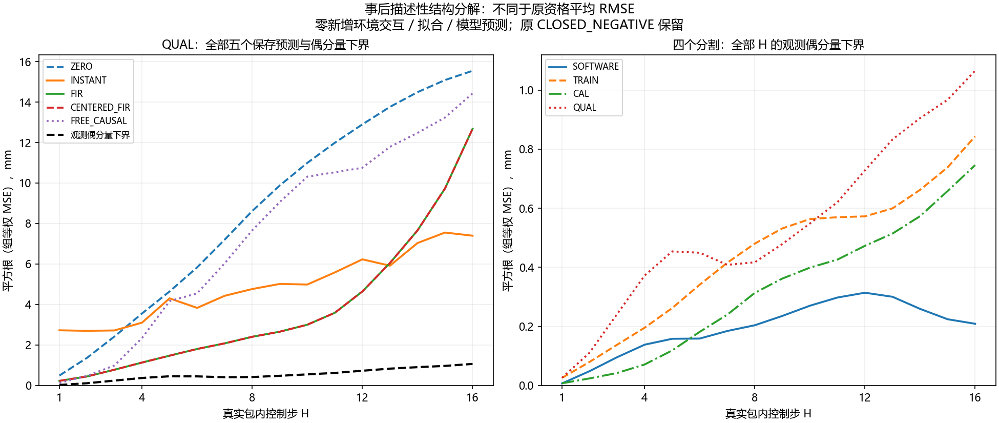

# A线：三角色响应结构诊断 v1 中文报告

**全部新增分析为事后描述性分析。原 FIR 独立资格 `CLOSED_NEGATIVE` 保持；没有新任务收益或算法创新证据。**

本轮改变的后续判断是：不能把主要预测缺口简单归因于“线性类表达不了偶非线性”，也不能由此改用更大网络。QUAL H16 的偶分量表示下界只占保存 FIR MSE 的约0.706%，reach所有H合计约0.0094%；主要剩余量在反对称响应上，但这部分仍可能包含奇非线性、状态/参数变化、估计和泛化误差。

## 冻结、来源与完整人口

诊断冻结 `28744e2cbde342ba6e493a5d9addfcf119427290`；运行 `packet_structure_20261027T114501Z_28744e2cbde3`；清单 `eaa20b9d5c6467c3175fa0e0254c98775ec2e08495f4220270f3e08fe7bfd170`。源记录为已封存 `paired_packet_20261027T101154Z_bb74926c3c07`，没有重采或重拟合。21项新数组/合成记录测试通过，2,265项原检查按源码哈希复用；编译、依赖、秘密扫描及实际索引/磁盘字节检查通过后才执行。

| 分割 | 案例 | 家族 | 至少一个完整H | 完整H16家族 | 可用家族×H | 缺失家族×H |
| --- | --- | --- | --- | --- | --- | --- |
| SOFTWARE | 108 | 36 | 31 | 31 | 496 | 80 |
| TRAIN | 324 | 108 | 81 | 80 | 1284 | 444 |
| CAL | 108 | 36 | 31 | 31 | 496 | 80 |
| QUAL | 324 | 108 | 81 | 80 | 1294 | 434 |

864案例/288家族全部登记；4,608个家族×H槽位中实际可分解3,570个。保存预测槽位23,040个，其中数值分解8,950个，其余显式缺失/未保存预测；SOFTWARE/TRAIN不能凭空补出模型预测。全部三角色才可作本分解，原资格可用的单独配对仍按原规则计分，本分析不会替换原分母。

## 分解是什么意思

同入口给零、正、负命令，实测手部位置记为y0,y+,y-。偶分量 `e=(y++y-)/2-y0` 表示反号后仍保留的同向变化；反对称分量 `o=(y+-y-)/2` 随命令反号改变方向。
同入口的线性命令响应预测对三配对应为 `(p,-p,-2p)`。三个配对/两个轴的平均平方误差满足 `MSE=||p-o||²+||e||²/3`。末项是有限家族/H上的事后表示下界，不是可部署预测器；没有求一个事后oracle模型。
保存预测若有浮点子空间偏差，额外有符号交叉项完整保留，不将其归为物理误差。原生目标偶分量与手部-目标差也保留交叉项，不能当作独立可加因果方差。

这里展示 `sqrt(组等权平均MSE)`，单位mm。原资格是平均端点RMSE、缺失罚1m及裁剪，二者不可互换。本次平方误差分解不改变原 FIR−INSTANT 均差−0.030032mm及95%区间[-0.939732,+0.987179]mm，也不证明二者等价。

## 全部保存模型及完整分层

| 分割 | 保存模型 | 可用组 | 可用家族 | 保存预测 RMS mm | 偶分量下界 RMS mm | 反对称残差 RMS mm | 下界/MSE % |
| --- | --- | --- | --- | --- | --- | --- | --- |
| SOFTWARE | ZERO | 0 | 0 | 缺失 | 缺失 | 缺失 | 缺失 |
| SOFTWARE | INSTANT | 0 | 0 | 缺失 | 缺失 | 缺失 | 缺失 |
| SOFTWARE | FIR | 0 | 0 | 缺失 | 缺失 | 缺失 | 缺失 |
| SOFTWARE | CENTERED_FIR | 0 | 0 | 缺失 | 缺失 | 缺失 | 缺失 |
| SOFTWARE | FREE_CAUSAL | 0 | 0 | 缺失 | 缺失 | 缺失 | 缺失 |
| TRAIN | ZERO | 0 | 0 | 缺失 | 缺失 | 缺失 | 缺失 |
| TRAIN | INSTANT | 0 | 0 | 缺失 | 缺失 | 缺失 | 缺失 |
| TRAIN | FIR | 0 | 0 | 缺失 | 缺失 | 缺失 | 缺失 |
| TRAIN | CENTERED_FIR | 0 | 0 | 缺失 | 缺失 | 缺失 | 缺失 |
| TRAIN | FREE_CAUSAL | 0 | 0 | 缺失 | 缺失 | 缺失 | 缺失 |
| CAL | ZERO | 3 | 31 | 9.376097 | 0.394330 | 9.367801 | 0.176879 |
| CAL | INSTANT | 3 | 31 | 4.155993 | 0.394330 | 4.137244 | 0.900264 |
| CAL | FIR | 3 | 31 | 2.762589 | 0.394330 | 2.734301 | 2.037450 |
| CAL | CENTERED_FIR | 3 | 31 | 2.762589 | 0.394330 | 2.734301 | 2.037450 |
| CAL | FREE_CAUSAL | 3 | 31 | 9.016210 | 0.394330 | 9.007583 | 0.191281 |
| QUAL | ZERO | 9 | 81 | 9.997916 | 0.611695 | 9.979186 | 0.374327 |
| QUAL | INSTANT | 9 | 81 | 5.141092 | 0.611695 | 5.104573 | 1.415661 |
| QUAL | FIR | 9 | 81 | 5.114132 | 0.611695 | 5.077418 | 1.430626 |
| QUAL | CENTERED_FIR | 9 | 81 | 5.114132 | 0.611695 | 5.077418 | 1.430626 |
| QUAL | FREE_CAUSAL | 9 | 81 | 8.777828 | 0.611695 | 8.756489 | 0.485619 |

表中“所有H”先在每个家族内等权H，再组内等权家族、最后组等权；没有把长轨迹多算。四分割不混池，缺失不填0。全部H1–16、固定四步段及任务×条件×获取×边界×H交叉层见原JSON和本次CSV。

| QUAL FIR层 | 可用组 | 可用家族 | 保存预测 RMS mm | 偶下界 RMS mm | 偶下界/MSE % |
| --- | --- | --- | --- | --- | --- |
| 所有H | 9 | 81 | 5.114132 | 0.611695 | 1.430626 |
| task=push-v3 | 6 | 24 | 2.135311 | 0.203045 | 0.904195 |
| task=reach-v3 | 6 | 23 | 9.464901 | 0.091596 | 0.009365 |
| task=door-open-v3 | 9 | 34 | 3.099058 | 0.655708 | 4.476735 |
| context=UNCHANGED | 9 | 41 | 4.966294 | 0.464728 | 0.875655 |
| context=CHANGED | 9 | 40 | 5.230135 | 0.729634 | 1.946187 |
| acquisition_action=IN_TASK | 9 | 42 | 5.341894 | 0.821419 | 2.364500 |
| acquisition_action=MOVE | 9 | 39 | 4.819183 | 0.271303 | 0.316930 |
| boundary=16 | 3 | 36 | 6.008597 | 0.239539 | 0.158930 |
| boundary=32 | 3 | 30 | 4.550849 | 0.352668 | 0.600549 |
| boundary=64 | 3 | 15 | 4.652909 | 0.969927 | 4.345393 |
| horizon=8 | 9 | 81 | 2.405271 | 0.416966 | 3.005201 |
| horizon=16 | 9 | 80 | 12.676772 | 1.065481 | 0.706438 |

## 执行器、原生目标与反证

| 分割 | 完整H16家族 | 末级动作裁剪家族 | 原生目标夹限家族 |
| --- | --- | --- | --- |
| SOFTWARE | 31 | 0 | 0 |
| TRAIN | 80 | 0 | 7 |
| CAL | 31 | 0 | 2 |
| QUAL | 80 | 0 | 4 |

上表限定于完整三角色H16人口，不能推广到缺失时点。QUAL的4个原生夹限家族均是door；reach完整窗口没有这些夹限，但其反对称预测残差最大，因此原生夹限不是reach失败的充分解释。完整夹限清单全部保存在 `all_workspace_clip_H16_families.json`。
QUAL完整H16家族的实际输入偶分量最大绝对值约4.2841e-8 command；末级动作裁剪未出现。不能把小输入偶分量直接换算成无噪声手部误差或唯一非线性原因。
已分别复算所有10,721条真实包动作和10,721次真实原生目标更新：float32仿射/死区→XYZ实际噪声→最终裁剪，以及原生目标float32增量→工作空间夹限，均与原记录逐位一致。真参数、噪声和原生状态只用于评估。

## 能推导和不能推导的结论

- 下界小，反驳“保存模型大多数误差都由其无法表示的偶分量造成”的解释；不保证有一个可学习的共享线性模型。
- 反对称残差大，不意味着只缺状态条件。奇非线性也在其中：例如三次函数在正负输入下反号，偶分量仍为0。短包/单次耦合不能分离全部噪声和奇非线性。
- 固定幅值0/±a的包上，单坐标恒有 `u³=a²u`。因此仅由该刺激的包标签拟合一次/三次特征，两列共线；这是一条设计代数限制，不是新机器人试验，也不是在所有建模假设下的物理不可识别定理。历史观测和结构先验可能提供额外约束，尚未验证。
- 原生目标/跟踪偶分量包含可正可负交叉项，不能用大小比例宣称夹限或接触的因果贡献。
- 本次结果尚未证明公开历史可预测剩余反对称量；不能根据旧QUAL选特征或阈值补救此版。

## 查新与共享反馈残差的边界

非线性辨识中的激励依赖/BLA和偶、奇响应检测已有[Schoukens等的研究](https://arxiv.org/html/1804.09587v1)。我们的短包没有重复周期噪声设计，[2005原文4.3–4.4](https://www.mit.bme.hu/system/files/oktatas/targyak/9132/Identification_of_linear_systems_with_no.pdf)的完整条件不能直接移植。
[Feedback World Model v2](https://arxiv.org/html/2605.15705v2)使用观测反馈修正预测并作动作相关引导，已是强邻近路线。本轮只读方法/假设，未复现其基准。
同入口将一个动作无关共享偏移c加到所有绝对候选预测，候选间向量差严格抵消。因此“只加共享偏移就修复本包差异”不足；绝对目标距离、动作排序和后续真实反馈仍可能受益，不能据此反驳其完整控制结果。其收敛要求不由本有限记录自动成立。
完整12候选及accepted/rejected/deferred决定见 `docs/research/packet_structure_decision_v1_zh.md`。MDE、OCCAM、GAUGE、Residual RL、Poke and Strike、TOM和完整程序DR等比较要求继续有效。

## 独立审计、成本与下一步

独立读者以公开导出取手部位置，另读原生流，并禁用主分解函数，用保存浮点的精确有理数核对85,830个量，另复算29,576个分组均值。共享JSON/NumPy原语；这是另写算术审计，不是独立物理重仿真。主分析47.714秒，独立审计37.173秒。
两实现各再生224条旧确定性噪声带/336,000个标量，分别记账；不是新独立样本。两实现各做3,570次观测分解、8,950次保存预测算术分解；没有模型拟合、参数更新或新预测器执行。
新增环境创建、重置、控制步、物理帧、策略查询、在线LLM API均为0。源成本864次/56,801控制步/44,064全部重置/22,316,005帧及57主求解/57独立求解单列为历史，不重复收费。原始失败、分片、恢复副本与原统计SHA保持。

后续先要求一个独立协议，证明公开历史中的动作依赖响应信息能跨真实获取/纠正状态转移，并与同权限条件线性、反馈观察器、适用性/表现预测强参考比较；仅换网络或加残差不够。本次不解锁采集，不重开原FIR/ARX/GRU/SS。最终仍须新方法自身时序、包含获取和失败的截止损失超过DIRECT_C8/积分/RAW PI/廉价固定率等，并做消融。CCF A目标保持未完成。
