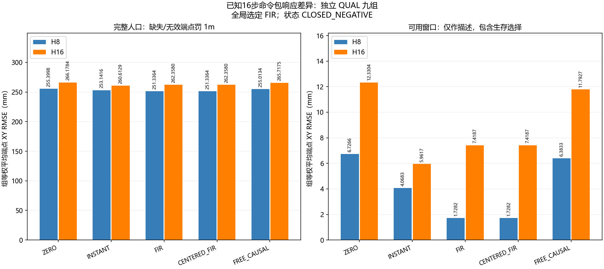

# A线：已知命令包响应差异模型 v1 中文报告

结果状态：**`CLOSED_NEGATIVE`**。本轮是标准前向响应组件的训练与独立资格试验，完整任务收益尚未评价，算法新颖性尚未成立，CCF A 目标仍未完成。

## 冻结与执行

科学冻结 `bb74926c3c0743911cb3bbdddda9ab0ab8868747`，运行 `paired_packet_20261027T101154Z_bb74926c3c07`，清单 `0c1464e0b814377def4650af4786401ae516a087ba8f66969f8821facb11d960`。
先实现收集器、测试、独立审计与固定预算，再提交冻结，随后一次性执行。在线 LLM API 调用为零。
37 项新测试通过，2,228 项旧检查按源码哈希复用，未重跑旧仿真。171 次冻结前测试执行中重复项目不重复算新测试；合成求解费用与科学训练分列。

冻结前发现包装器的墙钟计时会造成跨新尝试哈希误报。原35项候选回执保留，补充2项约束测试；仅投影掉唯一已知 `episode_start_time`，原始完整 Python 哈希另存，不改实际包装器或 RNG/物理状态。
`freeze_validation_v2` 的编译、依赖、全仓秘密扫描、实际暂存对象补充扫描、普通/暂存差异和提交后60对象字节核对通过。

| 阶段 | 已执行 | 冻结分配 | 状态 | 控制步 | 实际入口 | 完整16步包 |
| --- | --- | --- | --- | --- | --- | --- |
| SOFTWARE | 108 | 108 | COLLECTED_FOR_INDEPENDENT_AUDIT | 7497 | 93 | 93 |
| TRAIN | 324 | 324 | COLLECTED_FOR_INDEPENDENT_AUDIT | 20734 | 243 | 240 |
| CAL | 108 | 108 | COLLECTED_FOR_INDEPENDENT_AUDIT | 7587 | 93 | 93 |
| QUAL | 324 | 324 | COLLECTED_FOR_INDEPENDENT_AUDIT | 20983 | 243 | 242 |

## 方法名称与可用信息

每个家族含 ZERO/PLUS/MINUS 三个独立实际尝试，共同前缀、获取程序及入口一致。可选 MOVE 是原 LOCAL_PID，随后真实 common8，再执行预先公开16步包。不能重置撤销移动。ZERO 入口先保存全部三配对预测，另两尝试核对真实入口后复用，不能看 ZERO 结果重算。

- ZERO：假定两组命令不会产生响应差异。
- INSTANT：用一个固定 XY 增益矩阵乘累计命令差。
- FIR（有限脉冲响应）：用16个延迟响应核表达输入对后续运动的影响。
- CENTERED_FIR：同数据三角色减均值的回归，登记为 FIR 的等价性检查，不计新算法。
- FREE_CAUSAL：每个预测时长单独拟合线性映射，禁止读该时长之后的命令。

模型只用任务名与已知命令。入口公共历史用于因果性/配对审计，不作为状态条件特征。真实扰动、实际噪声、私有状态只用于执行核对，不进入拟合输入或标签。所有标签都是实际公共 XY 观测。
ZERO 角色发送零命令，实际仍受扰动和噪声影响，不能把它称为物理静止。
未来输入已知依赖本轮的固定开放环包；不能外推为闭环未知动作预测。模型从未求逆或进入任务控制。

## 训练、校准与独立资格

TRAIN 共 108 个登记家族，完整三角色 H16 家族 80；主求解 57，独立增广最小二乘 57。
固定 ridge=0.001、16阶、TRAIN 加权 RMS、不设截距。缺失家族不进入拟合，但保留全部分母；输入依赖的生存选择并未被随机命令消除。CAL 只选一个全局 FIR/FREE_CAUSAL，权重不重训；模型锁先于 QUAL。

| 模型 | 全人口平均端点损失 mm↓ | 可用窗口描述性均值 mm↓ | 可用/全部端点 |
| --- | --- | --- | --- |
| CENTERED_FIR | 256.847203 | 4.568650 | 484/648 |
| FIR | 256.847203 | 4.568650 | 484/648 |
| FREE_CAUSAL | 260.365446 | 9.090622 | 484/648 |
| INSTANT | 256.877234 | 5.014987 | 484/648 |
| ZERO | 260.789107 | 9.529464 | 484/648 |

主评分是 H8/H16 的三配对端点 XY RMSE，缺失/无效端点罚1m，数值上限1m，十进制80位后舍入至1nm。可用子集均值仅作描述，不能替代全分配评价。组等权，9个独立组按边界分层 bootstrap10,000次。

| 选定模型−参考 | 均差 mm | 组 bootstrap95% mm |
| --- | --- | --- |
| ZERO | -3.941904 | [-4.870844, -2.970166] |
| INSTANT | -0.030032 | [-0.939732, +0.987179] |

选定 FIR 相对 INSTANT 的全人口平均差为 -0.030032 mm，95% 区间 [-0.939732, +0.987179] mm。区间跨零，未建立相对强参考的稳定优势；这也不证明两者等价。reach 和 H16 的预设点规则未通过。数值/记录门通过与性能门失败分别保留，不能把资格失败解释成纯软件问题。

QUAL 每模型 648 个登记端点中，484 个可用、164 个缺失，所有方法使用同一缺失惩罚。数百毫米的全人口分数主要包含这一预设惩罚，不能称为实际可用窗口的纯物理预测误差。可用子集仍有生存选择和不同组内分母。

资格门：

- `both_primary_CI_upper_negative`：`False`。
- `all_task_and_horizon_points_below_both`：`False`。
- `all9_groups_have_complete_family`：`True`。
- `minimum_complete_pairs_per_cell`：`True`。
- `zero_invalid_forecasts`：`True`。

完整边际分层如下。任务×条件×获取×时点×H 的全部交叉层保存在 `qual_evaluation/panels.json`，没有按结果挑子集。

| 层 | ZERO mm | INSTANT mm | FIR mm | CENTERED_FIR mm | FREE_CAUSAL mm |
| --- | --- | --- | --- | --- | --- |
| push-v3 | 341.155298 | 336.427971 | 334.642560 | 334.642560 | 341.087142 |
| reach-v3 | 376.625253 | 373.750681 | 377.766268 | 377.766268 | 376.011617 |
| door-open-v3 | 64.586770 | 60.453051 | 58.132780 | 58.132780 | 63.997578 |
| UNCHANGED | 248.752323 | 244.658990 | 244.159521 | 244.159521 | 248.309475 |
| CHANGED | 272.825891 | 269.095479 | 269.534884 | 269.534884 | 272.421416 |
| IN_TASK | 229.878760 | 225.981383 | 226.323447 | 226.323447 | 229.464212 |
| MOVE | 291.699454 | 287.773086 | 287.370958 | 287.370958 | 291.266679 |
| 16 | 12.996972 | 5.339540 | 5.316253 | 5.316253 | 11.826013 |
| 32 | 183.093333 | 180.094478 | 180.130441 | 180.130441 | 182.940701 |
| 64 | 586.277016 | 585.197685 | 585.094914 | 585.094914 | 586.329623 |
| 8 | 255.399804 | 253.141551 | 251.336441 | 251.336441 | 255.013359 |
| 16 | 266.178410 | 260.612918 | 262.357964 | 262.357964 | 265.717532 |

## 缺失、失败与识别边界

无阶段执行异常。

全部实际案例、提前结束、未达锚点、部分包及原因见 `presentation/all_case_outcomes.csv` 和 `full_population_missingness.json`，也保留每步原始记录。包末成功标志只描述该有限响应窗口，不能当作完整任务成功率；本轮没有任务尾部或截止损失比较。
没有执行采用新模型纠正的完整任务，错误更新率与完整截止损失均为未评价，不填零。
独立记录审计复算 float32 仿射/死区→XYZ噪声→最终裁剪及原生目标更新，核对真实前后值、噪声游标、命令引用和生命周期。补充重放共享调度程序/原策略类，只使用保存观测，不物理重仿真。全状态哈希是固定运行时的来源见证，不能当作普遍隐藏状态或安全证明。

## 完整费用

| 阶段 | 控制步 | 全部重置 | 物理帧 | 在线/审计固定策略查询 | 采集秒 |
| --- | --- | --- | --- | --- | --- |
| SOFTWARE | 7497 | 5508 | 2791485 | 3816/3816 | 293.354 |
| TRAIN | 20734 | 16524 | 8365670 | 11148/11148 | 831.502 |
| CAL | 7587 | 5508 | 2791935 | 3756/3756 | 291.453 |
| QUAL | 20983 | 16524 | 8366915 | 11412/11412 | 845.874 |

实际总计 864 次、56801 控制步、44064 全部重置、22316005 物理帧；冻结上限864次/80,640步/44,064次重置/22,435,200帧。包含工厂每次50次内部重置及受控初始重置，未把这部分隐藏为免费准备。
科学主线性求解 57、独立复算 57；在线实际预测计数 `{'trajectories_started': 1680, 'zero_rows': 5376, 'trajectories_completed': 1680, 'linear_rows': 21504}`。原生见证与日志耗时包括在采集时间内，模型计算逐次延迟另存。在线 LLM API=0，神经更新=0，C4/C8拟合=0，恢复=0。
旧数据/试验费用不计为本轮新增，但旧历史保留；不利用旧资格调整本轮模型或阈值。详见 `presentation/costs.json`。
历史来源费用单列：已声明原生接口的既有资格为18次、2,835控制步、918次全部重置、473,175帧，来源哈希写入成本清单。固定 PI/PID 原语的原开发账本见 `reports/acquisition_reference_qualification_v1_zh.md`；不将重叠历史重复加总。旧训练样本复用=0、旧学习模型权重加载=0。本轮独立训练成本另列，不能把已有工程原语说成从零免费开发。

## 后续判断与已有工作

标准动态模型通过时，只支持它在本分配的已知命令响应差异上作为参考；仍需检验纠正后的实际状态/输入适用性和包含获取成本的任务收益。失败则封存版本，不扩样、修权重、换最佳任务或叠加选择规则。
本次模型按任务固定，入口状态历史未作为特征；状态、参数变化、接触和噪声均可能影响表现。本试验不能区分唯一失败原因，不根据 QUAL 增添特征补救当前版本。
配对未来输入诊断已有研究，见[2026年时间序列模型研究](https://arxiv.org/html/2610.08118v1)；闭环辨识与反事实适应也已有 [AdaptOn](https://arxiv.org/abs/2003.11227)。本轮未复现这些论文，也不主张配对/FIR/中心化为创新。
MDE、Residual RL、OCCAM、GAUGE、Poke and Strike、TOM 等仍是必要邻近路线，阅读范围和限制见 `docs/research/paired_packet_response_decision_v1_zh.md`。
下一项研究仍要建立“获取改变实际状态与模型适用性”时的具体机制，保留 DIRECT_C8、积分补偿、RAW PI/廉价固定率、始终获取/不更新及标准辨识/检测/任务相关获取强参考，在新方法自身独立时序中证明完整截止损失优势并做消融。测试、组件资格和归档均不代替论文贡献。

## 来源与复算

冻结协议 `docs/protocols/paired_packet_response_v1_zh.md`；入口 `scripts/run_paired_packet_response_v1.py`；原科学分配不允许重跑。可对原记录运行另行版本化的只读审计，不改已存在输出。
原始 gzip 均留本地，结果提交包含≤4MiB原始字节分片及索引，逐个实际恢复并核对字节；恢复副本保留。来源、大小、哈希、索引和恢复证明见 `outputs/paired_packet_response/archives_v1`。紧凑远端归档沿既有规则省略原始gzip和二进制分片，目录明确列出省略项目，不能声称远端已具备全部大记录。
