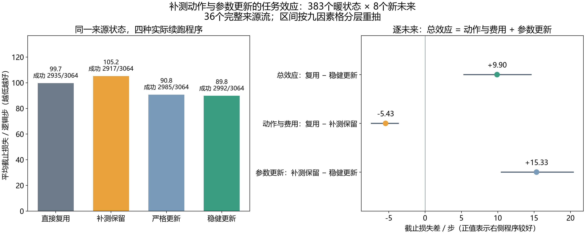

# 同状态探测与纠正效应的中文解读

在本轮固定来源历史上，补测后更新参数、无效时保留旧参数，相比直接复用旧参数，
平均截止损失降低 **9.90 步**，95%完整流区间为 **[5.36, 14.59]**。
收益来自参数更新：单独增加探测动作而继续使用旧参数，平均损失反而增加 **5.43 步**。
这说明指定更新程序有平均任务收益，仍不足以证明代理能提前识别哪些状态值得补测。

这是三个 MetaWorld 任务上的机制测量，API 调用为零。没有训练或确认新选择器，
也没有真实机器人硬件结果。完整数据、历史负结果和冻结协议保持原样。

## 四个名字分别表示什么

四个程序都从同一个已经完成四步探测的暖状态开始，手中都有较早真实成功验证过的旧参数。
因此“直接复用”也已经支付了初始四步费用，不能当作从重置开始的 NO_PROBE 基线。

| 代码 | 中文意思 | 到该状态之后实际做什么 |
|---|---|---|
| R，REUSE_OLD | 直接复用 | 立即用旧参数纠正固定政策 |
| P，PROBE_KEEP | 补测保留 | 再探测四步，仍用旧参数 |
| U，PROBE_UPDATE | 严格更新 | 再探测四步，用实际八步数据重新估计；新拟合无效则停止 |
| K，PROBE_UPDATE_KEEP | 更新并回退 | 再探测四步；新拟合有效则使用，无效则继续用旧参数 |

“稳健更新”只是 K 的普通无效回退规则，不是新算法名称。
当前四步前缀检查也不同于后继草案中的“四步重新估计”：本轮 U、K 使用全部八步拟合。

## 完整人口和任务结果

432 个来源单元全部保留，其中 49 个是没有旧缓存的冷启动，383 个形成可比较的暖状态。
每个暖状态有八个新未来，每个未来实际执行四个程序，各程序共 3,064 次。
这些未来属于 383 个状态、36 个完整来源流，不能当作 3,064 个独立任务样本。
实际来源未来 0 只用于形成自己的后续历史，不进入下面的程序效果均值。

| 程序 | 成功／全部 | 失败总数 | 其中停止 | 平均截止损失 |
|---|---:|---:|---:|---:|
| 直接复用 R | 2935／3064 | 129 | 0 | 99.75 |
| 补测保留 P | 2917／3064 | 147 | 0 | 105.18 |
| 严格更新 U | 2985／3064 | 79 | 7 | 90.78 |
| 更新并回退 K | 2992／3064 | 72 | 0 | 89.84 |

成功按含初始探测的全部逻辑步数计分；失败与停止计 500。实际费用始终记实际执行的步骤，
停止不会被填充成 500 个物理步。各程序平均损失是指定续跑程序的结果，
不能代替它们各自从头部署、按自己结果更新缓存的长期政策表现。
实际来源政策本身为 417／432 成功，这是另一个分母。

图中左侧柱高表示截止损失，单位为逻辑步数；含失败惩罚，不能直接读成平均实际环境步数。

## 为什么平均改善不等于每次都应补测

| 预先注册的效果 | 平均值／步 | 95%完整流区间 |
|---|---:|---|
| 总效果 R−K | +9.90 | [5.36, 14.59] |
| 补测动作、费用与状态变化 R−P | −5.43 | [−7.39, −3.67] |
| 同一额外前缀后的更新 P−K | +15.33 | [10.49, 20.39] |
| 严格更新的总效果 R−U | +8.97 | [4.21, 13.79] |
| 无效回退效果 U−K | +0.93 | [0.00, 2.29] |

正值表示右侧程序损失更低。区间在九因素格内各四个完整来源流分层重抽 10,000 次，
重新计算状态加权分子与分母；次比较未作多重校正。没有小效应功效、等效或非劣效结论。

每个未来都满足 R−K=(R−P)+(P−K)。R−P包含动作费用、物理状态变化和后续反馈；
P−K是指定拟合器及其拒绝规则的更新效果，不等于最优信息价值。

383 个状态的八未来均值中，**104 个更新并回退较好，276 个直接复用较好，3 个相同**。
少数大损失改善使总体均值为正。86 个状态在八个未来中同时出现总效果的正负方向，
所以这些状态均值不是可靠的逐状态真值标签。噪声修正保留原始有符号协方差，
不据此声称公开证据下的不可约不确定性、单状态置信保证或选择器可学习性。

以下是预先注册分组的描述均值，没有单独的分组置信区间。故障与变化方式只供评价，不能交给代理选动作。

| 分组 | 暖状态数 | 总效果 R−K／步 | 更新效果 P−K／步 |
|---|---:|---:|---:|
| 开门 door-open-v3 | 130 | −4.35 | −0.25 |
| 推物 push-v3 | 128 | +13.51 | +22.04 |
| 到达 reach-v3 | 125 | +21.03 | +24.68 |
| 偏置 BIAS | 128 | +9.46 | +11.35 |
| 二维映射 COLUMN_Y | 131 | +0.01 | +6.86 |
| 死区 DEADZONE | 124 | +20.82 | +28.39 |
| 不变 UNCHANGED | 127 | −4.55 | +0.84 |
| 突变 ABRUPT | 129 | +7.86 | +11.51 |
| 渐变 GRADUAL | 127 | +26.43 | +33.71 |

不能把这些组间差异全部归因于单个故障或变化因素：各组来源状态、参数和历史也有差异。

## 保留的失败与相反例子

按观测状态均值选择的两个极端例子，只用于说明异质性，不是代理在执行前能选出的策略。
种子 19218 的到达任务中，R、P 八个未来全部失败，U、K 全部成功，平均损失由 500 降至 68.125。
种子 19493 的推物任务中，R、P 全部成功，U、K 只有三个未来成功；
R 的平均损失为 68.25，K 为 356.75。后者说明新拟合通过数值资格，也可能伤害任务。
其总效果均值为 −288.50 步，MC 标准误为 71.82 步；不将一个小样本状态均值推广为条件规律。

七次严格停止来自两个状态，新拟合矩阵的最小奇异值均低于预先固定的 0.25 逆补偿下界。
K 保留旧参数后七次均成功；这是普通回退的作用，不能作为创新或普遍优胜证据。

| 任务种子与任务 | 严格停止的未来编号 | K 的真实总步数 |
|---|---|---|
| 19363，到达 | 2、8 | 114、111 |
| 19485，开门 | 1、4、6、7、8 | 84、84、84、84、84 |

全部 427 次评价分支失败以及另列的 15 次实际来源失败均保留在
[失败清单](../outputs/paired_probe_effects/development_v1/paired_probe_effects_20261016T191951Z_591c353cd1e2/main_analysis_v1/failures.csv)；
[停止清单](../outputs/paired_probe_effects/development_v1/paired_probe_effects_20261016T191951Z_591c353cd1e2/main_analysis_v1/stops.csv)
保留实际八步和 500 分任务惩罚。没有用其他方法代执行这些失败。

## 审计和完整成本

记录审计重放 3,656,705 条事件，核对 6,128 对共同探测前缀、3,057 对有效更新同轨、
7 对无效回退同轨、383 次来源状态恢复。数值审计核对 4,161 个字段，最大差为 9.09×10⁻¹³。
记录审计复用固定政策、拟合器、编码器及缓存检查数学；物理见证由来源生成，
没有重新构建环境来独立证明每条轨迹，也不推广为任意隐藏状态或真实硬件的完整证明。

| 费用口径 | 控制步 | 受控重置 | 全部重置 | 请求仿真帧 |
|---|---:|---:|---:|---:|
| 本轮 MAIN 实际采集 | 1,169,939 | 432 | 22,032 | 16,865,695 |
| 单列 SMOKE | 6,964 | 9 | 459 | 264,320 |
| 既有完整名义模型来源 | 3,840 | 480 | 24,480 | 12,259,200 |
| 既有恢复工具两版本资格 | 4,032 | 13 | 663 | 351,660 |

MAIN 控制步包括实际来源 41,105 步和评价后缀 1,128,834 步；共同初始四步只支付一次。
名义来源按 432 个来源单元摊销为每单元 8.888889 步，不除以四个程序或八个未来。
既有来源不作为本轮重新采集的数据，恢复资格也保留 v1 失败费用。

采集实际拟合 6,201 次、优化器 nfev 6,201、政策查询 1,131,534 次；
审计另重算同样次数，分别计入计算费用。采集主体墙钟 14,997.959 秒，
其中捕获 110.483 秒、恢复 3,231.094 秒，二者是主体的子集。完整六步流程约 15,677.938 秒。
API、选择器拟合、政策权重更新均为零。

## 对后续研究的约束

按固定来源历史保存的建议，UNCERTAINTY4 在 359 个状态复用、24 个状态刷新；
TASK_IVR4 在 26 个状态复用、357 个状态刷新，其当前状态平均损失分别为 94.71、92.46。
这只是当前状态建议的评价，不能代替两者按自身历史运行的独立时序表现。
没有把事后损失最小的程序包装成在线算法。

下一候选需要用执行前可见证据识别有益与有害更新，计入探测引起的状态变化和拒绝回退，
并保留便宜四步、完整八步及其他强参考，按自身历史独立确认。
四步标准参考目前只完成软件组件，尚未执行其物理人口；软件验证不能替代任务比较。
[完整发表要求](../docs/research/publication_path_v1.md)中的新贡献、独立新方法评价、消融与完整论文仍未完成。
本轮平均收益不属于 LLM；[历史 API 闭环报告](online_calibrated_agent_development_v1.md)单独保留。

原始报告和图表均保持生成时字节。六步流程均返回 0，终态以 main_pipeline_completion.json 的
COMPLETED_FOR_REVIEW 为准；main_pipeline_status.json 是子进程完成后的快照，最后的 RUNNING 字段保留原样。

证据：[原始中文报告](paired_probe_effects_main_v1.md)、
[数值结果](../outputs/paired_probe_effects/development_v1/paired_probe_effects_20261016T191951Z_591c353cd1e2/main_analysis_v1/statistics.json)、
[完整成本](../outputs/paired_probe_effects/development_v1/paired_probe_effects_20261016T191951Z_591c353cd1e2/main_analysis_v1/costs.json)。
运行 paired_probe_effects_20261016T191951Z_591c353cd1e2；清单 758755b6e0b07419c631f6c8cc83696de4d05a9be8ca1d66f334b8fd6cb7f1f7；
冻结源码 591c353cd1e2a8c940be82fbcb1af97ce3f531da。
