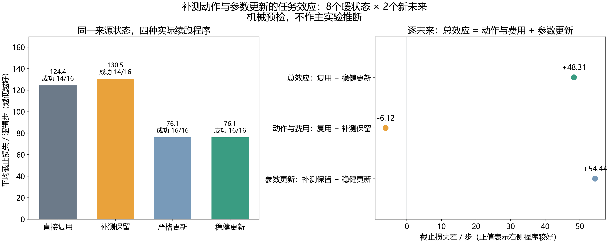

# 同一状态下，补测动作与参数更新的任务效应

本轮是MetaWorld机制开发测量，没有在线API、新算法或真实机器人硬件结果。来源行为固定为“考虑旧参数误差的4步检查”，评价分支不写入来源缓存。

**这是采集与审计预检。任务分数不用于调参，也不能当主实验结论。**

完整保留9个来源单元：冷源1、4步内已结束0、合格暖状态8。每个合格状态另有2个新未来；实际来源未来0与哨兵不进入效果均值。

| 程序 | 中文意思 | 成功／全部 | 停止 | 平均截止损失 | 平均逻辑步数 | 平均实际后缀 |
|---|---|---:|---:|---:|---:|---:|
| REUSE_OLD | 直接用旧参数 | 14／16 | 0 | 124.375000 | 124.375000 | 120.375000 |
| PROBE_KEEP | 补测但保留旧参数 | 14／16 | 0 | 130.500000 | 130.500000 | 126.500000 |
| PROBE_UPDATE | 补测并更新，无效即停 | 16／16 | 0 | 76.062500 | 76.062500 | 72.062500 |
| PROBE_UPDATE_KEEP | 补测并更新，无效沿用旧参数 | 16／16 | 0 | 76.062500 | 76.062500 | 72.062500 |

成功计从初始重置起的全部逻辑步数；失败／停止损失500，实际费用仍按真实执行步数。四程序起点都是来源的同一个4步状态，不是四条独立部署的完整时序政策。

| 注册效果（正值表示右侧程序损失较低） | 均值／步 | 95%完整流区间 | 正负方向都出现的状态数 |
|---|---:|---|---:|
| 直接复用 − 补测稳健更新 | +48.312500 | 预检不作区间推断 | 1／8 |
| 直接复用 − 补测保留 | -6.125000 | 预检不作区间推断 | 1／8 |
| 补测保留 − 补测稳健更新 | +54.437500 | 预检不作区间推断 | 1／8 |
| 直接复用 − 补测严格更新 | +48.312500 | 预检不作区间推断 | 1／8 |
| 严格更新 − 稳健更新 | +0.000000 | 预检不作区间推断 | 0／8 |

逐未来满足 R−K=(R−P)+(P−K)。R−P包含补测运动、4步费用及后续状态变化；P−K是指定拟合器和拒绝规则的更新效应，不能称为纯信息价值或最优EVSI。
状态均值的噪声修正协方差保留负值。每状态MC标准误、所有正负反转、原始与修正协方差保存在 statistics.json／state_effects.csv；它们不识别固定公开证据下的隐藏变异，也不保证单状态符号或可学习性。

同证据的UNCERTAINTY4与TASK_IVR4建议在当前后续结果之前保存。其当前状态损失只描述固定来源历史上的选择，不是各自独立部署的长期效果，也没有用事后最优程序代替在线选择。
全部任务、故障族与变化方式分组见 statistics.json；所有来源单元、程序执行、失败、停止和状态效果均单独导出CSV，没有按评价结果删状态。

独立记录审计重放22477个事件，共核对32对共同探测前缀、8次来源状态恢复和1次完整哨兵。独立数值审计核对335个字段，最大差3.64e-12。

物理恢复使用已通过注册条件资格的原生复制工具；见证仍由来源生成，不能推广为任意隐藏状态、任意版本或真实硬件的完整证明。记录审计共享固定政策、数值拟合器、编码器及缓存／检查数学，未重新构建环境或调用复制执行器。

本阶段实际6964个控制步，其中来源618、评价后缀6256、哨兵后缀90。受控重置9次，全部重置459次，请求模拟帧264320。

完整名义模型来源3840步／480次受控重置、24480次全部重置／12259200请求帧，单列摊到本阶段每个来源单元426.666667步；不按反事实程序或重复未来数量稀释。恢复工具两版本的既有资格费另列4032控制步／13受控重置／663全部重置／351660请求帧，包含保留的v1失败。

采集侧参数拟合34次、nfev 34、政策查询6736；审计另重算拟合34次、nfev 34、政策查询6736。采集主体墙钟98.508秒，捕获2.370秒、恢复19.029秒为其子集；API／选择器拟合／政策更新均为0。

本轮结果用于约束下一候选机制；新方法定义、与已有工作的实质区别、独立新方法任务确认、消融和完整论文要求仍未完成，不将此测量当作CCF A发表证据。

证据：paired_probe_effects_20261016T191951Z_591c353cd1e2；清单 758755b6e0b07419c631f6c8cc83696de4d05a9be8ca1d66f334b8fd6cb7f1f7；冻结源码 591c353cd1e2a8c940be82fbcb1af97ce3f531da。
