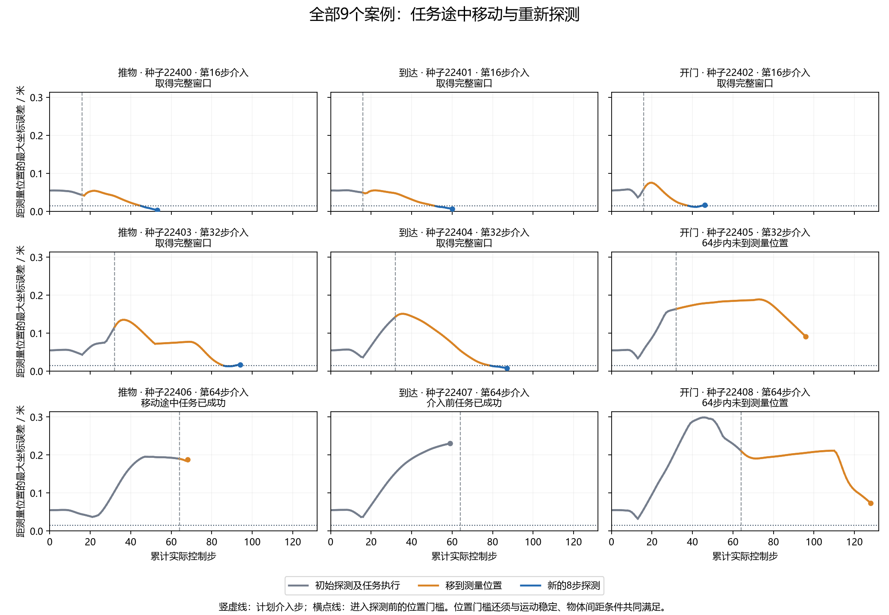

# 中途重新探测：9案例执行验证

**本轮通过执行可用性门：5/9个案例取得完整的新探测窗口，覆盖推物、到达、开门三种任务。记录审计通过。**
这回答了‘机器人能否在任务做到一半时，实际移到测量位置再探测’；尚未证明这些数据能准确估计偏差，也未证明任务收益或算法新颖性。5/9是窗口获取数量，不是任务成功率。

## 方法与完整结果

每个案例从一次初始重置开始。C4/C8分别表示根据最初4/8步探测数据得到的纠正；用C8执行到计划介入时刻，再最多用64步移动、8步试动。环境和噪声状态连续。窗口完整或操作停止后即结束采集，没有后续完整任务对照，也没有在线LLM参与。

|任务|种子|计划介入步|结果|移动步|新探测步|总控制步|
|---|---:|---:|---|---:|---:|---:|
|推物|22400|16|取得完整窗口|29|8|53|
|到达|22401|16|取得完整窗口|36|8|60|
|开门|22402|16|取得完整窗口|22|8|46|
|推物|22403|32|取得完整窗口|54|8|94|
|到达|22404|32|取得完整窗口|47|8|87|
|开门|22405|32|64步内未到测量位置|64|0|96|
|推物|22406|64|移动途中任务已成功|4|0|68|
|到达|22407|64|介入前任务已成功|0|0|59|
|开门|22408|64|64步内未到测量位置|64|0|128|

两个开门案例达到移动上限；推物22406在移动途中成功，到达22407在第59步、计划介入前成功。四者均留在分母，不补选、不按探测成功计算。不同介入时刻使用不同种子，不能据此断言早探测优于晚探测。

横点线仅表示进入探测前的位置条件；探测期间允许位置变化，另按高度和物体间距检查范围。图中显示的是可见观测，并不证明隐状态与初始重置一致。

## 成本与审计

新增总控制步691：介入前331，移动320，新探测40。成功取得窗口的5例，移动加探测平均45.6步；成本统计仍保留其余4例。受控初始重置9次，加工厂目标生成共459次；请求及完成仿真帧均为232,955。
初始策略查询259次，C4/C8拟合18次（nfev合计18）；中途拟合、API调用、名义模型重训和策略权重更新均为0。
采集进程51.433秒；独立审计进程16.182秒。审计额外重算259次策略查询和18次初始拟合，无新增物理步。
沿用C8所需完整历史名义费用：3,840控制步、480受控重置、24,480全部重置、12,259,200帧。本轮按9案例摊销426.667历史控制步/案例；旧资格与研究仍是另列的历史开发费用。软件测试夹具费用见冻结检查记录，早先一次未持久保存的定向测试费用不在该记录中，因此不把记录冒称为整个开发阶段总成本。
审计核对3,703条主事件和27份私有状态见证，重建保存的选择、执行顺序、连续状态、噪声及费用；未发现协议内的预算、衔接或信息边界违规。它依赖冻结采集器的可信执行，并非外部物理真值认证。
仿真日志保留Gymnasium观测空间与MetaWorld动作裁剪提示；未删改提示或通过静默重跑替换案例。

## 下一步与结论边界

执行可用性已得到这9例的有限支持。下一步需要独立的中途响应校准和资格数据，不能把本轮窗口直接送入仅适用于初始重置的C8模型。后续任务实验须至少比较继续C8、仅移动后继续C8、移动并探测但保持C8、移动并探测后更新，并收取全部移动和探测费用。
本轮不能作为CCF A算法创新或投稿就绪证据；新方法、强基线收益、独立多任务流、消融和完整论文要求仍未完成。

冻结提交：`e6ffa2f4deaec07d116aba031cd1d9520621fbda`。清单：`612f593437f5e8f6ecd00a0d1d14e009daba92b661297d89ac642ed9c3ddbf61`。
原始记录与独立审计：[运行目录](../outputs/physical_reprobe/qualification_v1/physical_reprobe_20261019T120619Z_e6ffa2f4deae)；[冻结协议](../docs/protocols/physical_reprobe_execution_qualification_v1.md)。全仓库1,187项测试及编译、依赖、秘密与差异检查通过。
