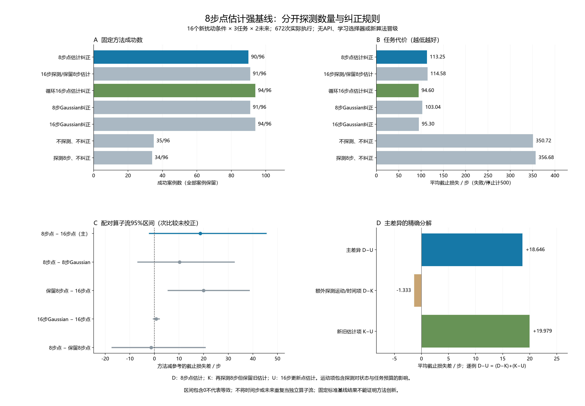

# 8步点估计与16步探测：补齐便宜强基线

本轮补齐原先缺失的‘8步点估计纠正’，并将额外探测的运动/时间影响与使用新数据的影响分开。全部是固定标准基线；没有训练新选择器，没有API或记忆参与。

主比较：8步点估计90/96、平均截止损失113.250步；16步点估计94/96、94.604步。8步减16步为+18.646步，95%算子流bootstrap区间[-2.000, +45.417]。负值有利于8步；区间包含0不能称为等效。

本批观察到平均截止损失最低的固定方法为循环16步点估计纠正（POINT16_CYCLE）。这是结果描述，不是新算法或总体优胜保证；所有失败与停止均保留。

## 方法含义与全部结果

POINT表示使用一组确定的估计参数逆补偿；Gaussian沿用包含协方差风险项的原命令目标。两者还有正则化与命令约束方式的差异，因此不是仅协方差的纯消融。8和16指探测环境步。KEEP方案保存8步点估计，完成额外8步相同探测后仍从保存对象执行；不能事后换成更新估计。

| 固定方法 | 成功／96 | 停止 | 平均截止损失 | 平均实际总步 | 平均探测步 | 名义来源步／受控重置 |
|---|---:|---:|---:|---:|---:|---|
| 8步点估计纠正（DIRECT_POINT8） | 90 | 0 | 113.250 | 113.250 | 8.000 | 21,010／288 |
| 探测16步、保留8步点估计（KEEP_POINT8_AFTER16） | 91 | 0 | 114.583 | 114.583 | 16.000 | 21,010／288 |
| 循环16步点估计纠正（POINT16_CYCLE） | 94 | 0 | 94.604 | 94.604 | 16.000 | 21,010／288 |
| 8步Gaussian纠正（DIRECT_G8） | 91 | 0 | 103.042 | 103.042 | 8.000 | 21,010／288 |
| 16步Gaussian纠正（UPDATE_G16） | 94 | 0 | 95.302 | 95.302 | 16.000 | 21,010／288 |
| 不探测、不纠正（NO_PROBE） | 35 | 0 | 350.719 | 350.719 | 0.000 | 0／0 |
| 探测8步、不纠正（IDENTITY_AFTER8） | 34 | 0 | 356.677 | 356.677 | 8.000 | 0／0 |

成功的截止损失等于含探测的总步数，失败/停止计500。实际费用只按真实执行步数计算，提前停止没有虚构剩余环境步。每方法96案例，未按拟合是否有效或探测是否完整筛选。

## 注册比较

主比较与四个未做多重校正的次比较分列。16个算子流是重采样单位，流内三任务、两个未来重复不充作独立流。偶奇各8流分层bootstrap10000次，随机数20261015；这些区间不是模型校准界。

| 方法减参考 | 地位 | 成功率差／百分点 | 截止损失差及95%区间／步 | 原成功变失败 | 原失败变成功 |
|---|---|---:|---|---:|---:|
| 8步点估计纠正 − 循环16步点估计纠正 | 主 | -4.167 | +18.646 [-2.000, +45.417] | 4 | 0 |
| 8步点估计纠正 − 8步Gaussian纠正 | 次，未校正 | -1.042 | +10.208 [-6.677, +32.406] | 2 | 1 |
| 探测16步、保留8步点估计 − 循环16步点估计纠正 | 次，未校正 | -3.125 | +19.979 [+5.635, +38.522] | 3 | 0 |
| 16步Gaussian纠正 − 循环16步点估计纠正 | 次，未校正 | +0.000 | +0.698 [-0.427, +1.948] | 0 | 0 |
| 8步点估计纠正 − 探测16步、保留8步点估计 | 次，未校正 | -1.042 | -1.333 [-17.198, +20.625] | 2 | 1 |

## 主差异的精确分解

对每个相同任务/扰动/未来单元，以D表示8步点估计、K表示再探测8步但保留旧估计、U表示16步更新点估计，则

    L(D) − L(U) = [L(D) − L(K)] + [L(K) − L(U)]。

全部96例逐例恒等式通过。均值为+18.646 = (-1.333) + (+19.979)步。第一项包含额外探测的运动、耗时及替代任务动作的影响；第二项在完整共同16步时比较同状态的新旧估计。若拟合停止导致共同边界未完成，仍保留总体程序效果，不能对该例作纯同状态信息解释。置信区间端点不能直接相加。

这是一项标准代数分解与固定干预对照，不是新理论。真实扰动只用于注入与评价，拟合与纠正仅使用因果可见轨迹。

## 任务分层

| 方法 | 任务 | 成功／32 | 平均截止损失 |
|---|---|---:|---:|
| 8步点估计纠正 | push-v3 | 28 | 127.438 |
| 8步点估计纠正 | reach-v3 | 32 | 71.906 |
| 8步点估计纠正 | door-open-v3 | 30 | 140.406 |
| 探测16步、保留8步点估计 | push-v3 | 29 | 120.375 |
| 探测16步、保留8步点估计 | reach-v3 | 32 | 78.844 |
| 探测16步、保留8步点估计 | door-open-v3 | 30 | 144.531 |
| 循环16步点估计纠正 | push-v3 | 32 | 79.375 |
| 循环16步点估计纠正 | reach-v3 | 32 | 70.719 |
| 循环16步点估计纠正 | door-open-v3 | 30 | 133.719 |
| 8步Gaussian纠正 | push-v3 | 30 | 99.594 |
| 8步Gaussian纠正 | reach-v3 | 32 | 69.344 |
| 8步Gaussian纠正 | door-open-v3 | 29 | 140.188 |
| 16步Gaussian纠正 | push-v3 | 32 | 79.375 |
| 16步Gaussian纠正 | reach-v3 | 32 | 71.062 |
| 16步Gaussian纠正 | door-open-v3 | 30 | 135.469 |
| 不探测、不纠正 | push-v3 | 11 | 353.750 |
| 不探测、不纠正 | reach-v3 | 10 | 369.469 |
| 不探测、不纠正 | door-open-v3 | 14 | 328.938 |
| 探测8步、不纠正 | push-v3 | 10 | 368.281 |
| 探测8步、不纠正 | reach-v3 | 10 | 372.188 |
| 探测8步、不纠正 | door-open-v3 | 14 | 329.562 |

## 失败与停止

全部143条失败/停止在[完整列表](../outputs/point8_baseline/report_v1/failures.json)。五个注册比较的480对结局在[逐例配对](../outputs/point8_baseline/report_v1/matched_outcomes.json)。下面保留主比较全部成功翻转，不挑有利例子。

| 扰动条件 | 任务 | 重复 | 8步成功 | 16步成功 | 8步截止损失 | 16步截止损失 |
|---:|---|---:|---|---|---:|---:|
| 2 | push-v3 | 0 | False | True | 500 | 81 |
| 2 | push-v3 | 1 | False | True | 500 | 80 |
| 9 | push-v3 | 0 | False | True | 500 | 69 |
| 9 | push-v3 | 1 | False | True | 500 | 67 |

## 成本、连续性与审计

新执行672次、117,905个环境步、672次受控初始重置；工厂等临时重置33,600次，总重置34,272次，完成请求仿真帧17,725,525，均在冻结上限内。帧不是物理引擎所有内部积分调用的计数。

已有名义模型来源为21010步/288次受控重置。5个拟合方法分别承担完整来源，按每方法96单元摊销为218.85417步/3次重置；共同物理来源只支付一次。两个不纠正方法无需来源。政策、选择器训练、自然记忆写入和API均为0；各标准控制器按其冻结规则执行在线数值拟合。

保存的在线估计决策共480次；按冻结调用路径重建的infer_operator调用共480次。拟合失败也计费；KEEP使用已保存参数不重新拟合。详见[逐方法拟合费用](../outputs/point8_baseline/report_v1/fit_costs.json)。

完整记录审计通过308,002个事件和681个冻结Git输入，绑定实际选择、命令、噪声、模拟时钟、前缀与费用。8步核对576条中480为不同方法、96为自核对；另192个16步核对和336个跨未来8步核对。实际前缀原因如下：

- `MATCHED_ACTIVE_PREFIX_16`：192条。
- `MATCHED_ACTIVE_PREFIX_8`：576条。

每次只做一次受控初始重置，探测到任务连续执行，没有复制状态或重复播种。审计独立重建噪声与执行顺序，但明确复用原点/Gaussian数学、命令辅助和生命周期账本，不声称完整隐藏状态证明或物理概率校准。

另以独立聚合脚本核对421个统计数值与5个配对区间；NumPy随机数和百分位原语复用。866项完整测试及最终新增测试通过；编译、依赖、秘密扫描、差异与字节绑定见交付记录。

新种子仅13400–13447，13448–13799及全部旧保留范围未执行。旧RFF与尾价值组件的负结果均不修改；没有从新结果拟合阈值或重跑本批。

## 对后续方法的含义

未来方法必须同时保留便宜的8步点估计和强16步点估计，并分开控制纠正规则与探测数量。固定基线改善不等于选择能力改善；统计区间包含0也不证明没有信息价值或两方法等效。本轮不包含新选择机制、时序变化、多故障新验证或完整论文，不能作为CCF A创新证据。

另作[结果后有限银行诊断](../outputs/point8_baseline/rationale_v1/check.json)：在48个共同8步历史中，用全部已观察结局事后挑选8/16步点估计，平均截止损失为88.052，比最佳固定94.604低6.552步，成功数仍94。扩展到6个探测后分支，差距为8.177步。这个乐观的事后描述未注册为假设检验，不是可部署选择器、可达收益或总体上界，也没有据此调参。

[冻结协议](../docs/protocols/point8_baseline_development_v1.md)、[问题与原文边界](../docs/research/point8_baseline_question_v1.md)、[选段文献复核](../outputs/point8_baseline/literature_v1/notes_zh.md)、[记录审计](../outputs/point8_baseline/analysis_v1/audit.json)、[统计审计](../outputs/point8_baseline/statistics_audit_v1/check.json)。

运行 `point8_baseline_20261015T153211Z_b9506ff0e3ae`；清单 `15226f9f43e1dbbb11d9e5354b975663038557e501b43c42ad79c5caa293cdce`；冻结提交 `b9506ff0e3aeeb209e18cd2b1b7a6bb0514d11b2`。
