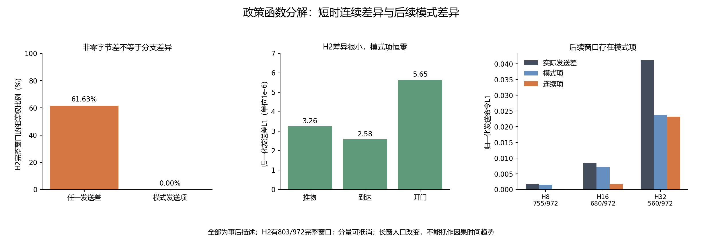

# 政策分支与连续反馈：完整TRAIN函数诊断

**全部新增分析为事后描述性分析。** 只分解固定政策函数对Z/夹爪命令差的来源，不解释真实植物响应的唯一原因，不构成入口预测、新模型、任务收益、安全或新颖性资格。

冻结 `074ef5632712f50ce1d1a811c0cd2a689feacbf2`。648条既有TRAIN，9组、三任务×两条件×三个时点×三获取×四速率；972个无向实际速率对×六窗，共5,832行，2,214个完整面板。没有读取CAL/TEST/旧QUAL内容选择模型或阈值。

## 方法与名字

“模式项”指同一观测下替换政策叶子造成的函数变化；“连续项”指固定叶子下观测改变造成的函数变化。push和door有接近/下降/推进等位置叶；push还有独立夹爪条件，reach没有这些分支。所有真实采用后政策动作均从当时公开观测精确重建。

这里的“模式不同”指同一时点两个真实程序选择了不同政策叶，并不统计某一条轨迹自身何时换叶。两个程序也可能同步换叶而没有配对模式差异。

对两个真实观测与各自真实叶，另计算两个交叉叶函数值，再作两种替换顺序的对称平均。交叉值可能不符合该叶条件，不是执行过的命令或可行物理轨迹。分解分别在原始float32政策输出与clip[-1,1]发送层完成；XY积分不改变Z/夹爪发送层。这是送出命令，未把执行器后续加噪、扰动和最终裁剪冒作相同层次。

## 预定H2全任务描述

|任务|完整窗口／324|可用组|窗口出现任一Z/夹爪差|窗口出现模式发送项|实际发送差L1|模式发送项L1|连续发送项L1|
|---|---:|---:|---:|---:|---:|---:|---:|
|push-v3|276/324|9|67.593%|0.000%|3.2618e-06|0|3.2618e-06|
|reach-v3|204/324|6|98.148%|0.000%|2.5812e-06|0|2.5812e-06|
|door-open-v3|323/324|9|31.173%|0.000%|5.65303e-06|0|5.65303e-06|

L1为Z/夹爪两个归一化命令分量及窗内步的均值，再按独立组→任务条件→获取节点→率对逐层等权。这里的分量可以抵消，模式L1和连续L1不能当作实际差的因果占比。任一差异的百分比只表示非零，不表示幅度大。

## H2三任务与两条件完整边际

|任务|条件|完整／162|可用组|发送差L1|模式项L1|连续项L1|
|---|---|---:|---:|---:|---:|---:|
|push-v3|UNCHANGED|138/162|9|3.5237682e-06|0|3.5237682e-06|
|push-v3|CHANGED|138/162|9|2.999836e-06|0|2.999836e-06|
|reach-v3|UNCHANGED|108/162|6|2.6366906e-06|0|2.6366906e-06|
|reach-v3|CHANGED|96/162|6|2.5257166e-06|0|2.5257166e-06|
|door-open-v3|UNCHANGED|161/162|9|6.5904115e-06|0|6.5904115e-06|
|door-open-v3|CHANGED|162/162|9|4.7156486e-06|0|4.7156486e-06|

## 六窗完整总表

|H|完整／972|组|任一发送差窗口|原始总能量|原始模式能量|原始连续能量|原始交叉项|发送总L1|发送模式L1|发送连续L1|
|---|---:|---:|---:|---:|---:|---:|---:|---:|---:|---:|
|1|803/972|9|0.000%|0|0|0|0|0|0|0|
|2|803/972|9|61.626%|6.1379e-10|0|6.1379e-10|0|4.07241e-06|0|4.07241e-06|
|4|772/972|9|58.951%|4.05925e-08|0|4.05925e-08|0|3.18836e-05|0|3.18836e-05|
|8|755/972|9|57.716%|0.00408204|0.00408822|2.23326e-06|-8.41605e-06|0.00168283|0.00157357|0.000112172|
|16|680/972|9|68.179%|0.0224648|0.0212027|0.00237104|-0.00110891|0.00858659|0.0072143|0.00176296|
|32|560/972|9|92.747%|0.117206|0.0838712|0.0283574|0.00497718|0.0412232|0.0237039|0.0231617|

恒等式为总能量＝模式能量＋连续能量＋交叉项；交叉项可负。H越长可用人口越少，不能把表中变化唯一解释为时间延迟或模式失配。H1同一真实观测决定相同原始政策与Z/夹爪，全部分解恒零，独立核对通过。reach的模式项在所有实际窗口恒零。

## 三任务全部窗口

|任务|H|完整／324|两程序模式不同的步比例|发送差L1|模式项L1|连续项L1|
|---|---:|---:|---:|---:|---:|---:|
|push-v3|1|276/324|0.000%|0|0|0|
|push-v3|2|276/324|0.000%|3.2618e-06|0|3.2618e-06|
|push-v3|4|264/324|0.000%|3.32656e-05|0|3.32656e-05|
|push-v3|8|252/324|1.091%|0.00612768|0.00606949|6.94477e-05|
|push-v3|16|247/324|4.588%|0.026699|0.0266273|0.00156273|
|push-v3|32|205/324|12.302%|0.0720294|0.0720078|0.017648|
|reach-v3|1|204/324|0.000%|0|0|0|
|reach-v3|2|204/324|0.000%|2.5812e-06|0|2.5812e-06|
|reach-v3|4|186/324|0.000%|2.38202e-05|0|2.38202e-05|
|reach-v3|8|186/324|0.000%|0.0001635|0|0.0001635|
|reach-v3|16|139/324|0.000%|0.000463919|0|0.000463919|
|reach-v3|32|97/324|0.000%|0.000671583|0|0.000671583|
|door-open-v3|1|323/324|0.000%|0|0|0|
|door-open-v3|2|323/324|0.000%|5.65303e-06|0|5.65303e-06|
|door-open-v3|4|322/324|0.000%|3.62185e-05|0|3.62185e-05|
|door-open-v3|8|317/324|0.000%|0.000154215|0|0.000154215|
|door-open-v3|16|294/324|0.887%|0.00204071|6.32728e-05|0.00197744|
|door-open-v3|32|258/324|4.138%|0.0320165|0.0031955|0.0288226|

完整的任务×条件×时点×获取×率对×H、逐组及全部边际表保存在all2214_panels.csv和panels.json；逐步代数分量、648条轨迹模式次数及缺失均保留。没有选有利任务/窗口或将相关时间步当独立样本。

## 后续判断

预定H2的模式解释不获支持：803个完整窗口中，两程序分支相同，模式项全零，实际发送差L1约4.07×10⁻⁶。H4同样没有配对模式项。因此不能用早期Z/夹爪字节差支持“第二步发生模式跳变”或解锁模式门控。H8及以后确有函数模式项，但可用人口改变，且模式变化可能是有益的任务推进；不能一律把它标为错误更新。当前不新训模型、不追加采集，不把长窗分量当唯一植物原因。A方向和完整CCF A目标仍保持。

## 审计、成本与限制

独立标量实现禁用主签名、叶和分解函数；另以已有独立层级权重复算全部面板。实际政策输出的float32字节、发送Z/夹爪、首分歧对齐及代数恒等式均核对。共享已审计来源解析器与独立权重参考明确披露；这是第二实现审计，不是独立机构或物理重模拟。

新增环境创建、重置、控制步、物理帧、机器人政策查询、模型拟合和在线LLM API全部0。科学主叶展开133191次、独立标量展开133191次，主＋数学核对耗时62.281秒；额外统计/展示另记。合成开发18次＋正式18次安装政策函数查询单列，不是机器人步骤。原开发1项夹具失败及配置exclusive写入失败保留，未读真实轨迹、未改变分解公式。历史来源648次、77,563步、33,048全部重置、16,911,815帧另列。

旧记录没有逐步接触力/接触对；没有无噪声物理对照。模式项仅证明政策函数结构，不能证明它导致植物预测失败；真实状态变化、接触、动作反馈、噪声及执行器最终裁剪仍可能共同作用。交叉叶不是物理反事实。未来模式在入口尚不可知，本次并未预测它。

15项新增纯数组测试与原2,448项源码/回执绑定复用，共2,463项唯一检查。原六项比较、native和响应资格负结果不变；不因本诊断调模型、阈值、任务或追加人口。后续需要有区别的可计算机制、强廉价模式控制/完整成本Q或DR/任务相关获取参考以及独立自身历史完整任务验证；当前仍不能宣称CCF A目标完成。

来源：[冻结协议](../docs/protocols/policy_mode_diagnostic_v1_zh.md)、[决定与直接先例](../docs/research/policy_mode_diagnostic_decision_v1_zh.md)、[完整面板](../outputs/policy_mode_diagnostic/diagnostic_v1/panels.json)、[独立审计](../outputs/policy_mode_diagnostic/diagnostic_v1/independent_audit.json)。
