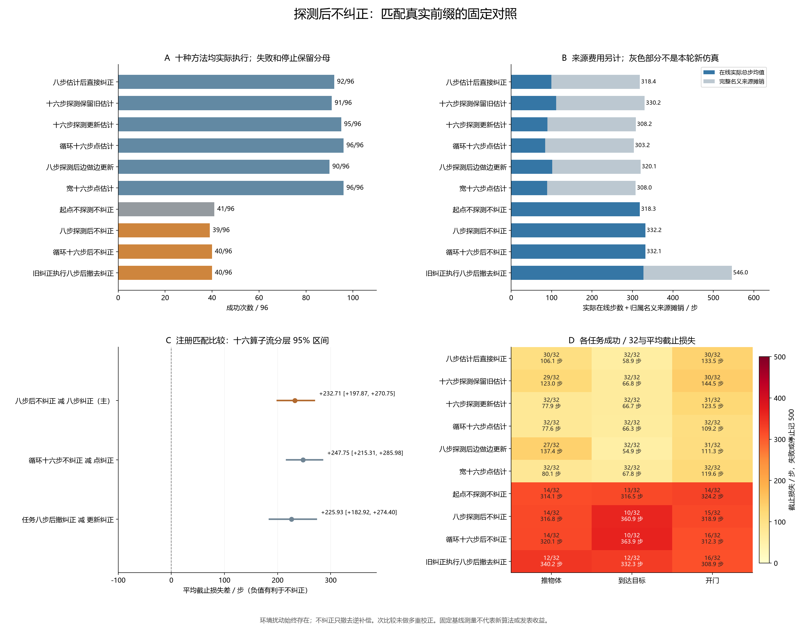

# 探测后不纠正的实际任务对照

本轮补充三个固定基线，测量实际探测后保持或恢复原政策的效果。身份控制器只是不做逆补偿；相同的执行器扰动与噪声始终存在。它们不训练选择器，也不是新算法。

十六个新算子流、三任务、两个未来实现，共 96 单元与十种方法、960 次真实执行。主比较为探测八步后不纠正减八步估计后纠正：平均截止损失差 +232.70833 步，95% 算子流区间 [+197.87422, +270.75182]；成功率差 -55.208 个百分点。负的损失差有利于不纠正。这是注册固定控制的开发比较，不是新方法晋级。

本批观察到的最佳固定方法是 POINT16_CYCLE，成功 96/96，平均截止损失 84.35417 步。这个名称根据完整结果描述性确定，未新增一个在线选择器，也不代表总体成功率为 100%。八步不纠正的全部收益与伤害均在下表保留，不能只展示救回案例。

## 三个新对照如何执行

IDENTITY_AFTER8 真实执行八步对称探测，然后直接读取原固定政策的命令。IDENTITY_AFTER16_CYCLE 将同一八步探测执行两遍，随后读取原政策；它与宽十六步探测不同。两者没有使用名义模型拟合。IDENTITY_AFTER16_PASSIVE 先探测八步，用旧纠正执行八步任务，再保存身份控制器继续；若旧估计不能构造，它按停止记录，不替换成其他方法。

这三者分别与 DIRECT_G8、POINT16_CYCLE、PASSIVE_G16 保持实际八步或十六步的同一前缀。每种方法都从唯一一次受控初始重置开始，前缀到任务在真实状态、时钟及噪声流上连续执行；不复制状态或重新播种。NO_PROBE 在起点就直接执行，不能当作这些探测后分支的替代结局。

## 全部方法结果

成功记包括探测在内的实际总步；失败或停止记 500。实际总步另列，全部案例留在每方法 96 的分母。名义来源归属是部署该方法所需的完整来源费用，不是本轮新增仿真。

| 方法 | 含义 | 成功／96 | 停止 | 平均截止损失 | 平均实际总步 | 名义来源步数 |
|---|---|---:|---:|---:|---:|---:|
| DIRECT_G8 | 八步估计后纠正 | 92 | 0 | 99.50000 | 99.50000 | 21,010 |
| KEEP_G8_AFTER16 | 十六步探测保留旧估计 | 91 | 0 | 111.39583 | 111.39583 | 21,010 |
| UPDATE_G16 | 十六步探测更新估计 | 95 | 0 | 89.37500 | 89.37500 | 21,010 |
| POINT16_CYCLE | 循环十六步点估计 | 96 | 0 | 84.35417 | 84.35417 | 21,010 |
| PASSIVE_G16 | 八步探测加八步任务观测后更新 | 90 | 0 | 101.19792 | 101.19792 | 21,010 |
| POINT16_WIDE | 宽十六步点估计 | 96 | 0 | 89.14583 | 89.14583 | 21,010 |
| NO_PROBE | 起点不探测不纠正 | 41 | 0 | 318.28125 | 318.28125 | 0 |
| IDENTITY_AFTER8 | 探测八步后不纠正 | 39 | 0 | 332.20833 | 332.20833 | 0 |
| IDENTITY_AFTER16_CYCLE | 循环探测十六步后不纠正 | 40 | 0 | 332.10417 | 332.10417 | 0 |
| IDENTITY_AFTER16_PASSIVE | 旧纠正执行八步任务后撤去纠正 | 40 | 0 | 327.12500 | 327.12500 | 21,010 |

## 注册匹配比较

主比较与两个补充比较分开解释；补充区间没有做多重比较校正。按偶／奇算子流各八个分层重采样 10,000 次，固定随机数 20261015。每流包含的任务和未来重复不是新的独立算子流。

| 不纠正减对应纠正 | 类型 | 损失差及 95% 区间／步 | 成功率差 | 原成功变失败 | 原失败变成功 |
|---|---|---:|---:|---:|---:|
| IDENTITY_AFTER8 − DIRECT_G8 | PRIMARY | +232.70833 [+197.87422, +270.75182] | -55.208 pp | 55 | 2 |
| IDENTITY_AFTER16_CYCLE − POINT16_CYCLE | SECONDARY_UNADJUSTED | +247.75000 [+215.31094, +285.98203] | -58.333 pp | 56 | 0 |
| IDENTITY_AFTER16_PASSIVE − PASSIVE_G16 | SECONDARY_UNADJUSTED | +225.92708 [+182.91641, +274.39635] | -52.083 pp | 51 | 1 |

八步不纠正相对八步纠正的救回案例逐项列在下表，同时列出循环十六步点估计的已执行结局。不同未来重复仍属于各自算子流；这些案例不能证明新增方案相对全部强基线有独特成功收益。

| 流 | 任务 | 未来 | 八步不纠正实际步数 | 八步纠正成功 | 循环十六步成功／实际步数 |
|---|---|---:|---:|---|---|
| 4 | push-v3 | 1 | 76 | False | True / 74 |
| 10 | door-open-v3 | 0 | 175 | False | True / 175 |

## 全部任务分层

| 方法 | 任务 | 成功／32 | 平均截止损失 |
|---|---|---:|---:|
| DIRECT_G8 | push-v3 | 30 | 106.06250 |
| DIRECT_G8 | reach-v3 | 32 | 58.93750 |
| DIRECT_G8 | door-open-v3 | 30 | 133.50000 |
| KEEP_G8_AFTER16 | push-v3 | 29 | 122.96875 |
| KEEP_G8_AFTER16 | reach-v3 | 32 | 66.75000 |
| KEEP_G8_AFTER16 | door-open-v3 | 30 | 144.46875 |
| UPDATE_G16 | push-v3 | 32 | 77.93750 |
| UPDATE_G16 | reach-v3 | 32 | 66.65625 |
| UPDATE_G16 | door-open-v3 | 31 | 123.53125 |
| POINT16_CYCLE | push-v3 | 32 | 77.56250 |
| POINT16_CYCLE | reach-v3 | 32 | 66.34375 |
| POINT16_CYCLE | door-open-v3 | 32 | 109.15625 |
| PASSIVE_G16 | push-v3 | 27 | 137.37500 |
| PASSIVE_G16 | reach-v3 | 32 | 54.90625 |
| PASSIVE_G16 | door-open-v3 | 31 | 111.31250 |
| POINT16_WIDE | push-v3 | 32 | 80.06250 |
| POINT16_WIDE | reach-v3 | 32 | 67.78125 |
| POINT16_WIDE | door-open-v3 | 32 | 119.59375 |
| NO_PROBE | push-v3 | 14 | 314.12500 |
| NO_PROBE | reach-v3 | 13 | 316.50000 |
| NO_PROBE | door-open-v3 | 14 | 324.21875 |
| IDENTITY_AFTER8 | push-v3 | 14 | 316.75000 |
| IDENTITY_AFTER8 | reach-v3 | 10 | 360.93750 |
| IDENTITY_AFTER8 | door-open-v3 | 15 | 318.93750 |
| IDENTITY_AFTER16_CYCLE | push-v3 | 14 | 320.12500 |
| IDENTITY_AFTER16_CYCLE | reach-v3 | 10 | 363.90625 |
| IDENTITY_AFTER16_CYCLE | door-open-v3 | 16 | 312.28125 |
| IDENTITY_AFTER16_PASSIVE | push-v3 | 12 | 340.15625 |
| IDENTITY_AFTER16_PASSIVE | reach-v3 | 12 | 332.28125 |
| IDENTITY_AFTER16_PASSIVE | door-open-v3 | 16 | 308.93750 |

## 完整费用与失败

本轮新增 180,930 个环境步、960 次受控初始重置；另外 48,000 次工厂等临时重置，共 48,960 次顶层重置。完成的模拟请求帧 25,384,650，均在冻结上限内。帧指完成的 do_simulation 请求帧，不能当作所有物理引擎内部积分调用的计数。

已有名义模型来源为 21,010 步／288 次控制重置，共用来源的物理采集只记一次。NO_PROBE、IDENTITY_AFTER8、IDENTITY_AFTER16_CYCLE 不需要该模型，部署归属费用为零；其他方法各承担完整来源，按每方法 96 单元摊销为 218.85417 步／3 次控制重置。旧银行只用于本轮之前的描述性问题诊断，没有训练新选择器。

全部 240 次失败或停止保存在[完整失败列表](../outputs/post_probe_identity/report_v1/failures.json)；全部 288 对主／次对照结局保存在[逐例匹配结局](../outputs/post_probe_identity/report_v1/matched_outcomes.json)。完整 960 个结局及原始轨迹由[审计](../outputs/post_probe_identity/analysis_v1/audit.json)绑定，不能删去失败或以其他控制器代执行。API、经验记忆写入、政策权重训练和选择器训练均为零；原有基线仍执行各自的在线数值估计。

## 审计范围与研究结论边界

记录审计通过 465,348 个事件、671 个冻结 Git 输入及清单绑定的库源。注册列表含 768 对八步核对，其中 672 对为不同方法、96 对为参考方法与自身；另有 192 对十六步方法比较和 480 对跨未来八步核对。冻结协议将八步列表统称跨方法，本报告按实际列表拆开披露，不把自核对当成额外方法证据。每次保存选择先于执行，原政策命令从已保存身份控制器读取。噪声与实际扰动独立重建；Gaussian／点估计、前缀核对和描述统计明确复用原数学辅助，不声称额外独立实现或完整隐藏状态证明。

847 项完整单元测试在冻结前通过。交付时的测试、编译、依赖、秘密扫描、差异和文件字节绑定见[交付记录](../outputs/post_probe_identity/delivery_v1/receipt.json)。新种子仅 13000–13047，13048–13399 和全部旧保留范围未执行。

另以独立聚合与配对计算核对[全部结果统计](../outputs/post_probe_identity/statistics_audit_v1/check.json)，覆盖各方法均值、任务分层和三组注册比较的区间。该检查复用 NumPy 随机数和百分位实现，不新增机器人执行或推断保证。

本轮解决的是关键固定对照缺失，不能仅凭哪个基线获胜声称新算法、任务价值证书或 CCF A 创新。此前核回归负结果和近期效应反例继续保留。下一机制必须使用因果可获得的输入，在独立新数据上证明任务收益，并区分方案集合改善与选择能力改善。

[冻结协议](../docs/protocols/post_probe_identity_development_v1.md)、[问题及旧银行复用边界](../docs/research/post_probe_identity_question_v1.md)、[旧源数值复算](../outputs/post_probe_identity/rationale_v1/check.json)、[首流预审](../outputs/post_probe_identity/integrity_stream0_v1/check.json)。

运行 `post_probe_identity_20261015T134029Z_e0a879a8c014`；manifest `7e3a87d5e755ee496ae2a8653e76d2d553092624b94a98a45625c91d9369ae30`；冻结提交 `e0a879a8c014f35354a282737f033087f8863b5b`。
