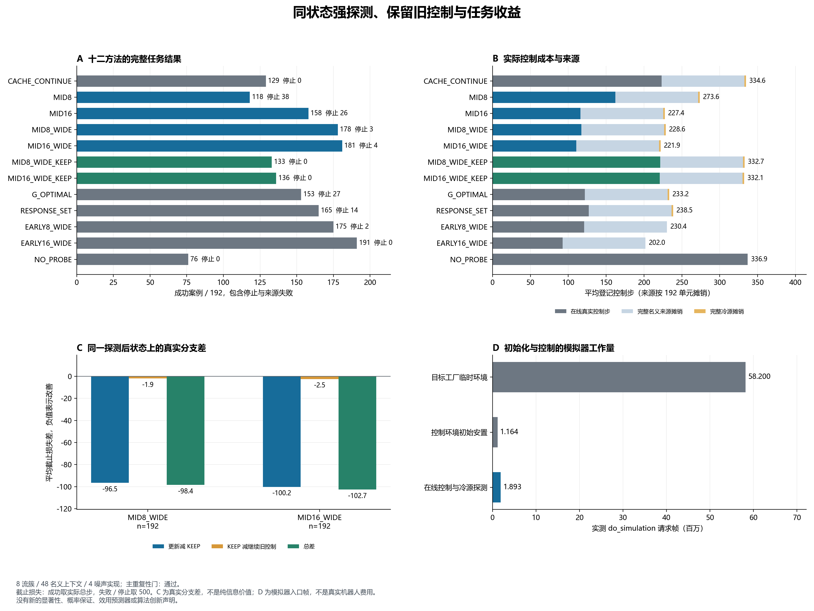

# 同状态强探测、保留控制与任务收益：中文完整结果

本轮收集并审计 2,304 次方法案例与 24 次冷源。主端点 MID16_WIDE 对 CACHE_CONTINUE 的冻结重复性门通过。最强固定基线 EARLY16_WIDE 成功 191/192，主候选 MID16_WIDE 为 181/192；固定基线的平均在线步和截止损失也更低。这是名义上下文上的目标测量；四重复的前缀可能不同，尚不构成固定状态收益分布、部署选择器或 CCF A 新方法证据。

本轮新增 API 调用为零。此前的[在线 GLM-5.2 闭环报告](online_calibrated_agent_development_v1.md)记录了真实 API 选择与执行：LLM 为 14/16，仿射和最近邻均为 16/16。当前研究结果不能算作新的 API 收益证据。

运行 `acquisition_value_20261014T151159Z_cb935ccb7187`；清单 `04a3a6b2928956a7522296435a209e330b03c6dc42c98da8b982b15b16ff6c5f`；冻结源 `cb935ccb718701630e5fd4c44992616276921025`。新任务种子 11200–11247，11248–11499 保留。

原冻结审计器因硬编码错误的模拟时钟单位未通过；读取绑定 XML 的 v2 重放完全部案例后，因冷源列表与整数同名字段的核对错误未通过。当前通过的是另存的只读 v3 审计，原轨迹、失败日志、配置、方法和阈值均保留。原冻结审计通过与事后修正审计通过不同。

[时间单位修复说明](../docs/research/acquisition_clock_audit_repair_v2.md) · [末尾汇总格式修复说明](../docs/research/acquisition_terminal_schema_audit_v3.md)

[冻结协议](../docs/protocols/postprefix_probe_value_development_v1.md) · [独立执行审计](../outputs/acquisition_value/analysis_v3/audit.json) · [原始清单与分流轨迹](../outputs/acquisition_value/development_v1/acquisition_value_20261014T151159Z_cb935ccb7187/manifest.json)

## 全部方法与任务截止损失

每方法分母 192，包括无效来源、拟合停止与全部失败。deadline_loss 在成功时用真实总步，失败或停止为 500；实际物理步另外报告。旧源控制固定，不吸收别的方法、当前结局或未来案例。

| 方法 | 成功 / 192 | 停止 | 平均在线步 | 平均探测步 | 平均截止损失 | 平均含来源步 | 无效拟合 |
|---|---:|---:|---:|---:|---:|---:|---:|
| CACHE_CONTINUE | 129 | 0 | 223.1406 | 0.0000 | 223.1406 | 334.5677 | 0 |
| MID8 | 118 | 38 | 162.1771 | 8.0000 | 258.3646 | 273.6042 | 38 |
| MID16 | 158 | 26 | 115.9740 | 16.0000 | 180.7031 | 227.4010 | 26 |
| MID8_WIDE | 178 | 3 | 117.1458 | 8.0000 | 124.7396 | 228.5729 | 3 |
| MID16_WIDE | 181 | 4 | 110.5208 | 16.0000 | 120.4792 | 221.9479 | 4 |
| MID8_WIDE_KEEP | 133 | 0 | 221.2865 | 8.0000 | 221.2865 | 332.7135 | 0 |
| MID16_WIDE_KEEP | 136 | 0 | 220.6875 | 16.0000 | 220.6875 | 332.1146 | 0 |
| G_OPTIMAL | 153 | 27 | 121.7344 | 19.4792 | 188.8281 | 233.1615 | 27 |
| RESPONSE_SET | 165 | 14 | 127.0417 | 22.9167 | 161.7292 | 238.4688 | 14 |
| EARLY8_WIDE | 175 | 2 | 120.9635 | 8.0000 | 126.0885 | 230.3906 | 2 |
| EARLY16_WIDE | 191 | 0 | 92.5260 | 16.0000 | 92.5260 | 201.9531 | 0 |
| NO_PROBE | 76 | 0 | 336.8698 | 0.0000 | 336.8698 | 336.8698 | 0 |

每个使用名义模型的方法完整承担旧 21,010 登记控制步／288 控制重置，按 192 单元摊销。需要旧缓存的方法另承担本轮完整冷源费用 384 步／24 控制重置。EARLY 宽探测不使用旧缓存；NO_PROBE 无名义模型来源费用。来源物理上分别只采集一次。

## 主重复性端点

| 指标 | 结果 |
|---|---:|
| contexts | 48 |
| fully_matched_contexts | 48 |
| non_tie_contexts | 47 |
| sign_reversal_contexts | 5 |
| sign_reversal_fraction | 0.10638297872340426 |
| leave_one_out_checked | 183 |
| leave_one_out_correct | 172 |
| leave_one_out_abstained | 2 |
| leave_one_out_agreement | 0.9398907103825137 |
| leave_one_out_coverage | 0.9891891891891892 |
| passed | True |

每上下文四个改善／恶化／平局符号；其余三重复的非零和预测当前非零方向，和为零则弃权。预测覆盖和一致率同时要求 75%，非平局上下文至少 24，方向反转占比最多 25%。未按结果换主方法、权重或阈值。

| 流 | 任务 | 情景 | 四符号 | 配对完整 | 反转 | LOOR 正确 / 已预测 |
|---:|---|---|---|---|---|---|
| 0 | push-v3 | UNCHANGED | [-1, -1, -1, -1] | True | False | 4 / 4 |
| 0 | push-v3 | CHANGED | [1, 1, 1, 1] | True | False | 4 / 4 |
| 0 | reach-v3 | UNCHANGED | [-1, -1, -1, -1] | True | False | 4 / 4 |
| 0 | reach-v3 | CHANGED | [0, 1, 1, 1] | True | False | 3 / 3 |
| 0 | door-open-v3 | UNCHANGED | [1, -1, -1, -1] | True | True | 3 / 4 |
| 0 | door-open-v3 | CHANGED | [-1, 1, -1, 0] | True | True | 0 / 1 |
| 1 | push-v3 | UNCHANGED | [-1, -1, -1, -1] | True | False | 4 / 4 |
| 1 | push-v3 | CHANGED | [-1, 1, 1, -1] | True | True | 0 / 4 |
| 1 | reach-v3 | UNCHANGED | [-1, -1, -1, -1] | True | False | 4 / 4 |
| 1 | reach-v3 | CHANGED | [-1, -1, -1, -1] | True | False | 4 / 4 |
| 1 | door-open-v3 | UNCHANGED | [1, 1, -1, 1] | True | True | 3 / 4 |
| 1 | door-open-v3 | CHANGED | [1, 1, 1, 1] | True | False | 4 / 4 |
| 2 | push-v3 | UNCHANGED | [-1, -1, -1, -1] | True | False | 4 / 4 |
| 2 | push-v3 | CHANGED | [1, 1, 1, 1] | True | False | 4 / 4 |
| 2 | reach-v3 | UNCHANGED | [-1, -1, -1, -1] | True | False | 4 / 4 |
| 2 | reach-v3 | CHANGED | [1, 1, 1, 1] | True | False | 4 / 4 |
| 2 | door-open-v3 | UNCHANGED | [1, 1, 1, 1] | True | False | 4 / 4 |
| 2 | door-open-v3 | CHANGED | [1, 1, 1, 1] | True | False | 4 / 4 |
| 3 | push-v3 | UNCHANGED | [-1, -1, -1, -1] | True | False | 4 / 4 |
| 3 | push-v3 | CHANGED | [-1, 1, -1, 1] | True | True | 0 / 4 |
| 3 | reach-v3 | UNCHANGED | [-1, -1, -1, -1] | True | False | 4 / 4 |
| 3 | reach-v3 | CHANGED | [1, 1, 1, 1] | True | False | 4 / 4 |
| 3 | door-open-v3 | UNCHANGED | [1, 1, 1, 1] | True | False | 4 / 4 |
| 3 | door-open-v3 | CHANGED | [1, 1, 1, 1] | True | False | 4 / 4 |
| 4 | push-v3 | UNCHANGED | [-1, -1, -1, -1] | True | False | 4 / 4 |
| 4 | push-v3 | CHANGED | [1, 1, 1, 1] | True | False | 4 / 4 |
| 4 | reach-v3 | UNCHANGED | [-1, -1, -1, -1] | True | False | 4 / 4 |
| 4 | reach-v3 | CHANGED | [-1, -1, -1, -1] | True | False | 4 / 4 |
| 4 | door-open-v3 | UNCHANGED | [-1, -1, -1, -1] | True | False | 4 / 4 |
| 4 | door-open-v3 | CHANGED | [-1, -1, -1, -1] | True | False | 4 / 4 |
| 5 | push-v3 | UNCHANGED | [-1, -1, -1, -1] | True | False | 4 / 4 |
| 5 | push-v3 | CHANGED | [1, 1, 1, 1] | True | False | 4 / 4 |
| 5 | reach-v3 | UNCHANGED | [-1, -1, -1, -1] | True | False | 4 / 4 |
| 5 | reach-v3 | CHANGED | [1, 1, 1, 1] | True | False | 4 / 4 |
| 5 | door-open-v3 | UNCHANGED | [1, 1, 0, 1] | True | False | 3 / 3 |
| 5 | door-open-v3 | CHANGED | [1, 1, 1, 1] | True | False | 4 / 4 |
| 6 | push-v3 | UNCHANGED | [-1, -1, -1, -1] | True | False | 4 / 4 |
| 6 | push-v3 | CHANGED | [1, 1, 1, 1] | True | False | 4 / 4 |
| 6 | reach-v3 | UNCHANGED | [-1, -1, -1, -1] | True | False | 4 / 4 |
| 6 | reach-v3 | CHANGED | [0, 0, 0, 0] | True | False | 0 / 0 |
| 6 | door-open-v3 | UNCHANGED | [-1, -1, -1, -1] | True | False | 4 / 4 |
| 6 | door-open-v3 | CHANGED | [-1, -1, -1, -1] | True | False | 4 / 4 |
| 7 | push-v3 | UNCHANGED | [-1, -1, -1, -1] | True | False | 4 / 4 |
| 7 | push-v3 | CHANGED | [1, 1, 1, 1] | True | False | 4 / 4 |
| 7 | reach-v3 | UNCHANGED | [-1, -1, -1, -1] | True | False | 4 / 4 |
| 7 | reach-v3 | CHANGED | [1, 1, 1, 1] | True | False | 4 / 4 |
| 7 | door-open-v3 | UNCHANGED | [-1, -1, -1, -1] | True | False | 4 / 4 |
| 7 | door-open-v3 | CHANGED | [1, 1, 1, 1] | True | False | 4 / 4 |

## 相同探测后的更新作用

KEEP 分支在同样六步与同样宽探测之后，预先继续旧控制。更新分支在同一观测、积分状态见证和 RNG 后使用新估计或停止。这衡量实际更新策略的作用，包含估计拒绝风险；不把它命名为纯信息价值。探测中已结束者单列，不是更新决策成功。

| 探测 | 可评更新决策 | 更新 / KEEP 成功 | 更新 / KEEP 停止 | 更新减 KEEP 截止损失 | KEEP 减继续旧控制 | 总差 |
|---|---:|---|---|---:|---:|---:|
| MID8_WIDE | 192 | 178 / 133 | 3 / 0 | -96.5469 | -1.8542 | -98.4010 |
| MID16_WIDE | 192 | 181 / 136 | 4 / 0 | -100.2083 | -2.4531 | -102.6615 |

MID8_WIDE 全部配对原因：`{"MATCHED_UPDATE": 192}`。

MID16_WIDE 全部配对原因：`{"MATCHED_UPDATE": 192}`。

损失差是三条真实分支的代数差；其可加性不等于新定理。没有虚拟拟合失败回退，也没有把一条记录的观察喂给替代动作来伪造动力学。

## 完整仿真初始化费用

新增登记控制 378,637 次 Env.step／2,328 次控制初始重置；实测顶层重置入口 118,728，完成 do_simulation 请求帧 61,257,185。重置模型内安置帧与控制步分开计数；目标工厂在临时环境中生成五十个目标，不属于当前在线控制轨迹的重置。

| 生命周期阶段 | 完成重置 | 完成模拟调用 | 完成模拟帧 |
|---|---:|---:|---:|
| GOAL_GENERATION | 116400 | 11640000 | 58200000 |
| CONTROLLED_RESET | 2328 | 232800 | 1164000 |
| CONTROL | 0 | 378637 | 1893185 |

该账本测量 Python 入口上的 reset 和 do_simulation 请求，不是所有 C 引擎计算、渲染或真实机器人费用。旧名义来源的内部初始化仍属于历史条件推算；本轮仪器不修改其数据。API 调用和自然经验记忆写入均为零。

## 完整任务、情景、流和重复分层

| 方法／分层 | 成功 / 分母 | 停止 | 平均在线步 | 平均截止损失 |
|---|---|---:|---:|---:|
| CACHE_CONTINUE/by_task/push-v3 | 41 / 64 | 0 | 225.7500 | 225.7500 |
| CACHE_CONTINUE/by_task/reach-v3 | 44 / 64 | 0 | 203.8125 | 203.8125 |
| CACHE_CONTINUE/by_task/door-open-v3 | 44 / 64 | 0 | 239.8594 | 239.8594 |
| CACHE_CONTINUE/by_scenario/UNCHANGED | 88 / 96 | 0 | 108.2604 | 108.2604 |
| CACHE_CONTINUE/by_scenario/CHANGED | 41 / 96 | 0 | 338.0208 | 338.0208 |
| CACHE_CONTINUE/by_stream/0 | 16 / 24 | 0 | 222.7917 | 222.7917 |
| CACHE_CONTINUE/by_stream/1 | 23 / 24 | 0 | 116.5000 | 116.5000 |
| CACHE_CONTINUE/by_stream/2 | 8 / 24 | 0 | 353.1667 | 353.1667 |
| CACHE_CONTINUE/by_stream/3 | 10 / 24 | 0 | 315.6667 | 315.6667 |
| CACHE_CONTINUE/by_stream/4 | 20 / 24 | 0 | 153.2083 | 153.2083 |
| CACHE_CONTINUE/by_stream/5 | 12 / 24 | 0 | 286.2917 | 286.2917 |
| CACHE_CONTINUE/by_stream/6 | 16 / 24 | 0 | 215.6250 | 215.6250 |
| CACHE_CONTINUE/by_stream/7 | 24 / 24 | 0 | 121.8750 | 121.8750 |
| CACHE_CONTINUE/by_replicate/0 | 33 / 48 | 0 | 215.7917 | 215.7917 |
| CACHE_CONTINUE/by_replicate/1 | 31 / 48 | 0 | 235.4167 | 235.4167 |
| CACHE_CONTINUE/by_replicate/2 | 33 / 48 | 0 | 216.1458 | 216.1458 |
| CACHE_CONTINUE/by_replicate/3 | 32 / 48 | 0 | 225.2083 | 225.2083 |
| MID8/by_task/push-v3 | 43 / 64 | 7 | 163.4219 | 216.5781 |
| MID8/by_task/reach-v3 | 46 / 64 | 8 | 144.4219 | 205.1719 |
| MID8/by_task/door-open-v3 | 29 / 64 | 23 | 178.6875 | 353.3438 |
| MID8/by_scenario/UNCHANGED | 64 / 96 | 17 | 149.6667 | 235.7292 |
| MID8/by_scenario/CHANGED | 54 / 96 | 21 | 174.6875 | 281.0000 |
| MID8/by_stream/0 | 20 / 24 | 0 | 204.7917 | 204.7917 |
| MID8/by_stream/1 | 15 / 24 | 8 | 70.9583 | 232.9583 |
| MID8/by_stream/2 | 22 / 24 | 1 | 102.3750 | 122.6250 |
| MID8/by_stream/3 | 6 / 24 | 12 | 152.3333 | 395.3333 |
| MID8/by_stream/4 | 15 / 24 | 1 | 241.5417 | 261.7917 |
| MID8/by_stream/5 | 15 / 24 | 7 | 110.9167 | 252.6667 |
| MID8/by_stream/6 | 12 / 24 | 2 | 270.2083 | 310.7083 |
| MID8/by_stream/7 | 13 / 24 | 7 | 144.2917 | 286.0417 |
| MID8/by_replicate/0 | 33 / 48 | 8 | 157.1875 | 238.1875 |
| MID8/by_replicate/1 | 28 / 48 | 10 | 159.1458 | 260.3958 |
| MID8/by_replicate/2 | 29 / 48 | 11 | 154.1042 | 265.4792 |
| MID8/by_replicate/3 | 28 / 48 | 9 | 178.2708 | 269.3958 |
| MID16/by_task/push-v3 | 57 / 64 | 2 | 126.7500 | 141.6875 |
| MID16/by_task/reach-v3 | 39 / 64 | 24 | 73.2969 | 252.5469 |
| MID16/by_task/door-open-v3 | 62 / 64 | 0 | 147.8750 | 147.8750 |
| MID16/by_scenario/UNCHANGED | 82 / 96 | 13 | 104.2500 | 168.9792 |
| MID16/by_scenario/CHANGED | 76 / 96 | 13 | 127.6979 | 192.4271 |
| MID16/by_stream/0 | 13 / 24 | 10 | 92.7083 | 291.8750 |
| MID16/by_stream/1 | 24 / 24 | 0 | 97.4583 | 97.4583 |
| MID16/by_stream/2 | 24 / 24 | 0 | 93.0000 | 93.0000 |
| MID16/by_stream/3 | 19 / 24 | 0 | 209.0000 | 209.0000 |
| MID16/by_stream/4 | 19 / 24 | 4 | 141.6250 | 221.2917 |
| MID16/by_stream/5 | 19 / 24 | 4 | 116.5833 | 196.2500 |
| MID16/by_stream/6 | 16 / 24 | 8 | 74.4167 | 233.7500 |
| MID16/by_stream/7 | 24 / 24 | 0 | 103.0000 | 103.0000 |
| MID16/by_replicate/0 | 38 / 48 | 8 | 112.3750 | 192.0417 |
| MID16/by_replicate/1 | 40 / 48 | 6 | 115.8958 | 175.6458 |
| MID16/by_replicate/2 | 40 / 48 | 6 | 122.4792 | 182.2292 |
| MID16/by_replicate/3 | 40 / 48 | 6 | 113.1458 | 172.8958 |
| MID8_WIDE/by_task/push-v3 | 63 / 64 | 0 | 82.9375 | 82.9375 |
| MID8_WIDE/by_task/reach-v3 | 58 / 64 | 3 | 87.8438 | 110.6250 |
| MID8_WIDE/by_task/door-open-v3 | 57 / 64 | 0 | 180.6562 | 180.6562 |
| MID8_WIDE/by_scenario/UNCHANGED | 92 / 96 | 0 | 111.4479 | 111.4479 |
| MID8_WIDE/by_scenario/CHANGED | 86 / 96 | 3 | 122.8438 | 138.0312 |
| MID8_WIDE/by_stream/0 | 24 / 24 | 0 | 87.0417 | 87.0417 |
| MID8_WIDE/by_stream/1 | 23 / 24 | 0 | 107.0833 | 107.0833 |
| MID8_WIDE/by_stream/2 | 22 / 24 | 0 | 111.7500 | 111.7500 |
| MID8_WIDE/by_stream/3 | 18 / 24 | 3 | 135.2083 | 195.9583 |
| MID8_WIDE/by_stream/4 | 23 / 24 | 0 | 136.3333 | 136.3333 |
| MID8_WIDE/by_stream/5 | 21 / 24 | 0 | 153.7917 | 153.7917 |
| MID8_WIDE/by_stream/6 | 24 / 24 | 0 | 87.4583 | 87.4583 |
| MID8_WIDE/by_stream/7 | 23 / 24 | 0 | 118.5000 | 118.5000 |
| MID8_WIDE/by_replicate/0 | 45 / 48 | 1 | 111.3750 | 121.5000 |
| MID8_WIDE/by_replicate/1 | 43 / 48 | 1 | 125.1042 | 135.2292 |
| MID8_WIDE/by_replicate/2 | 47 / 48 | 0 | 105.5625 | 105.5625 |
| MID8_WIDE/by_replicate/3 | 43 / 48 | 1 | 126.5417 | 136.6667 |
| MID16_WIDE/by_task/push-v3 | 63 / 64 | 0 | 92.7812 | 92.7812 |
| MID16_WIDE/by_task/reach-v3 | 57 / 64 | 4 | 101.9844 | 131.8594 |
| MID16_WIDE/by_task/door-open-v3 | 61 / 64 | 0 | 136.7969 | 136.7969 |
| MID16_WIDE/by_scenario/UNCHANGED | 91 / 96 | 2 | 104.2188 | 114.1771 |
| MID16_WIDE/by_scenario/CHANGED | 90 / 96 | 2 | 116.8229 | 126.7812 |
| MID16_WIDE/by_stream/0 | 23 / 24 | 0 | 121.6667 | 121.6667 |
| MID16_WIDE/by_stream/1 | 24 / 24 | 0 | 85.1667 | 85.1667 |
| MID16_WIDE/by_stream/2 | 24 / 24 | 0 | 86.5833 | 86.5833 |
| MID16_WIDE/by_stream/3 | 23 / 24 | 0 | 117.2083 | 117.2083 |
| MID16_WIDE/by_stream/4 | 21 / 24 | 0 | 166.9583 | 166.9583 |
| MID16_WIDE/by_stream/5 | 24 / 24 | 0 | 95.7917 | 95.7917 |
| MID16_WIDE/by_stream/6 | 18 / 24 | 4 | 115.0000 | 194.6667 |
| MID16_WIDE/by_stream/7 | 24 / 24 | 0 | 95.7917 | 95.7917 |
| MID16_WIDE/by_replicate/0 | 44 / 48 | 2 | 107.8958 | 127.8125 |
| MID16_WIDE/by_replicate/1 | 46 / 48 | 0 | 115.7292 | 115.7292 |
| MID16_WIDE/by_replicate/2 | 45 / 48 | 2 | 108.5208 | 128.4375 |
| MID16_WIDE/by_replicate/3 | 46 / 48 | 0 | 109.9375 | 109.9375 |
| MID8_WIDE_KEEP/by_task/push-v3 | 40 / 64 | 0 | 237.0312 | 237.0312 |
| MID8_WIDE_KEEP/by_task/reach-v3 | 44 / 64 | 0 | 208.9062 | 208.9062 |
| MID8_WIDE_KEEP/by_task/door-open-v3 | 49 / 64 | 0 | 217.9219 | 217.9219 |
| MID8_WIDE_KEEP/by_scenario/UNCHANGED | 92 / 96 | 0 | 100.3021 | 100.3021 |
| MID8_WIDE_KEEP/by_scenario/CHANGED | 41 / 96 | 0 | 342.2708 | 342.2708 |
| MID8_WIDE_KEEP/by_stream/0 | 16 / 24 | 0 | 233.2917 | 233.2917 |
| MID8_WIDE_KEEP/by_stream/1 | 24 / 24 | 0 | 102.8333 | 102.8333 |
| MID8_WIDE_KEEP/by_stream/2 | 9 / 24 | 0 | 340.2917 | 340.2917 |
| MID8_WIDE_KEEP/by_stream/3 | 13 / 24 | 0 | 279.7083 | 279.7083 |
| MID8_WIDE_KEEP/by_stream/4 | 19 / 24 | 0 | 175.4167 | 175.4167 |
| MID8_WIDE_KEEP/by_stream/5 | 12 / 24 | 0 | 290.1250 | 290.1250 |
| MID8_WIDE_KEEP/by_stream/6 | 16 / 24 | 0 | 220.6250 | 220.6250 |
| MID8_WIDE_KEEP/by_stream/7 | 24 / 24 | 0 | 128.0000 | 128.0000 |
| MID8_WIDE_KEEP/by_replicate/0 | 32 / 48 | 0 | 229.4375 | 229.4375 |
| MID8_WIDE_KEEP/by_replicate/1 | 33 / 48 | 0 | 224.2708 | 224.2708 |
| MID8_WIDE_KEEP/by_replicate/2 | 35 / 48 | 0 | 207.0417 | 207.0417 |
| MID8_WIDE_KEEP/by_replicate/3 | 33 / 48 | 0 | 224.3958 | 224.3958 |
| MID16_WIDE_KEEP/by_task/push-v3 | 40 / 64 | 0 | 242.7969 | 242.7969 |
| MID16_WIDE_KEEP/by_task/reach-v3 | 44 / 64 | 0 | 215.0781 | 215.0781 |
| MID16_WIDE_KEEP/by_task/door-open-v3 | 52 / 64 | 0 | 204.1875 | 204.1875 |
| MID16_WIDE_KEEP/by_scenario/UNCHANGED | 92 / 96 | 0 | 106.7708 | 106.7708 |
| MID16_WIDE_KEEP/by_scenario/CHANGED | 44 / 96 | 0 | 334.6042 | 334.6042 |
| MID16_WIDE_KEEP/by_stream/0 | 16 / 24 | 0 | 237.5833 | 237.5833 |
| MID16_WIDE_KEEP/by_stream/1 | 24 / 24 | 0 | 112.2917 | 112.2917 |
| MID16_WIDE_KEEP/by_stream/2 | 12 / 24 | 0 | 294.8750 | 294.8750 |
| MID16_WIDE_KEEP/by_stream/3 | 16 / 24 | 0 | 236.2083 | 236.2083 |
| MID16_WIDE_KEEP/by_stream/4 | 16 / 24 | 0 | 227.6667 | 227.6667 |
| MID16_WIDE_KEEP/by_stream/5 | 12 / 24 | 0 | 294.4167 | 294.4167 |
| MID16_WIDE_KEEP/by_stream/6 | 16 / 24 | 0 | 226.8333 | 226.8333 |
| MID16_WIDE_KEEP/by_stream/7 | 24 / 24 | 0 | 135.6250 | 135.6250 |
| MID16_WIDE_KEEP/by_replicate/0 | 34 / 48 | 0 | 220.8542 | 220.8542 |
| MID16_WIDE_KEEP/by_replicate/1 | 34 / 48 | 0 | 220.5417 | 220.5417 |
| MID16_WIDE_KEEP/by_replicate/2 | 34 / 48 | 0 | 219.7292 | 219.7292 |
| MID16_WIDE_KEEP/by_replicate/3 | 34 / 48 | 0 | 221.6250 | 221.6250 |
| G_OPTIMAL/by_task/push-v3 | 58 / 64 | 1 | 122.2969 | 129.7656 |
| G_OPTIMAL/by_task/reach-v3 | 43 / 64 | 20 | 77.7031 | 227.0781 |
| G_OPTIMAL/by_task/door-open-v3 | 52 / 64 | 6 | 165.2031 | 209.6406 |
| G_OPTIMAL/by_scenario/UNCHANGED | 77 / 96 | 14 | 109.5208 | 179.0208 |
| G_OPTIMAL/by_scenario/CHANGED | 76 / 96 | 13 | 133.9479 | 198.6354 |
| G_OPTIMAL/by_stream/0 | 11 / 24 | 12 | 80.9167 | 319.4167 |
| G_OPTIMAL/by_stream/1 | 21 / 24 | 0 | 149.3333 | 149.3333 |
| G_OPTIMAL/by_stream/2 | 24 / 24 | 0 | 89.5000 | 89.5000 |
| G_OPTIMAL/by_stream/3 | 21 / 24 | 0 | 165.2500 | 165.2500 |
| G_OPTIMAL/by_stream/4 | 21 / 24 | 0 | 164.7500 | 164.7500 |
| G_OPTIMAL/by_stream/5 | 19 / 24 | 4 | 119.9583 | 199.6250 |
| G_OPTIMAL/by_stream/6 | 12 / 24 | 11 | 98.0833 | 316.6667 |
| G_OPTIMAL/by_stream/7 | 24 / 24 | 0 | 106.0833 | 106.0833 |
| G_OPTIMAL/by_replicate/0 | 37 / 48 | 7 | 130.8958 | 200.5208 |
| G_OPTIMAL/by_replicate/1 | 37 / 48 | 7 | 127.1042 | 196.6458 |
| G_OPTIMAL/by_replicate/2 | 39 / 48 | 7 | 115.8125 | 185.3542 |
| G_OPTIMAL/by_replicate/3 | 40 / 48 | 6 | 113.1250 | 172.7917 |
| RESPONSE_SET/by_task/push-v3 | 58 / 64 | 2 | 117.6875 | 132.6250 |
| RESPONSE_SET/by_task/reach-v3 | 54 / 64 | 4 | 123.9219 | 153.7969 |
| RESPONSE_SET/by_task/door-open-v3 | 53 / 64 | 8 | 139.5156 | 198.7656 |
| RESPONSE_SET/by_scenario/UNCHANGED | 92 / 96 | 2 | 108.0000 | 117.9583 |
| RESPONSE_SET/by_scenario/CHANGED | 73 / 96 | 12 | 146.0833 | 205.5000 |
| RESPONSE_SET/by_stream/0 | 15 / 24 | 6 | 143.4167 | 262.2500 |
| RESPONSE_SET/by_stream/1 | 24 / 24 | 0 | 101.5833 | 101.5833 |
| RESPONSE_SET/by_stream/2 | 24 / 24 | 0 | 92.7083 | 92.7083 |
| RESPONSE_SET/by_stream/3 | 21 / 24 | 0 | 154.5000 | 154.5000 |
| RESPONSE_SET/by_stream/4 | 22 / 24 | 0 | 148.1250 | 148.1250 |
| RESPONSE_SET/by_stream/5 | 19 / 24 | 4 | 119.8750 | 199.5417 |
| RESPONSE_SET/by_stream/6 | 16 / 24 | 4 | 147.8750 | 226.8750 |
| RESPONSE_SET/by_stream/7 | 24 / 24 | 0 | 108.2500 | 108.2500 |
| RESPONSE_SET/by_replicate/0 | 40 / 48 | 4 | 129.2708 | 168.9375 |
| RESPONSE_SET/by_replicate/1 | 40 / 48 | 4 | 132.1250 | 171.7917 |
| RESPONSE_SET/by_replicate/2 | 42 / 48 | 3 | 123.1667 | 152.8750 |
| RESPONSE_SET/by_replicate/3 | 43 / 48 | 3 | 123.6042 | 153.3125 |
| EARLY8_WIDE/by_task/push-v3 | 56 / 64 | 2 | 110.4219 | 125.7969 |
| EARLY8_WIDE/by_task/reach-v3 | 60 / 64 | 0 | 103.9375 | 103.9375 |
| EARLY8_WIDE/by_task/door-open-v3 | 59 / 64 | 0 | 148.5312 | 148.5312 |
| EARLY8_WIDE/by_scenario/UNCHANGED | 89 / 96 | 1 | 108.5521 | 113.6771 |
| EARLY8_WIDE/by_scenario/CHANGED | 86 / 96 | 1 | 133.3750 | 138.5000 |
| EARLY8_WIDE/by_stream/0 | 23 / 24 | 0 | 113.7083 | 113.7083 |
| EARLY8_WIDE/by_stream/1 | 22 / 24 | 0 | 112.8333 | 112.8333 |
| EARLY8_WIDE/by_stream/2 | 21 / 24 | 0 | 134.8750 | 134.8750 |
| EARLY8_WIDE/by_stream/3 | 23 / 24 | 0 | 104.7917 | 104.7917 |
| EARLY8_WIDE/by_stream/4 | 22 / 24 | 0 | 128.1250 | 128.1250 |
| EARLY8_WIDE/by_stream/5 | 21 / 24 | 0 | 146.2917 | 146.2917 |
| EARLY8_WIDE/by_stream/6 | 19 / 24 | 2 | 133.6250 | 174.6250 |
| EARLY8_WIDE/by_stream/7 | 24 / 24 | 0 | 93.4583 | 93.4583 |
| EARLY8_WIDE/by_replicate/0 | 41 / 48 | 2 | 134.5833 | 155.0833 |
| EARLY8_WIDE/by_replicate/1 | 47 / 48 | 0 | 103.2292 | 103.2292 |
| EARLY8_WIDE/by_replicate/2 | 45 / 48 | 0 | 110.6458 | 110.6458 |
| EARLY8_WIDE/by_replicate/3 | 42 / 48 | 0 | 135.3958 | 135.3958 |
| EARLY16_WIDE/by_task/push-v3 | 63 / 64 | 0 | 88.6719 | 88.6719 |
| EARLY16_WIDE/by_task/reach-v3 | 64 / 64 | 0 | 69.8125 | 69.8125 |
| EARLY16_WIDE/by_task/door-open-v3 | 64 / 64 | 0 | 119.0938 | 119.0938 |
| EARLY16_WIDE/by_scenario/UNCHANGED | 95 / 96 | 0 | 92.7083 | 92.7083 |
| EARLY16_WIDE/by_scenario/CHANGED | 96 / 96 | 0 | 92.3438 | 92.3438 |
| EARLY16_WIDE/by_stream/0 | 24 / 24 | 0 | 85.5417 | 85.5417 |
| EARLY16_WIDE/by_stream/1 | 24 / 24 | 0 | 89.5833 | 89.5833 |
| EARLY16_WIDE/by_stream/2 | 23 / 24 | 0 | 104.6250 | 104.6250 |
| EARLY16_WIDE/by_stream/3 | 24 / 24 | 0 | 92.0833 | 92.0833 |
| EARLY16_WIDE/by_stream/4 | 24 / 24 | 0 | 103.7917 | 103.7917 |
| EARLY16_WIDE/by_stream/5 | 24 / 24 | 0 | 86.7917 | 86.7917 |
| EARLY16_WIDE/by_stream/6 | 24 / 24 | 0 | 85.2500 | 85.2500 |
| EARLY16_WIDE/by_stream/7 | 24 / 24 | 0 | 92.5417 | 92.5417 |
| EARLY16_WIDE/by_replicate/0 | 48 / 48 | 0 | 89.1250 | 89.1250 |
| EARLY16_WIDE/by_replicate/1 | 48 / 48 | 0 | 91.8542 | 91.8542 |
| EARLY16_WIDE/by_replicate/2 | 48 / 48 | 0 | 89.9583 | 89.9583 |
| EARLY16_WIDE/by_replicate/3 | 47 / 48 | 0 | 99.1667 | 99.1667 |
| NO_PROBE/by_task/push-v3 | 20 / 64 | 0 | 373.7969 | 373.7969 |
| NO_PROBE/by_task/reach-v3 | 28 / 64 | 0 | 311.3906 | 311.3906 |
| NO_PROBE/by_task/door-open-v3 | 28 / 64 | 0 | 325.4219 | 325.4219 |
| NO_PROBE/by_scenario/UNCHANGED | 40 / 96 | 0 | 329.2604 | 329.2604 |
| NO_PROBE/by_scenario/CHANGED | 36 / 96 | 0 | 344.4792 | 344.4792 |
| NO_PROBE/by_stream/0 | 20 / 24 | 0 | 151.9583 | 151.9583 |
| NO_PROBE/by_stream/1 | 0 / 24 | 0 | 500.0000 | 500.0000 |
| NO_PROBE/by_stream/2 | 8 / 24 | 0 | 354.6250 | 354.6250 |
| NO_PROBE/by_stream/3 | 0 / 24 | 0 | 500.0000 | 500.0000 |
| NO_PROBE/by_stream/4 | 18 / 24 | 0 | 199.2083 | 199.2083 |
| NO_PROBE/by_stream/5 | 10 / 24 | 0 | 334.2500 | 334.2500 |
| NO_PROBE/by_stream/6 | 20 / 24 | 0 | 154.9167 | 154.9167 |
| NO_PROBE/by_stream/7 | 0 / 24 | 0 | 500.0000 | 500.0000 |
| NO_PROBE/by_replicate/0 | 18 / 48 | 0 | 344.6667 | 344.6667 |
| NO_PROBE/by_replicate/1 | 19 / 48 | 0 | 334.8125 | 334.8125 |
| NO_PROBE/by_replicate/2 | 20 / 48 | 0 | 328.2083 | 328.2083 |
| NO_PROBE/by_replicate/3 | 19 / 48 | 0 | 339.7917 | 339.7917 |

## 全部失败和停止案例

| 方法 | 流 | 任务 | 情景 | 重复 | 种子 | 停止 | 实际步 | 截止损失 | 无效拟合 |
|---|---:|---|---|---:|---:|---|---:|---:|---:|
| MID16 | 0 | push-v3 | UNCHANGED | 0 | 11201 | True | 22 | 500 | 1 |
| G_OPTIMAL | 0 | push-v3 | UNCHANGED | 0 | 11201 | True | 22 | 500 | 1 |
| RESPONSE_SET | 0 | push-v3 | UNCHANGED | 0 | 11201 | True | 22 | 500 | 1 |
| MID16 | 0 | push-v3 | UNCHANGED | 1 | 11201 | True | 22 | 500 | 1 |
| RESPONSE_SET | 0 | push-v3 | UNCHANGED | 1 | 11201 | True | 22 | 500 | 1 |
| CACHE_CONTINUE | 0 | push-v3 | CHANGED | 0 | 11201 | False | 500 | 500 | 0 |
| MID16 | 0 | push-v3 | CHANGED | 0 | 11201 | False | 500 | 500 | 0 |
| MID8_WIDE_KEEP | 0 | push-v3 | CHANGED | 0 | 11201 | False | 500 | 500 | 0 |
| MID16_WIDE_KEEP | 0 | push-v3 | CHANGED | 0 | 11201 | False | 500 | 500 | 0 |
| G_OPTIMAL | 0 | push-v3 | CHANGED | 0 | 11201 | False | 500 | 500 | 0 |
| RESPONSE_SET | 0 | push-v3 | CHANGED | 0 | 11201 | False | 500 | 500 | 0 |
| NO_PROBE | 0 | push-v3 | CHANGED | 0 | 11201 | False | 500 | 500 | 0 |
| CACHE_CONTINUE | 0 | push-v3 | CHANGED | 1 | 11201 | False | 500 | 500 | 0 |
| MID8_WIDE_KEEP | 0 | push-v3 | CHANGED | 1 | 11201 | False | 500 | 500 | 0 |
| MID16_WIDE_KEEP | 0 | push-v3 | CHANGED | 1 | 11201 | False | 500 | 500 | 0 |
| EARLY8_WIDE | 0 | push-v3 | CHANGED | 1 | 11201 | False | 500 | 500 | 0 |
| NO_PROBE | 0 | push-v3 | CHANGED | 1 | 11201 | False | 500 | 500 | 0 |
| CACHE_CONTINUE | 0 | push-v3 | CHANGED | 2 | 11201 | False | 500 | 500 | 0 |
| MID8_WIDE_KEEP | 0 | push-v3 | CHANGED | 2 | 11201 | False | 500 | 500 | 0 |
| MID16_WIDE_KEEP | 0 | push-v3 | CHANGED | 2 | 11201 | False | 500 | 500 | 0 |
| NO_PROBE | 0 | push-v3 | CHANGED | 2 | 11201 | False | 500 | 500 | 0 |
| CACHE_CONTINUE | 0 | push-v3 | CHANGED | 3 | 11201 | False | 500 | 500 | 0 |
| MID8_WIDE_KEEP | 0 | push-v3 | CHANGED | 3 | 11201 | False | 500 | 500 | 0 |
| MID16_WIDE_KEEP | 0 | push-v3 | CHANGED | 3 | 11201 | False | 500 | 500 | 0 |
| NO_PROBE | 0 | push-v3 | CHANGED | 3 | 11201 | False | 500 | 500 | 0 |
| MID16 | 0 | reach-v3 | UNCHANGED | 0 | 11203 | True | 22 | 500 | 1 |
| G_OPTIMAL | 0 | reach-v3 | UNCHANGED | 0 | 11203 | True | 22 | 500 | 1 |
| MID16 | 0 | reach-v3 | UNCHANGED | 1 | 11203 | True | 22 | 500 | 1 |
| G_OPTIMAL | 0 | reach-v3 | UNCHANGED | 1 | 11203 | True | 22 | 500 | 1 |
| MID16 | 0 | reach-v3 | UNCHANGED | 2 | 11203 | True | 22 | 500 | 1 |
| G_OPTIMAL | 0 | reach-v3 | UNCHANGED | 2 | 11203 | True | 22 | 500 | 1 |
| MID16 | 0 | reach-v3 | UNCHANGED | 3 | 11203 | True | 22 | 500 | 1 |
| G_OPTIMAL | 0 | reach-v3 | UNCHANGED | 3 | 11203 | True | 22 | 500 | 1 |
| CACHE_CONTINUE | 0 | reach-v3 | CHANGED | 0 | 11203 | False | 500 | 500 | 0 |
| MID8 | 0 | reach-v3 | CHANGED | 0 | 11203 | False | 500 | 500 | 0 |
| MID16 | 0 | reach-v3 | CHANGED | 0 | 11203 | True | 22 | 500 | 1 |
| MID16_WIDE | 0 | reach-v3 | CHANGED | 0 | 11203 | False | 500 | 500 | 0 |
| MID8_WIDE_KEEP | 0 | reach-v3 | CHANGED | 0 | 11203 | False | 500 | 500 | 0 |
| MID16_WIDE_KEEP | 0 | reach-v3 | CHANGED | 0 | 11203 | False | 500 | 500 | 0 |
| G_OPTIMAL | 0 | reach-v3 | CHANGED | 0 | 11203 | True | 22 | 500 | 1 |
| CACHE_CONTINUE | 0 | reach-v3 | CHANGED | 1 | 11203 | False | 500 | 500 | 0 |
| MID8 | 0 | reach-v3 | CHANGED | 1 | 11203 | False | 500 | 500 | 0 |
| MID16 | 0 | reach-v3 | CHANGED | 1 | 11203 | True | 22 | 500 | 1 |
| MID8_WIDE_KEEP | 0 | reach-v3 | CHANGED | 1 | 11203 | False | 500 | 500 | 0 |
| MID16_WIDE_KEEP | 0 | reach-v3 | CHANGED | 1 | 11203 | False | 500 | 500 | 0 |
| G_OPTIMAL | 0 | reach-v3 | CHANGED | 1 | 11203 | True | 22 | 500 | 1 |
| RESPONSE_SET | 0 | reach-v3 | CHANGED | 1 | 11203 | False | 500 | 500 | 0 |
| CACHE_CONTINUE | 0 | reach-v3 | CHANGED | 2 | 11203 | False | 500 | 500 | 0 |
| MID8 | 0 | reach-v3 | CHANGED | 2 | 11203 | False | 500 | 500 | 0 |
| MID16 | 0 | reach-v3 | CHANGED | 2 | 11203 | True | 22 | 500 | 1 |
| MID8_WIDE_KEEP | 0 | reach-v3 | CHANGED | 2 | 11203 | False | 500 | 500 | 0 |
| MID16_WIDE_KEEP | 0 | reach-v3 | CHANGED | 2 | 11203 | False | 500 | 500 | 0 |
| G_OPTIMAL | 0 | reach-v3 | CHANGED | 2 | 11203 | True | 22 | 500 | 1 |
| RESPONSE_SET | 0 | reach-v3 | CHANGED | 2 | 11203 | False | 500 | 500 | 0 |
| CACHE_CONTINUE | 0 | reach-v3 | CHANGED | 3 | 11203 | False | 500 | 500 | 0 |
| MID8 | 0 | reach-v3 | CHANGED | 3 | 11203 | False | 500 | 500 | 0 |
| MID16 | 0 | reach-v3 | CHANGED | 3 | 11203 | True | 22 | 500 | 1 |
| MID8_WIDE_KEEP | 0 | reach-v3 | CHANGED | 3 | 11203 | False | 500 | 500 | 0 |
| MID16_WIDE_KEEP | 0 | reach-v3 | CHANGED | 3 | 11203 | False | 500 | 500 | 0 |
| G_OPTIMAL | 0 | reach-v3 | CHANGED | 3 | 11203 | True | 22 | 500 | 1 |
| G_OPTIMAL | 0 | door-open-v3 | UNCHANGED | 0 | 11205 | True | 26 | 500 | 1 |
| G_OPTIMAL | 0 | door-open-v3 | UNCHANGED | 2 | 11205 | True | 26 | 500 | 1 |
| G_OPTIMAL | 0 | door-open-v3 | UNCHANGED | 3 | 11205 | True | 26 | 500 | 1 |
| RESPONSE_SET | 0 | door-open-v3 | CHANGED | 0 | 11205 | True | 26 | 500 | 1 |
| RESPONSE_SET | 0 | door-open-v3 | CHANGED | 1 | 11205 | True | 26 | 500 | 1 |
| RESPONSE_SET | 0 | door-open-v3 | CHANGED | 2 | 11205 | True | 26 | 500 | 1 |
| RESPONSE_SET | 0 | door-open-v3 | CHANGED | 3 | 11205 | True | 26 | 500 | 1 |
| EARLY8_WIDE | 1 | push-v3 | UNCHANGED | 0 | 11207 | False | 500 | 500 | 0 |
| NO_PROBE | 1 | push-v3 | UNCHANGED | 0 | 11207 | False | 500 | 500 | 0 |
| NO_PROBE | 1 | push-v3 | UNCHANGED | 1 | 11207 | False | 500 | 500 | 0 |
| MID8 | 1 | push-v3 | UNCHANGED | 2 | 11207 | False | 500 | 500 | 0 |
| NO_PROBE | 1 | push-v3 | UNCHANGED | 2 | 11207 | False | 500 | 500 | 0 |
| NO_PROBE | 1 | push-v3 | UNCHANGED | 3 | 11207 | False | 500 | 500 | 0 |
| EARLY8_WIDE | 1 | push-v3 | CHANGED | 0 | 11207 | False | 500 | 500 | 0 |
| NO_PROBE | 1 | push-v3 | CHANGED | 0 | 11207 | False | 500 | 500 | 0 |
| CACHE_CONTINUE | 1 | push-v3 | CHANGED | 1 | 11207 | False | 500 | 500 | 0 |
| NO_PROBE | 1 | push-v3 | CHANGED | 1 | 11207 | False | 500 | 500 | 0 |
| NO_PROBE | 1 | push-v3 | CHANGED | 2 | 11207 | False | 500 | 500 | 0 |
| G_OPTIMAL | 1 | push-v3 | CHANGED | 3 | 11207 | False | 500 | 500 | 0 |
| NO_PROBE | 1 | push-v3 | CHANGED | 3 | 11207 | False | 500 | 500 | 0 |
| NO_PROBE | 1 | reach-v3 | UNCHANGED | 0 | 11209 | False | 500 | 500 | 0 |
| NO_PROBE | 1 | reach-v3 | UNCHANGED | 1 | 11209 | False | 500 | 500 | 0 |
| NO_PROBE | 1 | reach-v3 | UNCHANGED | 2 | 11209 | False | 500 | 500 | 0 |
| NO_PROBE | 1 | reach-v3 | UNCHANGED | 3 | 11209 | False | 500 | 500 | 0 |
| NO_PROBE | 1 | reach-v3 | CHANGED | 0 | 11209 | False | 500 | 500 | 0 |
| NO_PROBE | 1 | reach-v3 | CHANGED | 1 | 11209 | False | 500 | 500 | 0 |
| NO_PROBE | 1 | reach-v3 | CHANGED | 2 | 11209 | False | 500 | 500 | 0 |
| NO_PROBE | 1 | reach-v3 | CHANGED | 3 | 11209 | False | 500 | 500 | 0 |
| MID8 | 1 | door-open-v3 | UNCHANGED | 0 | 11211 | True | 14 | 500 | 1 |
| G_OPTIMAL | 1 | door-open-v3 | UNCHANGED | 0 | 11211 | False | 500 | 500 | 0 |
| NO_PROBE | 1 | door-open-v3 | UNCHANGED | 0 | 11211 | False | 500 | 500 | 0 |
| MID8 | 1 | door-open-v3 | UNCHANGED | 1 | 11211 | True | 14 | 500 | 1 |
| G_OPTIMAL | 1 | door-open-v3 | UNCHANGED | 1 | 11211 | False | 500 | 500 | 0 |
| NO_PROBE | 1 | door-open-v3 | UNCHANGED | 1 | 11211 | False | 500 | 500 | 0 |
| MID8 | 1 | door-open-v3 | UNCHANGED | 2 | 11211 | True | 14 | 500 | 1 |
| NO_PROBE | 1 | door-open-v3 | UNCHANGED | 2 | 11211 | False | 500 | 500 | 0 |
| MID8 | 1 | door-open-v3 | UNCHANGED | 3 | 11211 | True | 14 | 500 | 1 |
| MID8_WIDE | 1 | door-open-v3 | UNCHANGED | 3 | 11211 | False | 500 | 500 | 0 |
| NO_PROBE | 1 | door-open-v3 | UNCHANGED | 3 | 11211 | False | 500 | 500 | 0 |
| MID8 | 1 | door-open-v3 | CHANGED | 0 | 11211 | True | 14 | 500 | 1 |
| NO_PROBE | 1 | door-open-v3 | CHANGED | 0 | 11211 | False | 500 | 500 | 0 |
| MID8 | 1 | door-open-v3 | CHANGED | 1 | 11211 | True | 14 | 500 | 1 |
| NO_PROBE | 1 | door-open-v3 | CHANGED | 1 | 11211 | False | 500 | 500 | 0 |
| MID8 | 1 | door-open-v3 | CHANGED | 2 | 11211 | True | 14 | 500 | 1 |
| NO_PROBE | 1 | door-open-v3 | CHANGED | 2 | 11211 | False | 500 | 500 | 0 |
| MID8 | 1 | door-open-v3 | CHANGED | 3 | 11211 | True | 14 | 500 | 1 |
| NO_PROBE | 1 | door-open-v3 | CHANGED | 3 | 11211 | False | 500 | 500 | 0 |
| EARLY8_WIDE | 2 | push-v3 | UNCHANGED | 0 | 11213 | False | 500 | 500 | 0 |
| EARLY8_WIDE | 2 | push-v3 | UNCHANGED | 2 | 11213 | False | 500 | 500 | 0 |
| EARLY8_WIDE | 2 | push-v3 | UNCHANGED | 3 | 11213 | False | 500 | 500 | 0 |
| EARLY16_WIDE | 2 | push-v3 | UNCHANGED | 3 | 11213 | False | 500 | 500 | 0 |
| CACHE_CONTINUE | 2 | push-v3 | CHANGED | 0 | 11213 | False | 500 | 500 | 0 |
| MID8_WIDE_KEEP | 2 | push-v3 | CHANGED | 0 | 11213 | False | 500 | 500 | 0 |
| MID16_WIDE_KEEP | 2 | push-v3 | CHANGED | 0 | 11213 | False | 500 | 500 | 0 |
| NO_PROBE | 2 | push-v3 | CHANGED | 0 | 11213 | False | 500 | 500 | 0 |
| CACHE_CONTINUE | 2 | push-v3 | CHANGED | 1 | 11213 | False | 500 | 500 | 0 |
| MID8_WIDE_KEEP | 2 | push-v3 | CHANGED | 1 | 11213 | False | 500 | 500 | 0 |
| MID16_WIDE_KEEP | 2 | push-v3 | CHANGED | 1 | 11213 | False | 500 | 500 | 0 |
| NO_PROBE | 2 | push-v3 | CHANGED | 1 | 11213 | False | 500 | 500 | 0 |
| CACHE_CONTINUE | 2 | push-v3 | CHANGED | 2 | 11213 | False | 500 | 500 | 0 |
| MID8_WIDE_KEEP | 2 | push-v3 | CHANGED | 2 | 11213 | False | 500 | 500 | 0 |
| MID16_WIDE_KEEP | 2 | push-v3 | CHANGED | 2 | 11213 | False | 500 | 500 | 0 |
| NO_PROBE | 2 | push-v3 | CHANGED | 2 | 11213 | False | 500 | 500 | 0 |
| CACHE_CONTINUE | 2 | push-v3 | CHANGED | 3 | 11213 | False | 500 | 500 | 0 |
| MID8 | 2 | push-v3 | CHANGED | 3 | 11213 | False | 500 | 500 | 0 |
| MID8_WIDE_KEEP | 2 | push-v3 | CHANGED | 3 | 11213 | False | 500 | 500 | 0 |
| MID16_WIDE_KEEP | 2 | push-v3 | CHANGED | 3 | 11213 | False | 500 | 500 | 0 |
| NO_PROBE | 2 | push-v3 | CHANGED | 3 | 11213 | False | 500 | 500 | 0 |
| CACHE_CONTINUE | 2 | reach-v3 | CHANGED | 0 | 11215 | False | 500 | 500 | 0 |
| MID8_WIDE_KEEP | 2 | reach-v3 | CHANGED | 0 | 11215 | False | 500 | 500 | 0 |
| MID16_WIDE_KEEP | 2 | reach-v3 | CHANGED | 0 | 11215 | False | 500 | 500 | 0 |
| NO_PROBE | 2 | reach-v3 | CHANGED | 0 | 11215 | False | 500 | 500 | 0 |
| CACHE_CONTINUE | 2 | reach-v3 | CHANGED | 1 | 11215 | False | 500 | 500 | 0 |
| MID8 | 2 | reach-v3 | CHANGED | 1 | 11215 | True | 14 | 500 | 1 |
| MID8_WIDE_KEEP | 2 | reach-v3 | CHANGED | 1 | 11215 | False | 500 | 500 | 0 |
| MID16_WIDE_KEEP | 2 | reach-v3 | CHANGED | 1 | 11215 | False | 500 | 500 | 0 |
| NO_PROBE | 2 | reach-v3 | CHANGED | 1 | 11215 | False | 500 | 500 | 0 |
| CACHE_CONTINUE | 2 | reach-v3 | CHANGED | 2 | 11215 | False | 500 | 500 | 0 |
| MID8_WIDE_KEEP | 2 | reach-v3 | CHANGED | 2 | 11215 | False | 500 | 500 | 0 |
| MID16_WIDE_KEEP | 2 | reach-v3 | CHANGED | 2 | 11215 | False | 500 | 500 | 0 |
| NO_PROBE | 2 | reach-v3 | CHANGED | 2 | 11215 | False | 500 | 500 | 0 |
| CACHE_CONTINUE | 2 | reach-v3 | CHANGED | 3 | 11215 | False | 500 | 500 | 0 |
| MID8_WIDE_KEEP | 2 | reach-v3 | CHANGED | 3 | 11215 | False | 500 | 500 | 0 |
| MID16_WIDE_KEEP | 2 | reach-v3 | CHANGED | 3 | 11215 | False | 500 | 500 | 0 |
| NO_PROBE | 2 | reach-v3 | CHANGED | 3 | 11215 | False | 500 | 500 | 0 |
| CACHE_CONTINUE | 2 | door-open-v3 | UNCHANGED | 0 | 11217 | False | 500 | 500 | 0 |
| MID8_WIDE_KEEP | 2 | door-open-v3 | UNCHANGED | 0 | 11217 | False | 500 | 500 | 0 |
| NO_PROBE | 2 | door-open-v3 | UNCHANGED | 0 | 11217 | False | 500 | 500 | 0 |
| CACHE_CONTINUE | 2 | door-open-v3 | UNCHANGED | 1 | 11217 | False | 500 | 500 | 0 |
| MID8_WIDE | 2 | door-open-v3 | UNCHANGED | 1 | 11217 | False | 500 | 500 | 0 |
| MID8_WIDE_KEEP | 2 | door-open-v3 | UNCHANGED | 1 | 11217 | False | 500 | 500 | 0 |
| NO_PROBE | 2 | door-open-v3 | UNCHANGED | 1 | 11217 | False | 500 | 500 | 0 |
| CACHE_CONTINUE | 2 | door-open-v3 | UNCHANGED | 2 | 11217 | False | 500 | 500 | 0 |
| NO_PROBE | 2 | door-open-v3 | UNCHANGED | 2 | 11217 | False | 500 | 500 | 0 |
| CACHE_CONTINUE | 2 | door-open-v3 | UNCHANGED | 3 | 11217 | False | 500 | 500 | 0 |
| MID8_WIDE | 2 | door-open-v3 | UNCHANGED | 3 | 11217 | False | 500 | 500 | 0 |
| MID8_WIDE_KEEP | 2 | door-open-v3 | UNCHANGED | 3 | 11217 | False | 500 | 500 | 0 |
| NO_PROBE | 2 | door-open-v3 | UNCHANGED | 3 | 11217 | False | 500 | 500 | 0 |
| CACHE_CONTINUE | 2 | door-open-v3 | CHANGED | 0 | 11217 | False | 500 | 500 | 0 |
| MID8_WIDE_KEEP | 2 | door-open-v3 | CHANGED | 0 | 11217 | False | 500 | 500 | 0 |
| MID16_WIDE_KEEP | 2 | door-open-v3 | CHANGED | 0 | 11217 | False | 500 | 500 | 0 |
| NO_PROBE | 2 | door-open-v3 | CHANGED | 0 | 11217 | False | 500 | 500 | 0 |
| CACHE_CONTINUE | 2 | door-open-v3 | CHANGED | 1 | 11217 | False | 500 | 500 | 0 |
| MID8_WIDE_KEEP | 2 | door-open-v3 | CHANGED | 1 | 11217 | False | 500 | 500 | 0 |
| MID16_WIDE_KEEP | 2 | door-open-v3 | CHANGED | 1 | 11217 | False | 500 | 500 | 0 |
| NO_PROBE | 2 | door-open-v3 | CHANGED | 1 | 11217 | False | 500 | 500 | 0 |
| CACHE_CONTINUE | 2 | door-open-v3 | CHANGED | 2 | 11217 | False | 500 | 500 | 0 |
| MID8_WIDE_KEEP | 2 | door-open-v3 | CHANGED | 2 | 11217 | False | 500 | 500 | 0 |
| MID16_WIDE_KEEP | 2 | door-open-v3 | CHANGED | 2 | 11217 | False | 500 | 500 | 0 |
| NO_PROBE | 2 | door-open-v3 | CHANGED | 2 | 11217 | False | 500 | 500 | 0 |
| CACHE_CONTINUE | 2 | door-open-v3 | CHANGED | 3 | 11217 | False | 500 | 500 | 0 |
| MID8_WIDE_KEEP | 2 | door-open-v3 | CHANGED | 3 | 11217 | False | 500 | 500 | 0 |
| MID16_WIDE_KEEP | 2 | door-open-v3 | CHANGED | 3 | 11217 | False | 500 | 500 | 0 |
| NO_PROBE | 2 | door-open-v3 | CHANGED | 3 | 11217 | False | 500 | 500 | 0 |
| NO_PROBE | 3 | push-v3 | UNCHANGED | 0 | 11219 | False | 500 | 500 | 0 |
| MID8 | 3 | push-v3 | UNCHANGED | 1 | 11219 | False | 500 | 500 | 0 |
| NO_PROBE | 3 | push-v3 | UNCHANGED | 1 | 11219 | False | 500 | 500 | 0 |
| MID8 | 3 | push-v3 | UNCHANGED | 2 | 11219 | False | 500 | 500 | 0 |
| NO_PROBE | 3 | push-v3 | UNCHANGED | 2 | 11219 | False | 500 | 500 | 0 |
| MID8 | 3 | push-v3 | UNCHANGED | 3 | 11219 | False | 500 | 500 | 0 |
| NO_PROBE | 3 | push-v3 | UNCHANGED | 3 | 11219 | False | 500 | 500 | 0 |
| MID8 | 3 | push-v3 | CHANGED | 0 | 11219 | True | 14 | 500 | 1 |
| MID16 | 3 | push-v3 | CHANGED | 0 | 11219 | False | 500 | 500 | 0 |
| MID8_WIDE_KEEP | 3 | push-v3 | CHANGED | 0 | 11219 | False | 500 | 500 | 0 |
| MID16_WIDE_KEEP | 3 | push-v3 | CHANGED | 0 | 11219 | False | 500 | 500 | 0 |
| RESPONSE_SET | 3 | push-v3 | CHANGED | 0 | 11219 | False | 500 | 500 | 0 |
| NO_PROBE | 3 | push-v3 | CHANGED | 0 | 11219 | False | 500 | 500 | 0 |
| CACHE_CONTINUE | 3 | push-v3 | CHANGED | 1 | 11219 | False | 500 | 500 | 0 |
| MID8 | 3 | push-v3 | CHANGED | 1 | 11219 | True | 14 | 500 | 1 |
| MID16 | 3 | push-v3 | CHANGED | 1 | 11219 | False | 500 | 500 | 0 |
| MID8_WIDE_KEEP | 3 | push-v3 | CHANGED | 1 | 11219 | False | 500 | 500 | 0 |
| MID16_WIDE_KEEP | 3 | push-v3 | CHANGED | 1 | 11219 | False | 500 | 500 | 0 |
| G_OPTIMAL | 3 | push-v3 | CHANGED | 1 | 11219 | False | 500 | 500 | 0 |
| RESPONSE_SET | 3 | push-v3 | CHANGED | 1 | 11219 | False | 500 | 500 | 0 |
| NO_PROBE | 3 | push-v3 | CHANGED | 1 | 11219 | False | 500 | 500 | 0 |
| MID8 | 3 | push-v3 | CHANGED | 2 | 11219 | True | 14 | 500 | 1 |
| MID16 | 3 | push-v3 | CHANGED | 2 | 11219 | False | 500 | 500 | 0 |
| MID16_WIDE | 3 | push-v3 | CHANGED | 2 | 11219 | False | 500 | 500 | 0 |
| MID8_WIDE_KEEP | 3 | push-v3 | CHANGED | 2 | 11219 | False | 500 | 500 | 0 |
| MID16_WIDE_KEEP | 3 | push-v3 | CHANGED | 2 | 11219 | False | 500 | 500 | 0 |
| G_OPTIMAL | 3 | push-v3 | CHANGED | 2 | 11219 | False | 500 | 500 | 0 |
| RESPONSE_SET | 3 | push-v3 | CHANGED | 2 | 11219 | False | 500 | 500 | 0 |
| NO_PROBE | 3 | push-v3 | CHANGED | 2 | 11219 | False | 500 | 500 | 0 |
| CACHE_CONTINUE | 3 | push-v3 | CHANGED | 3 | 11219 | False | 500 | 500 | 0 |
| MID8 | 3 | push-v3 | CHANGED | 3 | 11219 | True | 14 | 500 | 1 |
| MID16 | 3 | push-v3 | CHANGED | 3 | 11219 | False | 500 | 500 | 0 |
| MID8_WIDE_KEEP | 3 | push-v3 | CHANGED | 3 | 11219 | False | 500 | 500 | 0 |
| MID16_WIDE_KEEP | 3 | push-v3 | CHANGED | 3 | 11219 | False | 500 | 500 | 0 |
| NO_PROBE | 3 | push-v3 | CHANGED | 3 | 11219 | False | 500 | 500 | 0 |
| NO_PROBE | 3 | reach-v3 | UNCHANGED | 0 | 11221 | False | 500 | 500 | 0 |
| NO_PROBE | 3 | reach-v3 | UNCHANGED | 1 | 11221 | False | 500 | 500 | 0 |
| NO_PROBE | 3 | reach-v3 | UNCHANGED | 2 | 11221 | False | 500 | 500 | 0 |
| NO_PROBE | 3 | reach-v3 | UNCHANGED | 3 | 11221 | False | 500 | 500 | 0 |
| CACHE_CONTINUE | 3 | reach-v3 | CHANGED | 0 | 11221 | False | 500 | 500 | 0 |
| MID8 | 3 | reach-v3 | CHANGED | 0 | 11221 | True | 14 | 500 | 1 |
| MID8_WIDE | 3 | reach-v3 | CHANGED | 0 | 11221 | True | 14 | 500 | 1 |
| MID8_WIDE_KEEP | 3 | reach-v3 | CHANGED | 0 | 11221 | False | 500 | 500 | 0 |
| MID16_WIDE_KEEP | 3 | reach-v3 | CHANGED | 0 | 11221 | False | 500 | 500 | 0 |
| NO_PROBE | 3 | reach-v3 | CHANGED | 0 | 11221 | False | 500 | 500 | 0 |
| CACHE_CONTINUE | 3 | reach-v3 | CHANGED | 1 | 11221 | False | 500 | 500 | 0 |
| MID8 | 3 | reach-v3 | CHANGED | 1 | 11221 | False | 500 | 500 | 0 |
| MID8_WIDE | 3 | reach-v3 | CHANGED | 1 | 11221 | True | 14 | 500 | 1 |
| MID8_WIDE_KEEP | 3 | reach-v3 | CHANGED | 1 | 11221 | False | 500 | 500 | 0 |
| MID16_WIDE_KEEP | 3 | reach-v3 | CHANGED | 1 | 11221 | False | 500 | 500 | 0 |
| NO_PROBE | 3 | reach-v3 | CHANGED | 1 | 11221 | False | 500 | 500 | 0 |
| CACHE_CONTINUE | 3 | reach-v3 | CHANGED | 2 | 11221 | False | 500 | 500 | 0 |
| MID8 | 3 | reach-v3 | CHANGED | 2 | 11221 | True | 14 | 500 | 1 |
| MID16 | 3 | reach-v3 | CHANGED | 2 | 11221 | False | 500 | 500 | 0 |
| MID8_WIDE_KEEP | 3 | reach-v3 | CHANGED | 2 | 11221 | False | 500 | 500 | 0 |
| MID16_WIDE_KEEP | 3 | reach-v3 | CHANGED | 2 | 11221 | False | 500 | 500 | 0 |
| G_OPTIMAL | 3 | reach-v3 | CHANGED | 2 | 11221 | False | 500 | 500 | 0 |
| NO_PROBE | 3 | reach-v3 | CHANGED | 2 | 11221 | False | 500 | 500 | 0 |
| CACHE_CONTINUE | 3 | reach-v3 | CHANGED | 3 | 11221 | False | 500 | 500 | 0 |
| MID8 | 3 | reach-v3 | CHANGED | 3 | 11221 | False | 500 | 500 | 0 |
| MID8_WIDE | 3 | reach-v3 | CHANGED | 3 | 11221 | True | 14 | 500 | 1 |
| MID8_WIDE_KEEP | 3 | reach-v3 | CHANGED | 3 | 11221 | False | 500 | 500 | 0 |
| MID16_WIDE_KEEP | 3 | reach-v3 | CHANGED | 3 | 11221 | False | 500 | 500 | 0 |
| NO_PROBE | 3 | reach-v3 | CHANGED | 3 | 11221 | False | 500 | 500 | 0 |
| CACHE_CONTINUE | 3 | door-open-v3 | UNCHANGED | 0 | 11223 | False | 500 | 500 | 0 |
| MID8 | 3 | door-open-v3 | UNCHANGED | 0 | 11223 | False | 500 | 500 | 0 |
| NO_PROBE | 3 | door-open-v3 | UNCHANGED | 0 | 11223 | False | 500 | 500 | 0 |
| CACHE_CONTINUE | 3 | door-open-v3 | UNCHANGED | 1 | 11223 | False | 500 | 500 | 0 |
| MID8 | 3 | door-open-v3 | UNCHANGED | 1 | 11223 | True | 14 | 500 | 1 |
| NO_PROBE | 3 | door-open-v3 | UNCHANGED | 1 | 11223 | False | 500 | 500 | 0 |
| CACHE_CONTINUE | 3 | door-open-v3 | UNCHANGED | 2 | 11223 | False | 500 | 500 | 0 |
| MID8 | 3 | door-open-v3 | UNCHANGED | 2 | 11223 | True | 14 | 500 | 1 |
| NO_PROBE | 3 | door-open-v3 | UNCHANGED | 2 | 11223 | False | 500 | 500 | 0 |
| CACHE_CONTINUE | 3 | door-open-v3 | UNCHANGED | 3 | 11223 | False | 500 | 500 | 0 |
| MID8 | 3 | door-open-v3 | UNCHANGED | 3 | 11223 | True | 14 | 500 | 1 |
| EARLY8_WIDE | 3 | door-open-v3 | UNCHANGED | 3 | 11223 | False | 500 | 500 | 0 |
| NO_PROBE | 3 | door-open-v3 | UNCHANGED | 3 | 11223 | False | 500 | 500 | 0 |
| CACHE_CONTINUE | 3 | door-open-v3 | CHANGED | 0 | 11223 | False | 500 | 500 | 0 |
| MID8_WIDE | 3 | door-open-v3 | CHANGED | 0 | 11223 | False | 500 | 500 | 0 |
| MID8_WIDE_KEEP | 3 | door-open-v3 | CHANGED | 0 | 11223 | False | 500 | 500 | 0 |
| NO_PROBE | 3 | door-open-v3 | CHANGED | 0 | 11223 | False | 500 | 500 | 0 |
| CACHE_CONTINUE | 3 | door-open-v3 | CHANGED | 1 | 11223 | False | 500 | 500 | 0 |
| MID8 | 3 | door-open-v3 | CHANGED | 1 | 11223 | True | 14 | 500 | 1 |
| MID8_WIDE | 3 | door-open-v3 | CHANGED | 1 | 11223 | False | 500 | 500 | 0 |
| MID8_WIDE_KEEP | 3 | door-open-v3 | CHANGED | 1 | 11223 | False | 500 | 500 | 0 |
| NO_PROBE | 3 | door-open-v3 | CHANGED | 1 | 11223 | False | 500 | 500 | 0 |
| CACHE_CONTINUE | 3 | door-open-v3 | CHANGED | 2 | 11223 | False | 500 | 500 | 0 |
| MID8 | 3 | door-open-v3 | CHANGED | 2 | 11223 | True | 14 | 500 | 1 |
| NO_PROBE | 3 | door-open-v3 | CHANGED | 2 | 11223 | False | 500 | 500 | 0 |
| CACHE_CONTINUE | 3 | door-open-v3 | CHANGED | 3 | 11223 | False | 500 | 500 | 0 |
| MID8 | 3 | door-open-v3 | CHANGED | 3 | 11223 | True | 14 | 500 | 1 |
| MID8_WIDE | 3 | door-open-v3 | CHANGED | 3 | 11223 | False | 500 | 500 | 0 |
| MID8_WIDE_KEEP | 3 | door-open-v3 | CHANGED | 3 | 11223 | False | 500 | 500 | 0 |
| NO_PROBE | 3 | door-open-v3 | CHANGED | 3 | 11223 | False | 500 | 500 | 0 |
| MID8 | 4 | push-v3 | UNCHANGED | 0 | 11225 | False | 500 | 500 | 0 |
| MID8 | 4 | push-v3 | UNCHANGED | 1 | 11225 | False | 500 | 500 | 0 |
| MID8 | 4 | push-v3 | UNCHANGED | 2 | 11225 | True | 14 | 500 | 1 |
| MID8 | 4 | push-v3 | UNCHANGED | 3 | 11225 | False | 500 | 500 | 0 |
| CACHE_CONTINUE | 4 | push-v3 | CHANGED | 0 | 11225 | False | 500 | 500 | 0 |
| MID8_WIDE_KEEP | 4 | push-v3 | CHANGED | 0 | 11225 | False | 500 | 500 | 0 |
| MID16_WIDE_KEEP | 4 | push-v3 | CHANGED | 0 | 11225 | False | 500 | 500 | 0 |
| NO_PROBE | 4 | push-v3 | CHANGED | 0 | 11225 | False | 500 | 500 | 0 |
| CACHE_CONTINUE | 4 | push-v3 | CHANGED | 1 | 11225 | False | 500 | 500 | 0 |
| MID8_WIDE_KEEP | 4 | push-v3 | CHANGED | 1 | 11225 | False | 500 | 500 | 0 |
| MID16_WIDE_KEEP | 4 | push-v3 | CHANGED | 1 | 11225 | False | 500 | 500 | 0 |
| G_OPTIMAL | 4 | push-v3 | CHANGED | 1 | 11225 | False | 500 | 500 | 0 |
| CACHE_CONTINUE | 4 | push-v3 | CHANGED | 2 | 11225 | False | 500 | 500 | 0 |
| MID8_WIDE_KEEP | 4 | push-v3 | CHANGED | 2 | 11225 | False | 500 | 500 | 0 |
| MID16_WIDE_KEEP | 4 | push-v3 | CHANGED | 2 | 11225 | False | 500 | 500 | 0 |
| CACHE_CONTINUE | 4 | push-v3 | CHANGED | 3 | 11225 | False | 500 | 500 | 0 |
| MID8_WIDE_KEEP | 4 | push-v3 | CHANGED | 3 | 11225 | False | 500 | 500 | 0 |
| MID16_WIDE_KEEP | 4 | push-v3 | CHANGED | 3 | 11225 | False | 500 | 500 | 0 |
| NO_PROBE | 4 | push-v3 | CHANGED | 3 | 11225 | False | 500 | 500 | 0 |
| MID16 | 4 | reach-v3 | UNCHANGED | 0 | 11227 | True | 22 | 500 | 1 |
| NO_PROBE | 4 | reach-v3 | UNCHANGED | 0 | 11227 | False | 500 | 500 | 0 |
| NO_PROBE | 4 | reach-v3 | UNCHANGED | 1 | 11227 | False | 500 | 500 | 0 |
| MID16 | 4 | reach-v3 | UNCHANGED | 2 | 11227 | True | 22 | 500 | 1 |
| NO_PROBE | 4 | reach-v3 | UNCHANGED | 2 | 11227 | False | 500 | 500 | 0 |
| MID16 | 4 | reach-v3 | UNCHANGED | 3 | 11227 | True | 22 | 500 | 1 |
| NO_PROBE | 4 | reach-v3 | UNCHANGED | 3 | 11227 | False | 500 | 500 | 0 |
| MID16 | 4 | reach-v3 | CHANGED | 0 | 11227 | True | 22 | 500 | 1 |
| MID16_WIDE | 4 | door-open-v3 | UNCHANGED | 0 | 11229 | False | 500 | 500 | 0 |
| MID8_WIDE_KEEP | 4 | door-open-v3 | UNCHANGED | 0 | 11229 | False | 500 | 500 | 0 |
| MID16_WIDE_KEEP | 4 | door-open-v3 | UNCHANGED | 0 | 11229 | False | 500 | 500 | 0 |
| G_OPTIMAL | 4 | door-open-v3 | UNCHANGED | 0 | 11229 | False | 500 | 500 | 0 |
| RESPONSE_SET | 4 | door-open-v3 | UNCHANGED | 0 | 11229 | False | 500 | 500 | 0 |
| EARLY8_WIDE | 4 | door-open-v3 | UNCHANGED | 0 | 11229 | False | 500 | 500 | 0 |
| MID8 | 4 | door-open-v3 | UNCHANGED | 1 | 11229 | False | 500 | 500 | 0 |
| MID16 | 4 | door-open-v3 | UNCHANGED | 1 | 11229 | False | 500 | 500 | 0 |
| MID16_WIDE | 4 | door-open-v3 | UNCHANGED | 1 | 11229 | False | 500 | 500 | 0 |
| MID16_WIDE_KEEP | 4 | door-open-v3 | UNCHANGED | 1 | 11229 | False | 500 | 500 | 0 |
| G_OPTIMAL | 4 | door-open-v3 | UNCHANGED | 1 | 11229 | False | 500 | 500 | 0 |
| RESPONSE_SET | 4 | door-open-v3 | UNCHANGED | 1 | 11229 | False | 500 | 500 | 0 |
| MID8 | 4 | door-open-v3 | UNCHANGED | 2 | 11229 | False | 500 | 500 | 0 |
| MID16_WIDE_KEEP | 4 | door-open-v3 | UNCHANGED | 2 | 11229 | False | 500 | 500 | 0 |
| MID8 | 4 | door-open-v3 | UNCHANGED | 3 | 11229 | False | 500 | 500 | 0 |
| MID16_WIDE | 4 | door-open-v3 | UNCHANGED | 3 | 11229 | False | 500 | 500 | 0 |
| MID16_WIDE_KEEP | 4 | door-open-v3 | UNCHANGED | 3 | 11229 | False | 500 | 500 | 0 |
| MID8 | 4 | door-open-v3 | CHANGED | 1 | 11229 | False | 500 | 500 | 0 |
| MID8_WIDE | 4 | door-open-v3 | CHANGED | 1 | 11229 | False | 500 | 500 | 0 |
| MID8 | 4 | door-open-v3 | CHANGED | 3 | 11229 | False | 500 | 500 | 0 |
| EARLY8_WIDE | 4 | door-open-v3 | CHANGED | 3 | 11229 | False | 500 | 500 | 0 |
| NO_PROBE | 5 | push-v3 | UNCHANGED | 0 | 11231 | False | 500 | 500 | 0 |
| NO_PROBE | 5 | push-v3 | UNCHANGED | 1 | 11231 | False | 500 | 500 | 0 |
| NO_PROBE | 5 | push-v3 | UNCHANGED | 2 | 11231 | False | 500 | 500 | 0 |
| NO_PROBE | 5 | push-v3 | UNCHANGED | 3 | 11231 | False | 500 | 500 | 0 |
| CACHE_CONTINUE | 5 | push-v3 | CHANGED | 0 | 11231 | False | 500 | 500 | 0 |
| MID8_WIDE_KEEP | 5 | push-v3 | CHANGED | 0 | 11231 | False | 500 | 500 | 0 |
| MID16_WIDE_KEEP | 5 | push-v3 | CHANGED | 0 | 11231 | False | 500 | 500 | 0 |
| NO_PROBE | 5 | push-v3 | CHANGED | 0 | 11231 | False | 500 | 500 | 0 |
| CACHE_CONTINUE | 5 | push-v3 | CHANGED | 1 | 11231 | False | 500 | 500 | 0 |
| MID8_WIDE_KEEP | 5 | push-v3 | CHANGED | 1 | 11231 | False | 500 | 500 | 0 |
| MID16_WIDE_KEEP | 5 | push-v3 | CHANGED | 1 | 11231 | False | 500 | 500 | 0 |
| NO_PROBE | 5 | push-v3 | CHANGED | 1 | 11231 | False | 500 | 500 | 0 |
| CACHE_CONTINUE | 5 | push-v3 | CHANGED | 2 | 11231 | False | 500 | 500 | 0 |
| MID8_WIDE_KEEP | 5 | push-v3 | CHANGED | 2 | 11231 | False | 500 | 500 | 0 |
| MID16_WIDE_KEEP | 5 | push-v3 | CHANGED | 2 | 11231 | False | 500 | 500 | 0 |
| CACHE_CONTINUE | 5 | push-v3 | CHANGED | 3 | 11231 | False | 500 | 500 | 0 |
| MID8_WIDE_KEEP | 5 | push-v3 | CHANGED | 3 | 11231 | False | 500 | 500 | 0 |
| MID16_WIDE_KEEP | 5 | push-v3 | CHANGED | 3 | 11231 | False | 500 | 500 | 0 |
| NO_PROBE | 5 | reach-v3 | UNCHANGED | 0 | 11233 | False | 500 | 500 | 0 |
| NO_PROBE | 5 | reach-v3 | UNCHANGED | 1 | 11233 | False | 500 | 500 | 0 |
| NO_PROBE | 5 | reach-v3 | UNCHANGED | 2 | 11233 | False | 500 | 500 | 0 |
| NO_PROBE | 5 | reach-v3 | UNCHANGED | 3 | 11233 | False | 500 | 500 | 0 |
| CACHE_CONTINUE | 5 | reach-v3 | CHANGED | 0 | 11233 | False | 500 | 500 | 0 |
| MID8 | 5 | reach-v3 | CHANGED | 0 | 11233 | True | 14 | 500 | 1 |
| MID16 | 5 | reach-v3 | CHANGED | 0 | 11233 | True | 22 | 500 | 1 |
| MID8_WIDE | 5 | reach-v3 | CHANGED | 0 | 11233 | False | 500 | 500 | 0 |
| MID8_WIDE_KEEP | 5 | reach-v3 | CHANGED | 0 | 11233 | False | 500 | 500 | 0 |
| MID16_WIDE_KEEP | 5 | reach-v3 | CHANGED | 0 | 11233 | False | 500 | 500 | 0 |
| G_OPTIMAL | 5 | reach-v3 | CHANGED | 0 | 11233 | True | 22 | 500 | 1 |
| RESPONSE_SET | 5 | reach-v3 | CHANGED | 0 | 11233 | True | 22 | 500 | 1 |
| CACHE_CONTINUE | 5 | reach-v3 | CHANGED | 1 | 11233 | False | 500 | 500 | 0 |
| MID8 | 5 | reach-v3 | CHANGED | 1 | 11233 | True | 14 | 500 | 1 |
| MID16 | 5 | reach-v3 | CHANGED | 1 | 11233 | True | 22 | 500 | 1 |
| MID8_WIDE_KEEP | 5 | reach-v3 | CHANGED | 1 | 11233 | False | 500 | 500 | 0 |
| MID16_WIDE_KEEP | 5 | reach-v3 | CHANGED | 1 | 11233 | False | 500 | 500 | 0 |
| G_OPTIMAL | 5 | reach-v3 | CHANGED | 1 | 11233 | True | 22 | 500 | 1 |
| RESPONSE_SET | 5 | reach-v3 | CHANGED | 1 | 11233 | True | 22 | 500 | 1 |
| CACHE_CONTINUE | 5 | reach-v3 | CHANGED | 2 | 11233 | False | 500 | 500 | 0 |
| MID8 | 5 | reach-v3 | CHANGED | 2 | 11233 | True | 14 | 500 | 1 |
| MID16 | 5 | reach-v3 | CHANGED | 2 | 11233 | True | 22 | 500 | 1 |
| MID8_WIDE | 5 | reach-v3 | CHANGED | 2 | 11233 | False | 500 | 500 | 0 |
| MID8_WIDE_KEEP | 5 | reach-v3 | CHANGED | 2 | 11233 | False | 500 | 500 | 0 |
| MID16_WIDE_KEEP | 5 | reach-v3 | CHANGED | 2 | 11233 | False | 500 | 500 | 0 |
| G_OPTIMAL | 5 | reach-v3 | CHANGED | 2 | 11233 | True | 22 | 500 | 1 |
| RESPONSE_SET | 5 | reach-v3 | CHANGED | 2 | 11233 | True | 22 | 500 | 1 |
| EARLY8_WIDE | 5 | reach-v3 | CHANGED | 2 | 11233 | False | 500 | 500 | 0 |
| CACHE_CONTINUE | 5 | reach-v3 | CHANGED | 3 | 11233 | False | 500 | 500 | 0 |
| MID8 | 5 | reach-v3 | CHANGED | 3 | 11233 | True | 14 | 500 | 1 |
| MID16 | 5 | reach-v3 | CHANGED | 3 | 11233 | True | 22 | 500 | 1 |
| MID8_WIDE | 5 | reach-v3 | CHANGED | 3 | 11233 | False | 500 | 500 | 0 |
| MID8_WIDE_KEEP | 5 | reach-v3 | CHANGED | 3 | 11233 | False | 500 | 500 | 0 |
| MID16_WIDE_KEEP | 5 | reach-v3 | CHANGED | 3 | 11233 | False | 500 | 500 | 0 |
| G_OPTIMAL | 5 | reach-v3 | CHANGED | 3 | 11233 | True | 22 | 500 | 1 |
| RESPONSE_SET | 5 | reach-v3 | CHANGED | 3 | 11233 | True | 22 | 500 | 1 |
| EARLY8_WIDE | 5 | reach-v3 | CHANGED | 3 | 11233 | False | 500 | 500 | 0 |
| MID8 | 5 | door-open-v3 | UNCHANGED | 0 | 11235 | True | 14 | 500 | 1 |
| NO_PROBE | 5 | door-open-v3 | UNCHANGED | 0 | 11235 | False | 500 | 500 | 0 |
| MID8 | 5 | door-open-v3 | UNCHANGED | 1 | 11235 | True | 14 | 500 | 1 |
| NO_PROBE | 5 | door-open-v3 | UNCHANGED | 1 | 11235 | False | 500 | 500 | 0 |
| MID8 | 5 | door-open-v3 | UNCHANGED | 2 | 11235 | False | 500 | 500 | 0 |
| NO_PROBE | 5 | door-open-v3 | UNCHANGED | 2 | 11235 | False | 500 | 500 | 0 |
| MID8 | 5 | door-open-v3 | UNCHANGED | 3 | 11235 | True | 14 | 500 | 1 |
| NO_PROBE | 5 | door-open-v3 | UNCHANGED | 3 | 11235 | False | 500 | 500 | 0 |
| CACHE_CONTINUE | 5 | door-open-v3 | CHANGED | 0 | 11235 | False | 500 | 500 | 0 |
| MID8_WIDE_KEEP | 5 | door-open-v3 | CHANGED | 0 | 11235 | False | 500 | 500 | 0 |
| MID16_WIDE_KEEP | 5 | door-open-v3 | CHANGED | 0 | 11235 | False | 500 | 500 | 0 |
| CACHE_CONTINUE | 5 | door-open-v3 | CHANGED | 1 | 11235 | False | 500 | 500 | 0 |
| MID8 | 5 | door-open-v3 | CHANGED | 1 | 11235 | False | 500 | 500 | 0 |
| MID8_WIDE_KEEP | 5 | door-open-v3 | CHANGED | 1 | 11235 | False | 500 | 500 | 0 |
| MID16_WIDE_KEEP | 5 | door-open-v3 | CHANGED | 1 | 11235 | False | 500 | 500 | 0 |
| CACHE_CONTINUE | 5 | door-open-v3 | CHANGED | 2 | 11235 | False | 500 | 500 | 0 |
| MID8_WIDE_KEEP | 5 | door-open-v3 | CHANGED | 2 | 11235 | False | 500 | 500 | 0 |
| MID16_WIDE_KEEP | 5 | door-open-v3 | CHANGED | 2 | 11235 | False | 500 | 500 | 0 |
| EARLY8_WIDE | 5 | door-open-v3 | CHANGED | 2 | 11235 | False | 500 | 500 | 0 |
| CACHE_CONTINUE | 5 | door-open-v3 | CHANGED | 3 | 11235 | False | 500 | 500 | 0 |
| MID16 | 5 | door-open-v3 | CHANGED | 3 | 11235 | False | 500 | 500 | 0 |
| MID8_WIDE_KEEP | 5 | door-open-v3 | CHANGED | 3 | 11235 | False | 500 | 500 | 0 |
| MID16_WIDE_KEEP | 5 | door-open-v3 | CHANGED | 3 | 11235 | False | 500 | 500 | 0 |
| G_OPTIMAL | 5 | door-open-v3 | CHANGED | 3 | 11235 | False | 500 | 500 | 0 |
| RESPONSE_SET | 5 | door-open-v3 | CHANGED | 3 | 11235 | False | 500 | 500 | 0 |
| EARLY8_WIDE | 6 | push-v3 | UNCHANGED | 0 | 11237 | True | 8 | 500 | 1 |
| MID8 | 6 | push-v3 | UNCHANGED | 2 | 11237 | True | 14 | 500 | 1 |
| MID8 | 6 | push-v3 | UNCHANGED | 3 | 11237 | True | 14 | 500 | 1 |
| CACHE_CONTINUE | 6 | push-v3 | CHANGED | 0 | 11237 | False | 500 | 500 | 0 |
| MID8 | 6 | push-v3 | CHANGED | 0 | 11237 | False | 500 | 500 | 0 |
| MID8_WIDE_KEEP | 6 | push-v3 | CHANGED | 0 | 11237 | False | 500 | 500 | 0 |
| MID16_WIDE_KEEP | 6 | push-v3 | CHANGED | 0 | 11237 | False | 500 | 500 | 0 |
| EARLY8_WIDE | 6 | push-v3 | CHANGED | 0 | 11237 | True | 8 | 500 | 1 |
| NO_PROBE | 6 | push-v3 | CHANGED | 0 | 11237 | False | 500 | 500 | 0 |
| CACHE_CONTINUE | 6 | push-v3 | CHANGED | 1 | 11237 | False | 500 | 500 | 0 |
| MID8_WIDE_KEEP | 6 | push-v3 | CHANGED | 1 | 11237 | False | 500 | 500 | 0 |
| MID16_WIDE_KEEP | 6 | push-v3 | CHANGED | 1 | 11237 | False | 500 | 500 | 0 |
| NO_PROBE | 6 | push-v3 | CHANGED | 1 | 11237 | False | 500 | 500 | 0 |
| CACHE_CONTINUE | 6 | push-v3 | CHANGED | 2 | 11237 | False | 500 | 500 | 0 |
| MID8 | 6 | push-v3 | CHANGED | 2 | 11237 | False | 500 | 500 | 0 |
| MID8_WIDE_KEEP | 6 | push-v3 | CHANGED | 2 | 11237 | False | 500 | 500 | 0 |
| MID16_WIDE_KEEP | 6 | push-v3 | CHANGED | 2 | 11237 | False | 500 | 500 | 0 |
| NO_PROBE | 6 | push-v3 | CHANGED | 2 | 11237 | False | 500 | 500 | 0 |
| CACHE_CONTINUE | 6 | push-v3 | CHANGED | 3 | 11237 | False | 500 | 500 | 0 |
| MID8 | 6 | push-v3 | CHANGED | 3 | 11237 | False | 500 | 500 | 0 |
| MID8_WIDE_KEEP | 6 | push-v3 | CHANGED | 3 | 11237 | False | 500 | 500 | 0 |
| MID16_WIDE_KEEP | 6 | push-v3 | CHANGED | 3 | 11237 | False | 500 | 500 | 0 |
| NO_PROBE | 6 | push-v3 | CHANGED | 3 | 11237 | False | 500 | 500 | 0 |
| MID16 | 6 | reach-v3 | UNCHANGED | 0 | 11239 | True | 22 | 500 | 1 |
| MID16_WIDE | 6 | reach-v3 | UNCHANGED | 0 | 11239 | True | 22 | 500 | 1 |
| G_OPTIMAL | 6 | reach-v3 | UNCHANGED | 0 | 11239 | True | 22 | 500 | 1 |
| MID16 | 6 | reach-v3 | UNCHANGED | 1 | 11239 | True | 22 | 500 | 1 |
| G_OPTIMAL | 6 | reach-v3 | UNCHANGED | 1 | 11239 | True | 22 | 500 | 1 |
| MID16 | 6 | reach-v3 | UNCHANGED | 2 | 11239 | True | 22 | 500 | 1 |
| MID16_WIDE | 6 | reach-v3 | UNCHANGED | 2 | 11239 | True | 22 | 500 | 1 |
| G_OPTIMAL | 6 | reach-v3 | UNCHANGED | 2 | 11239 | True | 22 | 500 | 1 |
| MID16 | 6 | reach-v3 | UNCHANGED | 3 | 11239 | True | 22 | 500 | 1 |
| G_OPTIMAL | 6 | reach-v3 | UNCHANGED | 3 | 11239 | True | 22 | 500 | 1 |
| CACHE_CONTINUE | 6 | reach-v3 | CHANGED | 0 | 11239 | False | 500 | 500 | 0 |
| MID8 | 6 | reach-v3 | CHANGED | 0 | 11239 | False | 500 | 500 | 0 |
| MID16 | 6 | reach-v3 | CHANGED | 0 | 11239 | True | 22 | 500 | 1 |
| MID16_WIDE | 6 | reach-v3 | CHANGED | 0 | 11239 | True | 22 | 500 | 1 |
| MID8_WIDE_KEEP | 6 | reach-v3 | CHANGED | 0 | 11239 | False | 500 | 500 | 0 |
| MID16_WIDE_KEEP | 6 | reach-v3 | CHANGED | 0 | 11239 | False | 500 | 500 | 0 |
| G_OPTIMAL | 6 | reach-v3 | CHANGED | 0 | 11239 | True | 22 | 500 | 1 |
| RESPONSE_SET | 6 | reach-v3 | CHANGED | 0 | 11239 | False | 500 | 500 | 0 |
| EARLY8_WIDE | 6 | reach-v3 | CHANGED | 0 | 11239 | False | 500 | 500 | 0 |
| CACHE_CONTINUE | 6 | reach-v3 | CHANGED | 1 | 11239 | False | 500 | 500 | 0 |
| MID8 | 6 | reach-v3 | CHANGED | 1 | 11239 | False | 500 | 500 | 0 |
| MID16 | 6 | reach-v3 | CHANGED | 1 | 11239 | True | 22 | 500 | 1 |
| MID16_WIDE | 6 | reach-v3 | CHANGED | 1 | 11239 | False | 500 | 500 | 0 |
| MID8_WIDE_KEEP | 6 | reach-v3 | CHANGED | 1 | 11239 | False | 500 | 500 | 0 |
| MID16_WIDE_KEEP | 6 | reach-v3 | CHANGED | 1 | 11239 | False | 500 | 500 | 0 |
| G_OPTIMAL | 6 | reach-v3 | CHANGED | 1 | 11239 | True | 22 | 500 | 1 |
| RESPONSE_SET | 6 | reach-v3 | CHANGED | 1 | 11239 | False | 500 | 500 | 0 |
| CACHE_CONTINUE | 6 | reach-v3 | CHANGED | 2 | 11239 | False | 500 | 500 | 0 |
| MID8 | 6 | reach-v3 | CHANGED | 2 | 11239 | False | 500 | 500 | 0 |
| MID16 | 6 | reach-v3 | CHANGED | 2 | 11239 | True | 22 | 500 | 1 |
| MID16_WIDE | 6 | reach-v3 | CHANGED | 2 | 11239 | True | 22 | 500 | 1 |
| MID8_WIDE_KEEP | 6 | reach-v3 | CHANGED | 2 | 11239 | False | 500 | 500 | 0 |
| MID16_WIDE_KEEP | 6 | reach-v3 | CHANGED | 2 | 11239 | False | 500 | 500 | 0 |
| G_OPTIMAL | 6 | reach-v3 | CHANGED | 2 | 11239 | True | 22 | 500 | 1 |
| RESPONSE_SET | 6 | reach-v3 | CHANGED | 2 | 11239 | False | 500 | 500 | 0 |
| CACHE_CONTINUE | 6 | reach-v3 | CHANGED | 3 | 11239 | False | 500 | 500 | 0 |
| MID8 | 6 | reach-v3 | CHANGED | 3 | 11239 | False | 500 | 500 | 0 |
| MID16 | 6 | reach-v3 | CHANGED | 3 | 11239 | True | 22 | 500 | 1 |
| MID16_WIDE | 6 | reach-v3 | CHANGED | 3 | 11239 | False | 500 | 500 | 0 |
| MID8_WIDE_KEEP | 6 | reach-v3 | CHANGED | 3 | 11239 | False | 500 | 500 | 0 |
| MID16_WIDE_KEEP | 6 | reach-v3 | CHANGED | 3 | 11239 | False | 500 | 500 | 0 |
| G_OPTIMAL | 6 | reach-v3 | CHANGED | 3 | 11239 | True | 22 | 500 | 1 |
| RESPONSE_SET | 6 | reach-v3 | CHANGED | 3 | 11239 | False | 500 | 500 | 0 |
| EARLY8_WIDE | 6 | reach-v3 | CHANGED | 3 | 11239 | False | 500 | 500 | 0 |
| G_OPTIMAL | 6 | door-open-v3 | UNCHANGED | 0 | 11241 | False | 500 | 500 | 0 |
| G_OPTIMAL | 6 | door-open-v3 | UNCHANGED | 1 | 11241 | True | 26 | 500 | 1 |
| G_OPTIMAL | 6 | door-open-v3 | UNCHANGED | 2 | 11241 | True | 26 | 500 | 1 |
| MID8 | 6 | door-open-v3 | CHANGED | 0 | 11241 | False | 500 | 500 | 0 |
| RESPONSE_SET | 6 | door-open-v3 | CHANGED | 0 | 11241 | True | 26 | 500 | 1 |
| MID8 | 6 | door-open-v3 | CHANGED | 1 | 11241 | False | 500 | 500 | 0 |
| G_OPTIMAL | 6 | door-open-v3 | CHANGED | 1 | 11241 | True | 26 | 500 | 1 |
| RESPONSE_SET | 6 | door-open-v3 | CHANGED | 1 | 11241 | True | 26 | 500 | 1 |
| MID8 | 6 | door-open-v3 | CHANGED | 2 | 11241 | False | 500 | 500 | 0 |
| RESPONSE_SET | 6 | door-open-v3 | CHANGED | 2 | 11241 | True | 26 | 500 | 1 |
| RESPONSE_SET | 6 | door-open-v3 | CHANGED | 3 | 11241 | True | 26 | 500 | 1 |
| EARLY8_WIDE | 6 | door-open-v3 | CHANGED | 3 | 11241 | False | 500 | 500 | 0 |
| MID8 | 7 | push-v3 | UNCHANGED | 0 | 11243 | False | 500 | 500 | 0 |
| NO_PROBE | 7 | push-v3 | UNCHANGED | 0 | 11243 | False | 500 | 500 | 0 |
| MID8 | 7 | push-v3 | UNCHANGED | 1 | 11243 | False | 500 | 500 | 0 |
| MID8_WIDE | 7 | push-v3 | UNCHANGED | 1 | 11243 | False | 500 | 500 | 0 |
| NO_PROBE | 7 | push-v3 | UNCHANGED | 1 | 11243 | False | 500 | 500 | 0 |
| NO_PROBE | 7 | push-v3 | UNCHANGED | 2 | 11243 | False | 500 | 500 | 0 |
| MID8 | 7 | push-v3 | UNCHANGED | 3 | 11243 | False | 500 | 500 | 0 |
| NO_PROBE | 7 | push-v3 | UNCHANGED | 3 | 11243 | False | 500 | 500 | 0 |
| NO_PROBE | 7 | push-v3 | CHANGED | 0 | 11243 | False | 500 | 500 | 0 |
| NO_PROBE | 7 | push-v3 | CHANGED | 1 | 11243 | False | 500 | 500 | 0 |
| NO_PROBE | 7 | push-v3 | CHANGED | 2 | 11243 | False | 500 | 500 | 0 |
| NO_PROBE | 7 | push-v3 | CHANGED | 3 | 11243 | False | 500 | 500 | 0 |
| MID8 | 7 | reach-v3 | UNCHANGED | 0 | 11245 | True | 14 | 500 | 1 |
| NO_PROBE | 7 | reach-v3 | UNCHANGED | 0 | 11245 | False | 500 | 500 | 0 |
| NO_PROBE | 7 | reach-v3 | UNCHANGED | 1 | 11245 | False | 500 | 500 | 0 |
| NO_PROBE | 7 | reach-v3 | UNCHANGED | 2 | 11245 | False | 500 | 500 | 0 |
| NO_PROBE | 7 | reach-v3 | UNCHANGED | 3 | 11245 | False | 500 | 500 | 0 |
| NO_PROBE | 7 | reach-v3 | CHANGED | 0 | 11245 | False | 500 | 500 | 0 |
| NO_PROBE | 7 | reach-v3 | CHANGED | 1 | 11245 | False | 500 | 500 | 0 |
| NO_PROBE | 7 | reach-v3 | CHANGED | 2 | 11245 | False | 500 | 500 | 0 |
| NO_PROBE | 7 | reach-v3 | CHANGED | 3 | 11245 | False | 500 | 500 | 0 |
| NO_PROBE | 7 | door-open-v3 | UNCHANGED | 0 | 11247 | False | 500 | 500 | 0 |
| MID8 | 7 | door-open-v3 | UNCHANGED | 1 | 11247 | True | 14 | 500 | 1 |
| NO_PROBE | 7 | door-open-v3 | UNCHANGED | 1 | 11247 | False | 500 | 500 | 0 |
| MID8 | 7 | door-open-v3 | UNCHANGED | 2 | 11247 | True | 14 | 500 | 1 |
| NO_PROBE | 7 | door-open-v3 | UNCHANGED | 2 | 11247 | False | 500 | 500 | 0 |
| MID8 | 7 | door-open-v3 | UNCHANGED | 3 | 11247 | True | 14 | 500 | 1 |
| NO_PROBE | 7 | door-open-v3 | UNCHANGED | 3 | 11247 | False | 500 | 500 | 0 |
| MID8 | 7 | door-open-v3 | CHANGED | 0 | 11247 | True | 14 | 500 | 1 |
| NO_PROBE | 7 | door-open-v3 | CHANGED | 0 | 11247 | False | 500 | 500 | 0 |
| MID8 | 7 | door-open-v3 | CHANGED | 1 | 11247 | True | 14 | 500 | 1 |
| NO_PROBE | 7 | door-open-v3 | CHANGED | 1 | 11247 | False | 500 | 500 | 0 |
| MID8 | 7 | door-open-v3 | CHANGED | 2 | 11247 | True | 14 | 500 | 1 |
| NO_PROBE | 7 | door-open-v3 | CHANGED | 2 | 11247 | False | 500 | 500 | 0 |
| MID8 | 7 | door-open-v3 | CHANGED | 3 | 11247 | False | 500 | 500 | 0 |
| NO_PROBE | 7 | door-open-v3 | CHANGED | 3 | 11247 | False | 500 | 500 | 0 |

本轮没有训练效用预测器或提出已确认的新采集算法。审计重放注册的求解器和数学判断，并独立核对执行、注入／RNG和费用；没有重新仿真，也没有完整隐状态、概率或安全资格。重复性门和任务胜负分别解读，强固定基线获胜及负结果必须保留。

后继方法需要在新冻结范围上检验任务收益估计及探测后的更新选择，并接受强固定、保留控制和标准任务相关方法的对照。本文档是中文实验结果，不是已达 CCF A 投稿水平的算法创新证明。
