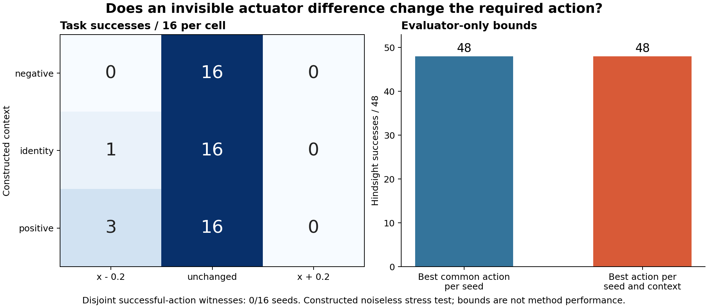

# An identifiable difference with no task value

The constructed probe-support study completed and **failed its task-relevance
gate**. The old probe cannot distinguish three actuator contexts, and an
equal-cost alternative can distinguish them, but the unchanged policy succeeds
on all 48 seed/context combinations. Learning this hidden difference cannot
improve binary task success on this population. Do not develop a selector or
increase the coefficient to manufacture a gain on these seeds.

## Complete task results

Sixteen new seeds 8500--8515 are crossed with three polynomial actuator
contexts. Each cell below contains the same 16 seeds. All states were included;
these are task successes, not recovery rates after initial failure.

| Context | Whole-episode x - 0.2 | Unchanged policy | Whole-episode x + 0.2 |
|---|---:|---:|---:|
| Negative coefficient (-0.5) | 0/16 | 16/16 | 0/16 |
| Identity (0) | 1/16 | 16/16 | 0/16 |
| Positive coefficient (+0.5) | 3/16 | 16/16 | 0/16 |



Both the best common candidate per seed and the context-aware hindsight
candidate attain 48/48. These are evaluator bounds, not online algorithm
results. Here the ordinary unchanged policy actually attains that ceiling.
There are **zero of 16** seeds with disjoint nonempty successful-action sets
between the negative and positive contexts (the preregistered requirement was
at least four). Neither a better classifier nor more repeated measurements
can raise this population's already perfect binary success baseline.

## What was and was not established

The actuator map was deliberately constructed as
T_k(u)=u+k*v^2*(v^2-m^2), where v=clip(u,-1,1), m is float32(0.2), and only
the x coordinate changes. Thus the extra term vanishes at every x input used
by the old four-direction probe. The physical experiment confirms identical
full old-probe transcripts across all contexts for every seed. At amplitude
0.8, all context pairs separate by more than the registered 1e-6 endpoint
criterion, at the same 16-step probe cost.

That resolves a structural identification question but fails to produce an
action-relevant ambiguity. The result is consistent with the closed-loop
policy compensating for this response change; controller robustness was not
separately isolated, so that explanation remains an interpretation. This
constructed noiseless family is not evidence about real actuator prevalence,
broader faults, or the uselessness of exploration in general.

The useful research constraint is stronger than "design a probe that separates
contexts": first demonstrate that unresolved contexts require different
actions within the intended decision problem. It also supplies a negative
control for future methods that spend interactions to identify dynamics that
do not affect the task. Task-relevant experiment design is established prior
art, not a novelty claim; see the [contribution boundary](../docs/research/probe_support_contribution_boundary_v1.md).

This branch stops at the diagnostic result. It does not justify a learned
selector, validation population, larger polynomial coefficient, or repeated
search for a favorable magnitude. Subsequent research must specify a credible
action-relevant uncertainty and compare with standard task-oriented experiment
design and cheap randomized excitation. The ongoing CCF A goal remains unmet.

## Frozen provenance and checks

- Run: `probe_support_20261013T095304Z_d51c76e77072`.
- Source commit: `d51c76e7707239bdca17278e213657285efe9f3d`.
- Manifest: `ef4634bf2dff4f697fcad92854eed53c6adae9842d8c167b92778ae1f77e6ab8`.
- Status: `COMPLETED_WITNESS_FAILED`; audit integrity `PASSED`.
- Collection: 96 probe groups (1,536 steps), 144 physical task rollouts
  (49,179 steps), 50,715 steps total against the 73,536 maximum.
- All 376 frozen input hashes match their source Git blobs. Probe support,
  resets, task associations, chronology, full population, costs, fixed plans,
  and summary recomputation were checked. API and memory writes were zero.
- The 591-test suite passed before collection, including exact input-support
  equality, alternative-support separation, bounded perturbation, mocked full
  execution, one-shot protection, and deliberate artifact tampering.

The complete per-seed table is in the [audit](../outputs/probe_support/analysis_v1/audit.json).
Raw collection is immutable, and seeds 8516--8699 remain reserved. Reproduce
the audit into a new file, without rerunning the simulator:

```powershell
.\.venv\Scripts\python.exe scripts/run_probe_support.py `
  --audit outputs/probe_support/development_v1/probe_support_20261013T095304Z_d51c76e77072/manifest.json `
  --audit-output outputs/probe_support/analysis_reproduction/audit.json
```

Plotting uses `scripts/render_probe_support.py` with Matplotlib separately
from the frozen simulator environment. The figure intentionally shows the
equal hindsight bounds rather than implying a benefit from separability.
