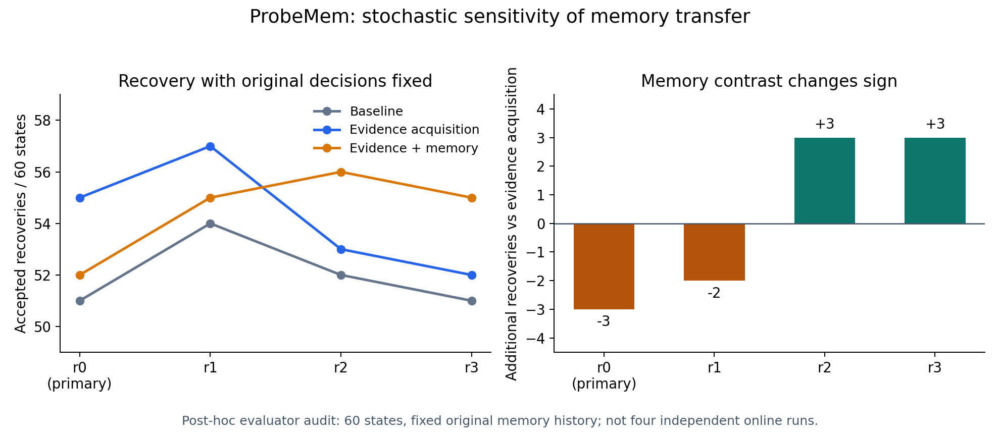

# ProbeMem additional experiments: recovery robustness audit

This is a post-hoc, no-new-rollout audit. The frozen experiment, its stopping
rule, primary results, and status remain unchanged. No API calls, memory replay,
new seeds, or promotion gates were used.

Source run: `probemem_additional_ablation_20260901T031926Z_4f9fd0b4556c`

Manifest: `759c9586f88d5bff43380b67e2bdae1931cd24e3bd57c726643e95510c6fc80f`

Experiment commit: `4f9fd0b4556c11c0b730ccef787bff4beee977d1`

## What the primary comparison actually identifies

All five configurations share 60 initial failures, collected from 94 sequential
units. Evidence Acquisition Enabled recovered 55/60 versus Baseline's 51/60:
four binary recovery wins, 56 ties, zero losses. Three wins occurred among the
eight stochastic-noise states, and one among the 52 stable-bias states. This is
a promising development observation with limited independent discordant pairs.

The historical percentile paired bootstrap reports +6.67 percentage points
with a [1.67, 13.33] interval. A separate exact two-sided discordance reference
calculation gives p=0.125 (four wins, zero losses). These are different
procedures, not a contradiction: a sparse empirical bootstrap with no observed
losses cannot resample a loss. The positive bootstrap lower bound alone should
not be presented as robust evidence of superiority. The p-value is exploratory,
unadjusted, and not a replacement promotion gate.

Probe+Memory versus Evidence Acquisition Enabled has one binary recovery win,
four losses, and 55 ties (-5.0 percentage points). All four losses occur in the
eight noise states. The older transfer taxonomy instead counts two useful and
four harmful transfers because it ranks ACCEPTED, INCONCLUSIVE, and REJECTED;
an ordinal improvement does not necessarily gain a successful recovery. Both
counts are valid for their respective estimands and must be labeled separately.

## The already-collected repetitions change the interpretation



Keep each method's original selected action fixed, and inspect all four
registered evaluator realizations:

| Configuration | r0 | r1 | r2 | r3 | Mean acceptance |
|---|---:|---:|---:|---:|---:|
| Baseline | 51/60 | 54/60 | 52/60 | 51/60 | 86.7% |
| Memory-only | 52/60 | 54/60 | 53/60 | 53/60 | 88.3% |
| Evidence Acquisition Enabled | 55/60 | 57/60 | 53/60 | 52/60 | 90.4% |
| Probe+Memory | 52/60 | 55/60 | 56/60 | 55/60 | 90.8% |
| Full ProbeMem | 52/60 | 55/60 | 56/60 | 55/60 | 90.8% |

The memory contrast changes from -3 and -2 recoveries in r0/r1 to +3 and +3
in r2/r3. Averaged over the four realizations, its fixed-action difference is
only +0.42 percentage points. This does **not** establish memory benefit; it
shows that the primary negative difference is sensitive to recovery randomness.
The results do not establish a stable sign for memory's effect in this setting.

Realization 0 remains the registered primary outcome. The additional columns
reuse decisions made from the original chronological memory history; they are
not four independent online runs. Outcomes from r1--r3 never update memory.
There are 60 states, not 240 independent cases. Neither episode-wise bootstrap
nor an independent-discordance calculation accounts for all dependence induced
by the memory trajectory.

The source contains nonexecuted plan failures encoded as blank-skill,
zero-step REJECTED records: Baseline 2, Memory-only 3, and each remaining method
1 state. These stay in the denominator but are not physical verification trials.
The audit accepts only that explicit placeholder contract and otherwise rejects
missing, duplicate, misassociated, or inconsistent outcomes.

## Research implication

The defensible application story is selective evidence acquisition plus a
careful investigation of why verified experience does not reliably transfer.
The existing data suggest action-outcome uncertainty and memory applicability
need to be separated. They do not establish general self-improvement, a learned
robot policy, or a beneficial verifier. No claims about physical safety follow
from these recovery-status labels.

A future preregistered study should compare complete independent chronological
streams, retain all failed initial episodes, specify the smallest effect of
interest and its power calculation before collection, and evaluate uncertainty
at the stream level. This audit does not freeze or execute such a study, choose
new thresholds, or release reserved seeds.

## Reproduction and provenance

```powershell
.\.venv\Scripts\python.exe scripts/audit_probemem_additional_robustness.py `
  --run-dir outputs/probemem_additional/ablation_development_v1/runs/probemem_additional_ablation_20260901T031926Z_4f9fd0b4556c `
  --output outputs/probemem_additional/robustness_audit_reproduction
```

The output must be new and outside the immutable source run. The
[machine-readable audit](../outputs/probemem_additional/robustness_audit_v1/audit.json)
records source hashes, experiment identity, audit-code hash, original bootstrap
intervals, stratum counts, and sensitivity results. The
[generated tables](../outputs/probemem_additional/robustness_audit_v1/report.md)
include every registered contrast and condition; no outcome-selected subset
replaces the primary population.

The optional figure renderer uses Matplotlib 3.10.8 in a separate Python 3.12
plotting environment; the experiment's Python 3.10 virtual environment and
requirements are unchanged. After installing that optional plotting dependency:

```powershell
python scripts/render_probemem_robustness.py `
  --audit outputs/probemem_additional/robustness_audit_v1/audit.json `
  --output outputs/probemem_additional/robustness_audit_v1/realization_sensitivity.png
```

Validation: 554 unit tests passed, including seven new audit contract tests.
Compileall, project-environment dependency checks, staged secret scanning, and
diff whitespace checks passed. Recomputing the audit reproduced every result;
all six source artifact hashes and the analysis-code hash were unchanged.
