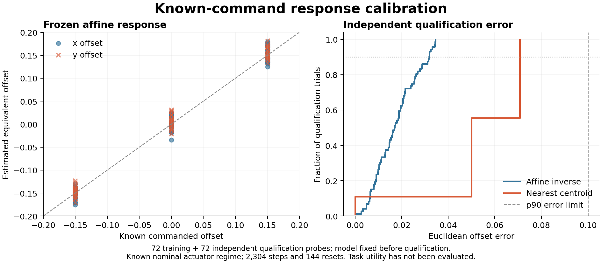

# Independently calibrated response passes identification qualification

The standard affine response model passed its frozen identification gate on
72 independent qualification trajectories. Mean Euclidean offset error was
0.01747 and 90th-percentile error was 0.03179, below the respective 0.05 and
0.10 tolerances. This is a prerequisite identification result; task utility,
confidence calibration, and a novel method remain unproven.

| Same-data baseline | Mean error | Median error | 90th-percentile error |
|---|---:|---:|---:|
| Affine response inverse | 0.01747 | 0.01688 | 0.03179 |
| Nearest calibration centroid | 0.05365 | 0.05000 | 0.07071 |



Training used eight task seeds 8900--8907 and nine commanded xy offsets per
seed, totaling 72 trajectories. A 32-dimensional gripper-displacement response
was fitted by ordinary least squares. The model was saved at sequence 72,
before qualification on seeds 8908--8915 and a different interior offset grid.
Its SHA remained fixed throughout all 72 qualification predictions.

The nearest-centroid comparator received the same training data. Its discrete
grid introduces quantization error; this comparison does not establish that
the affine model beats a stronger nonlinear or probabilistic identification
method. The reported qualification statistics are descriptive engineering
metrics, not task-success effects or coverage/confidence guarantees.

The known nominal actuator regime is a material assumption. Commanding a known
offset during calibration mimics an unknown additive execution offset only
under the registered additive/no-pre-noise-saturation model, unchanged dynamics,
and the same initial robot-state distribution. This result does not test
shifted robot poses, friction changes, stale calibration, or a real actuator.
It also cannot be compared directly to the previous online-fit error as a
matched effect: their populations and information access differ.

All 144 continuous probes completed, costing **2,304 physical steps and 144
explicit environment resets**. Of these, training costs 1,152 steps and 72
resets, and qualification the same again. Future task comparisons must disclose
both costs and distinguish total-system cost from amortized online cost.
No API, task-policy, or memory execution occurred in this phase.

The [audit](../outputs/response_calibration/analysis_v1/audit.json) reconstructed
the model exclusively from training trajectories, recomputed every prediction,
verified complete phase populations and RNG consumption, and reproduced all
statistics. All 385 frozen input hashes match their source Git blobs. The
source run is `response_calibration_20261013T105913Z_bfbd86c7c1dd`, with the full
source commit and manifest hash recorded in its immutable manifest.

The model is eligible for a separately frozen task-utility study on new seeds.
It is not eligible for a publication claim by qualification alone. Training
and qualification data remain immutable; reserved seeds 8916--9099 must not
be executed or used to tune this model.

```powershell
.\.venv\Scripts\python.exe scripts/run_response_calibration.py `
  --audit outputs/response_calibration/development_v1/response_calibration_20261013T105913Z_bfbd86c7c1dd/manifest.json `
  --output outputs/response_calibration/analysis_reproduction/audit.json
```

Choose a new output file; no simulator rerun is needed. The implementation
passed 615 tests before collection, including a known-dynamics deployment test,
training/qualification isolation, model freeze, full mocked collection, and
deliberate model tampering. Synthetic tests contribute no scientific results.

The separately frozen [subsequent task bridge](calibrated_continuous_task_utility_v1.md)
has now completed: the fixed model obtained 64/64 tasks versus 33/64 for the
same probe without correction, with disclosed offline costs. That task evidence
comes from new seeds and its own protocol, rather than these qualification
measurements.
