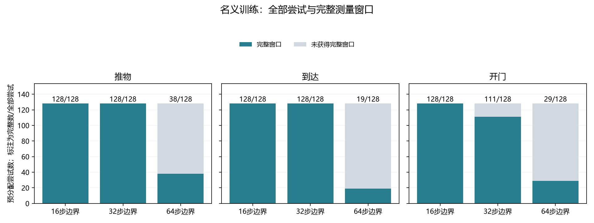
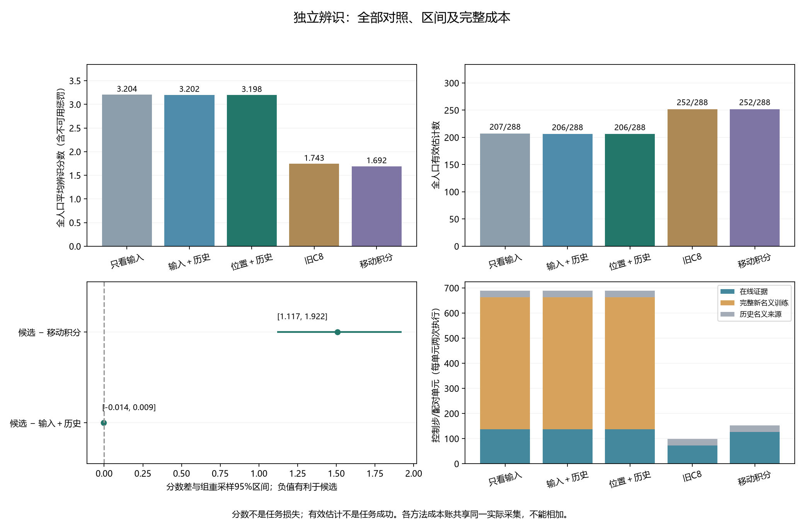

# 附近测量点响应模型：训练与独立辨识

**本轮结论：辨识资格未通过。尚未验证估计后的任务收益，也没有新增LLM API调用。**

机器人收到向右移动的指令，却可能实际向右上方移动。本轮估计这种动作偏差；前三个模型使用同一批训练数据和新探测观测，区别在于考虑哪些输入信息。

## 方法名字是什么意思

|方法名|图表简称|使用的信息与作用|
|---|---|---|
|SELECTED_INPUT_ONLY|只看输入|在选定测量点，根据探测指令与实际观测的关系估计动作偏差。|
|SELECTED_HISTORY|输入＋历史|再考虑进入测量点前最近的运动情况。这里的历史是运动记录，不是聊天记忆。|
|SELECTED_POSE_HISTORY|位置＋历史|进一步考虑手部在什么位置，因为不同位置的运动响应可能不同。|
|SAVED_C8|旧C8|沿用最初八步探测得到的估计，不用后续测量更新。|
|RELOCATION_INTEGRAL|移动积分|使用移向测量点时累计得到的补偿；继承C8矩阵，只更新固定偏移。|

SELECTED 指选定的测量位置。用于移向测量点的 PID 控制，会结合当前距离、运动变化和累计偏差调整指令；它不是上述响应模型的名字。

冻结提交：`6db2a7662590a403c626ff849f5f7f3ec666f8f4`；清单：`289d19ad6a80a3d5597cc1cc14020063c4fcde5c83a1b65aa2d448211ced7817`。

## 名义训练的全部尝试

|任务|边界|完整窗口/预分配尝试|
|---|---:|---:|
|推物|16|128/128|
|推物|32|128/128|
|推物|64|38/128|
|到达|16|128/128|
|到达|32|128/128|
|到达|64|19/128|
|开门|16|128/128|
|开门|32|111/128|
|开门|64|29/128|

训练按预分配尝试数停止，未通过的尝试没有被补采替换。完整窗口可能受所执行动作影响，随机分配不消除这一筛选效应。

|任务|模型|训练窗口|拟合返回有效|错误记录|
|---|---|---:|---|---|
|推物|只看输入|294|是|—|
|推物|输入＋历史|294|是|—|
|推物|位置＋历史|294|是|—|
|到达|只看输入|275|是|—|
|到达|输入＋历史|275|是|—|
|到达|位置＋历史|275|是|—|
|开门|只看输入|268|是|—|
|开门|输入＋历史|268|是|—|
|开门|位置＋历史|268|是|—|

## 独立辨识结果

|方法|有效/全部|全人口分数|仅有效估计的矩阵误差|仅有效估计的偏移误差|
|---|---:|---:|---:|---:|
|只看输入|207/288|3.2041|0.2735|0.0303|
|输入＋历史|206/288|3.2015|0.2237|0.0290|
|位置＋历史|206/288|3.1982|0.2020|0.0359|
|旧C8|252/288|1.7430|0.2133|0.1115|
|移动积分|252/288|1.6916|0.2133|0.0880|

分数为矩阵Frobenius误差＋偏移L2误差/0.4；不可用或无效估计固定记10.5。条件误差只描述有效估计，不能代替全人口比较。

|任务|条件|完整窗口/全部|候选有效/完整|候选有效/全部|
|---|---|---:|---:|---:|
|推物|不变|37/48|37/37|37/48|
|推物|变化|36/48|36/36|36/48|
|到达|不变|33/48|33/33|33/48|
|到达|变化|33/48|33/33|33/48|
|开门|不变|34/48|34/34|34/48|
|开门|变化|34/48|33/34|33/48|

|候选减参考|平均差|95%组重采样区间|
|---|---:|---|
|位置＋历史 − 输入＋历史|-0.0033|[-0.0138, 0.0087]|
|位置＋历史 − 移动积分|1.5067|[1.1174, 1.9218]|

两个主要比较的区间上界都须小于0，每个任务/条件完整率须≥0.5，完整窗口中的候选有效率须≥0.9。

冻结门槛结果：`{"complete_each_task_condition": true, "valid_among_complete_each_task_condition": true, "better_than_both_references": false}`。

计划边界不可用共36例；采集期间提前任务成功53例。两者是不同统计，不能把计划测量不可用写成任务失败。

区间以这一次冻结名义模型为条件，不包含重新训练的波动；也不是物理预测置信区间。

## 全部未完成与无效案例

|阶段|采集停止原因|案例数|
|---|---|---:|
|名义训练|ANCHOR_NOT_REACHED|118|
|名义训练|COMPLETE_NOMINAL_TRAIN|837|
|名义训练|ENDED_BEFORE_BOUNDARY|112|
|名义训练|ENDED_DURING_PROBE|2|
|名义训练|ENDED_DURING_REPOSITION|83|
|独立辨识|ANCHOR_NOT_REACHED|28|
|独立辨识|COMPLETE_UNQUALIFIED|207|
|独立辨识|ENDED_BEFORE_BOUNDARY|36|
|独立辨识|ENDED_DURING_REPOSITION|17|

|方法|估计状态/原因|案例数|
|---|---|---:|
|只看输入|NO_COMPLETE_WINDOW:ANCHOR_NOT_REACHED|28|
|只看输入|NO_COMPLETE_WINDOW:ENDED_DURING_REPOSITION|17|
|只看输入|PLANNED_BOUNDARY_UNAVAILABLE|36|
|只看输入|WORKING_SELECTED_RESPONSE_FIT|207|
|输入＋历史|NO_COMPLETE_WINDOW:ANCHOR_NOT_REACHED|28|
|输入＋历史|NO_COMPLETE_WINDOW:ENDED_DURING_REPOSITION|17|
|输入＋历史|OPTIMIZER_OR_INVERSE_DOMAIN_FAILURE|1|
|输入＋历史|PLANNED_BOUNDARY_UNAVAILABLE|36|
|输入＋历史|WORKING_SELECTED_RESPONSE_FIT|206|
|位置＋历史|NO_COMPLETE_WINDOW:ANCHOR_NOT_REACHED|28|
|位置＋历史|NO_COMPLETE_WINDOW:ENDED_DURING_REPOSITION|17|
|位置＋历史|OPTIMIZER_OR_INVERSE_DOMAIN_FAILURE|1|
|位置＋历史|PLANNED_BOUNDARY_UNAVAILABLE|36|
|位置＋历史|WORKING_SELECTED_RESPONSE_FIT|206|
|旧C8|PLANNED_BOUNDARY_UNAVAILABLE|36|
|旧C8|SAVED_PRECHANGE_C8|252|
|移动积分|PLANNED_BOUNDARY_UNAVAILABLE|36|
|移动积分|SAVED_PREPROBE_INTEGRAL|252|

逐案例记录包括提前成功、无完整窗口和无效估计，见[全部案例](../outputs/reproduction_reviews/selected_response_identification_v1/analysis_v1/all_cases.json)与[不可用或无效案例](../outputs/reproduction_reviews/selected_response_identification_v1/analysis_v1/unavailable_or_invalid_cases.json)。没有使用其他方法代执行来补齐结果。

## 完整成本

|实际采集阶段|控制步|受控重置|全部重置|仿真帧|采集墙钟（秒）|
|---|---:|---:|---:|---:|---:|
|新名义训练|75641|1152|58752|29754205|4719.430|
|独立辨识|19795|288|14688|7442975|1227.533|
|历史名义来源|3840|480|24480|12259200|—|

本轮模型拟合共9次尝试，拟合阶段墙钟14.263秒。历史来源单独收费；新实际采集只发生一次。

|方法|在线控制步|新名义步|历史步|每配对单元总步数|全部重置|仿真帧|在线优化函数评估|
|---|---:|---:|---:|---:|---:|---:|---:|
|只看输入|19795|75641|3840|689.417|97920|49456380|211|
|输入＋历史|19795|75641|3840|689.417|97920|49456380|211|
|位置＋历史|19795|75641|3840|689.417|97920|49456380|209|
|旧C8|10404|0|3840|98.917|39168|19655220|0|
|移动积分|18139|0|3840|152.632|39168|19693895|0|

每个新模型计入完整新名义训练；C8与积分参考在其实际证据结束处计费，不承担新模型训练和后续脉冲成本。以上方法账共享同一物理采集，不能求和当作实际总费用。

独立评价复算另使用631次优化函数评估，审计墙钟5.927秒。审计没有新增机器人步骤或API调用。

## 结论边界

当前结果只涉及指定测量操作与参数辨识。完整运动历史基线、支付探测成本后的真实任务续跑、自适应获取决策和独立时序任务评价仍需完成。积分参考不能代表所有历史辨识方法。

这轮没有新增LLM API调用、自然记忆或策略权重训练。上述组件结果不能直接作为算法创新、任务收益或完整CCF A投稿就绪的证据。
