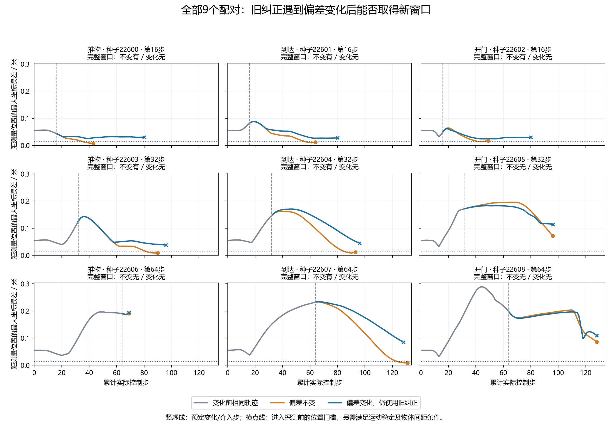

# 旧纠正失效后的重新探测：真实配对结果

**偏差不变取得6/9个完整窗口；偏差变化取得0/9个。执行资格：NOT_QUALIFIED；记录审计通过。**

## 名字怎么理解

C表示动作纠正方案。C4用最开始4步探测估计，C8用最开始8步探测估计；数字不是模型版本，也不代表成功次数。本轮把此前已实际使用的C8叫作旧纠正。

重新探测（re-probe）就是工作中再测一次：先移动到规定的测量位置，再做8步测试动作。完整窗口指这8步及所需的进入状态都已取得，不表示最终任务成功，也不表示已验证新估计器。

偏差不变（UNCHANGED）和偏差变化（CHANGED）是两种实验条件。过期纠正（stale correction）指环境偏差变了，机器人仍使用原先的纠正。冷启动（cold start）指刚初始化时的测量；中途测量（warm）指已经运动后，在连续状态上重新测量。

记录审计通过（PASSED）表示保存的决策、实际动作、状态连续性与费用核对通过。执行资格未通过（NOT_QUALIFIED）表示未达到预先规定的完整窗口数量门槛。这两个判据回答不同问题。

每个任务单元两次独立实际执行，在变化前核对状态和全部物理轨迹相同；变化臂在移动前把偏差从(0.12,−0.08)改为(−0.12,0.08)。代理看不到真实偏差或变化标签，继续使用先前实际执行过的C8。

图中位置门槛只用于进入探测，探测后位置允许变化。所有案例都显示，包括没有安装新条件就已结束的案例；没有挑选成功轨迹。

记录完整性：**PASSED**；执行资格：**NOT_QUALIFIED**。
测量模型资格和任务收益仍未证明。两臂变化前相同；偏差变化在移动前安装，代理继续使用旧C8。本轮采集到窗口或停止后结束，不继续完整任务。

来源提交：`fdb617869c37a32caa69e47613786fac633f823b`；清单：`5ea66255714e4c3011ee21e5dbdf01b6069f3bbbb94693a33c74cd42e5390b60`。

|任务|种子|条件|计划介入步|边界可用|完整窗口|停止理由|移动步|新探测步|总控制步|期间任务成功|
|---|---:|---|---:|---|---|---|---:|---:|---:|---|
|推物|22600|偏差不变|16|True|True|COMPLETE_UNQUALIFIED|19|8|43|False|
|推物|22600|偏差变化|16|True|False|ANCHOR_NOT_REACHED|64|0|80|False|
|到达|22601|偏差不变|16|True|True|COMPLETE_UNQUALIFIED|40|8|64|False|
|到达|22601|偏差变化|16|True|False|ANCHOR_NOT_REACHED|64|0|80|False|
|开门|22602|偏差不变|16|True|True|COMPLETE_UNQUALIFIED|25|8|49|False|
|开门|22602|偏差变化|16|True|False|ANCHOR_NOT_REACHED|64|0|80|False|
|推物|22603|偏差不变|32|True|True|COMPLETE_UNQUALIFIED|50|8|90|False|
|推物|22603|偏差变化|32|True|False|ANCHOR_NOT_REACHED|64|0|96|False|
|到达|22604|偏差不变|32|True|True|COMPLETE_UNQUALIFIED|53|8|93|False|
|到达|22604|偏差变化|32|True|False|ANCHOR_NOT_REACHED|64|0|96|False|
|开门|22605|偏差不变|32|True|False|ANCHOR_NOT_REACHED|64|0|96|False|
|开门|22605|偏差变化|32|True|False|ANCHOR_NOT_REACHED|64|0|96|False|
|推物|22606|偏差不变|64|True|False|ENDED_DURING_REPOSITION|5|0|69|True|
|推物|22606|偏差变化|64|True|False|ENDED_DURING_REPOSITION|5|0|69|True|
|到达|22607|偏差不变|64|True|True|COMPLETE_UNQUALIFIED|59|8|131|False|
|到达|22607|偏差变化|64|True|False|ANCHOR_NOT_REACHED|64|0|128|False|
|开门|22608|偏差不变|64|True|False|ANCHOR_NOT_REACHED|64|0|128|False|
|开门|22608|偏差变化|64|True|False|ANCHOR_NOT_REACHED|64|0|128|False|

不同介入时刻使用不同种子，不能据此宣称时间选择的因果收益。提前成功不算探测成功，所有不可用和未完成窗口保留。

全部9个单元通过变化前原生及Python比较状态、初始拟合、策略和物理轨迹匹配；仅投影已登记统计包装器计时字段。变化减不变的完整窗口计数差为-6，属于这批有限配对的描述，不是泛化概率保证。
核对8372条主事件、54份完整私有状态图，并重建状态图中的公开观测、初始探测数据、计数与原始噪声数组。没有以重新仿真作为审计，也不是外部物理真值认证。
新增控制步1616；受控重置18次，全部重置918次；请求/完成帧467080/467080。
策略查询528次，初始参数拟合36次、nfev 36；中途参数拟合和API均为0。
采集主体80.434821秒，其中见证构建22.956618秒；只读审计主体19.330583秒。进程墙钟另存。
审计额外重算策略528次、拟合36次、nfev 36，无新增环境步。
完整历史名义费用为3840控制步、480受控重置、24480全部重置、12259200帧；每臂均计完整先验费用，按9任务单元摊销426.666667历史控制步/单元。历史采集实际只发生一次；方法账单分别计费，不把它说成新采集了两次。旧研究及资格费用另列，未重跑。

|条件|完整窗口|总控制步|移动步|新探测步|
|---|---:|---:|---:|---:|
|偏差不变|6|763|379|48|
|偏差变化|0|853|517|0|

原移动参数、位置门槛、64步上限和8步程序均保持冻结。缺少新窗口时不调用warm估计器、不代执行、不补选案例。完整CCF A目标仍需可区分的新方法、独立校准与任务收益、强对照、消融及论文。

## 研究含义与下一步

这批配对检验原操作对既定偏差变化的适用性。窗口计数差是有限样本中的受控对照，不是任务成功率、广泛故障适用性或唯一动力学机制的证明。未到位不能用新估计器补救，因为尚未取得它需要的数据。
下一步应按实际资格结果决定是否先改进获取操作。若采用积分反馈等常规抗偏差控制，必须独立版本化、重新冻结新案例，并比较移动本身积累的补偿信息；不能预设额外8步探测有额外价值。原C8、原操作及本次负结果都保留。真实中途模型校准、完整成本下的任务收益、创新性和CCF A论文要求仍未完成。

采集进程94.395秒；只读审计进程20.598秒。本轮API调用0。全仓库1,215项测试、编译、依赖、秘密及差异检查通过。软件夹具费用为冻结记录覆盖的子集，早先两次定向测试的费用列表未导出，不宣称完整开发阶段总费用。
过程日志中的Gymnasium观测空间及MetaWorld动作裁剪提示原样保留。
[原始记录与审计](../outputs/stale_reprobe/qualification_v1/stale_reprobe_20261019T125614Z_fdb617869c37)；[冻结协议](../docs/protocols/stale_reprobe_execution_qualification_v1.md)。
