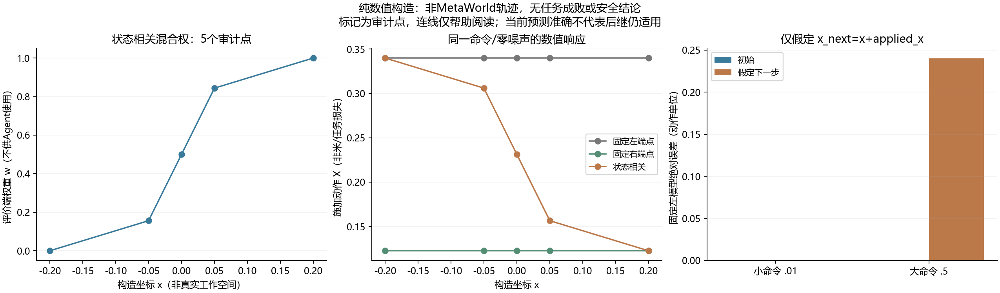

# A线短试机制审查与状态相关算子设计 v1

**这是构造算子与机制审查，不是机器人实验或新算法资格。** 本轮新增环境创建/重置/控制步/物理帧、固定政策查询、机器人种子、模型拟合和在线LLM API均为0。不解析机器人记录或旧CAL/TEST，不改变前轮13项比较、固定接收者负结果和完整程序支持审计。

## 研究判断先行

本轮拒绝把“短时试用候选纠正，再接受/拒绝”本身当创新。[在线切换控制](https://proceedings.mlr.press/v211/li23a.html)已有未知动力学、有限候选和前一控制器留下状态的处理；一般两阶段Q也可表达试用→真实返回→后继控制。其稳定性假设没有由本项目验证。算法是否适用于本项目、以及同预算表现如何，仍需后续真实比较，不能只靠近邻名称断言完全等价。

当前A1的注入映射在预定时点切换后仍为固定全局仿射；它的真实响应误差会随瞬态/接触改变，但这不等于注入参数按位置改变。本轮新增一个隔离的、状态相关评价算子，以便未来明确检验纠正怎样改变所访问的响应条件。这不是修改旧试验，也不把状态相关设置本身当算法贡献。

## 已实现的算子

读取命令之前公开手位置的一个坐标x，使用固定端点A0/b0、A1/b1和smoothstep权重：

\[ z=\mathrm{clip}((x-c)/(2h)+1/2,0,1),\quad w=z^2(3-2z),\quad A(x)=(1-w)A_0+wA_1. \]

b(x)同样混合。另保留两个平坦端点对照。端点对角[.75,1.25]、非对角绝对值≤.2、偏置绝对值≤.2，零死区；实数矩阵行列式下界.5225来自这些分量约束，不是通过数据拟合。float32实际行列式另存。没有求逆或控制器学习。

执行数值顺序：混合→参数float32→XY仿射/旧零死区算术→XYZ加显式噪声行→最终裁剪。z与夹爪维语义保留。纯函数不拥有噪声游标、物理时钟或环境；真实前状态和保存先后仍需未来原生收集器证明，不能凭接口字段名声称因果闭环成立。

参数、混合权、施加动作和行列式均是评价端oracle字段，不能提供给Agent或用作学习标签。没有为在线方法提供已知真实状态映射。此处“状态相关”是人工归一化映射，**不是从硬件测得的摩擦/回差模型**；[构型相关误差的出版者来源](https://ieeexplore.ieee.org/document/11488285/)只提供研究动机。

## 将三个判断分开

|判断|本轮证据|不能据此推出|
|---|---|---|
|参数数值合法|端点范围、凸混合、行列式与float32链检查|饱和后的可逆性或物理稳定/安全|
|当前/后继预测能力|明示运动学反例的已知数值比较|MetaWorld或真实机器人预测资格|
|包含获取成本的任务收益|本轮未执行任务、未测量|新方法优于基线或论文贡献|

## 明示的构造反例

仅假定无量纲运动学x_next=x+applied_x，初态x=−.4、端点矩阵均为单位阵，左右偏置X为±.12。这个假定不是MetaWorld动力学，且**不证明不可逆动力学**。它只说明先前命令改变后继位置，当前准确的固定模型可能在下一状态失配。

|构造命令|初始预测误差|假定后继x|下一权重|下一预测误差（动作单位）|
|---|---|---|---|---|
|SMALL|0.0|-0.27|0.0|0|
|LARGE|0.0|0.22|1.0|-0.24|

小命令留在原区，大命令进入另一响应区。两种命令的第一步预测误差都为0，端点矩阵都合法；大命令之后固定左模型误差约−.24。该数值不是米、任务损失或真实噪声影响。已知状态模型、MDE配合前瞻和两阶段Q也能解释这一反例；不能当作本项目方法优势。

## 固定网格与独立复算

先在 `657297ca850693fcdca0efabca8973c4cd3bcb18` 提交构造实现/配置/测试，再执行3类型×5位置×4X×4Y×3Z×2夹爪×3确定噪声行，共4320行。所有位置和尺度都是构造数值；没有真实工作空间中心或分区分配，没有随机机器人采样。

独立实现禁用主算子/权重/混合/fixture等9个函数，以struct逐标量float32取整和不同smoothstep展开复算。全部4320行的输入次序与覆盖核对，116640个标量字段比较通过；最大绝对数值差2.22044605e-16，预先固定容差5e-07。此容差只处理不同数值实现的舍入，不是物理或统计界。

两个平坦端点共2880行，与旧chronological_faults的同float32执行链逐字节相同。这是旧数值接口兼容性；不是完整机器人收集器、噪声游标连续性、环境重置或任务资格。全部网格、饱和和反例均保留。

12项新数组检查全部通过，加2103项源码哈希绑定复用检查，合计2115项独特检查；旧六组张量另列。4320构造行、2880兼容行和标量字段不计作新测试、独立机器人样本或方法执行数。本版没有失败测试或重采；历史失败仍完整保留。

构造含I/O墙钟3.29067秒，独立审计1.1911秒，完整只读流水线6.51612秒。报告/图形生成回执另存；科学拟合0。

## 查新边界和明确后续

新增读取在线切换控制、ECC2007控制器否定相关片段、JMLR2026不可逆学习正式摘要；复核MDE/OCCAM摘要和引言。RA-L出版者网页有机器人验证，未绕过，仅使用检索返回摘要/引言片段；ECC作者PDF首次可见开头，重读超时，未通读其证明。各来源及限制见[决定简报](../docs/research/state_coupled_validity_decision_v1_zh.md)。这是部分查新，不是穷尽或复现。

后续产物必须先给出可训练的具体机制及与同权限MDE+前瞻、TOM/表现预测、OCCAM、SPO/两阶段Q和连续切换的可检验区别。只有动作名称、门控、换损失、状态相关设置或保留当前真实状态，都不足以完成这一要求。若差别完全由标准组合解释，应保留为强参考并拒绝新颖性主张。

任何真实扩展还须独立冻结工作空间分区、条件/参数分配、原生收集器、完整TRAIN/CAL/自身历史最终评价、强对照、消融及全部重置/帧/政策查询/训练费用。目前配置没有这些分配，collection_allocation明确拒绝。不得用前轮4个正例挑难度，也不能人为加难后降低基线。DIRECT_C8、积分、完整免费反馈、始终获取/不更新、变化检测和任务相关参考均须保留。

**本轮完成构造研究实例，未完成新方法、独立任务收益或CCF A目标。**

- [全部4320构造记录](../outputs/correction_scope/state_coupled_design_v1/run_20261026T121947Z_657297ca8506/constructed_records.jsonl)
- [独立复算回执](../outputs/correction_scope/state_coupled_design_v1/run_20261026T121947Z_657297ca8506/audit.json)
- [构造结果与反例](../outputs/correction_scope/state_coupled_design_v1/run_20261026T121947Z_657297ca8506/construction.json)
- [设计协议](../docs/protocols/state_coupled_actuation_design_v1_zh.md)
- [决定与查新](../docs/research/state_coupled_validity_decision_v1_zh.md)
