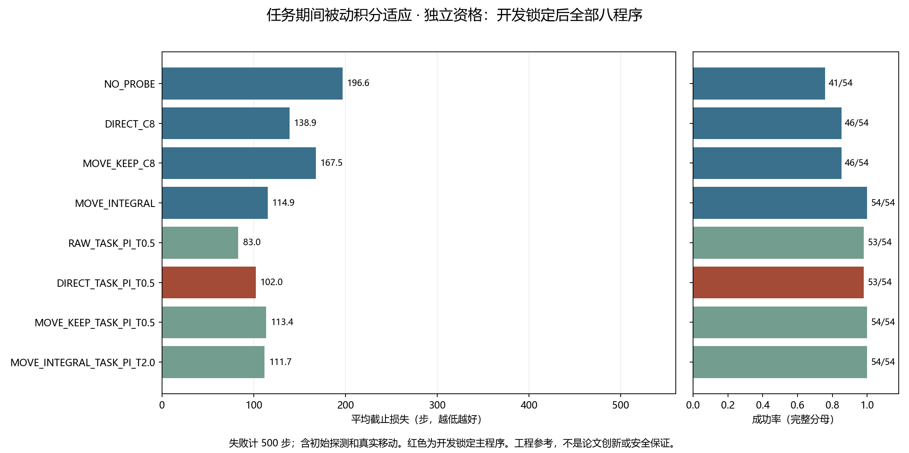
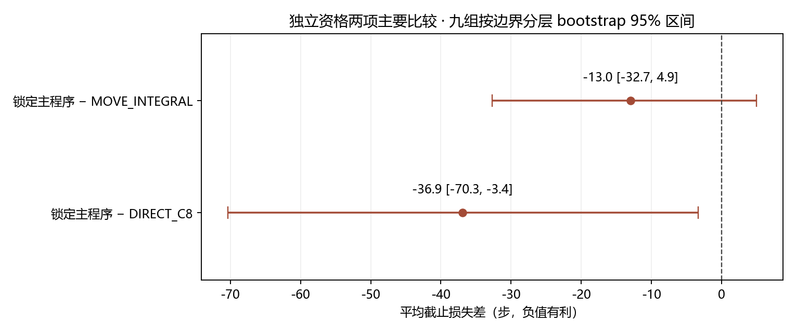

# 任务期间被动积分适应：完整任务开发与独立资格验证

## 先读结论

锁定主程序 **DIRECT_TASK_PI_T0.5** 在全部九个新组、三任务 × 两计划条件中为 **53/54 成功，平均截止损失 101.962963 步**。独立资格门槛：**未通过，保留独立负结果**。

这是标准持续积分控制的强对照。新增响应预测器训练、底层策略训练、在线 LLM API 调用均为 0；在线 C4/C8 参数估计与审计复算另行计账。原 ARX／GRU 负结果保持不变。

| 独立资格程序 | 成功／全部 | 平均截止损失↓ |
|---|---:|---:|
| NO_PROBE | 41/54 | 196.574074 |
| DIRECT_C8 | 46/54 | 138.870370 |
| MOVE_KEEP_C8 | 46/54 | 167.500000 |
| MOVE_INTEGRAL | 54/54 | 114.925926 |
| RAW_TASK_PI_T0.5 | 53/54 | 83.037037 |
| DIRECT_TASK_PI_T0.5 | 53/54 | 101.962963 |
| MOVE_KEEP_TASK_PI_T0.5 | 54/54 | 113.407407 |
| MOVE_INTEGRAL_TASK_PI_T2.0 | 54/54 | 111.740741 |

| 冻结的共同主要比较 | 平均差（步） | 九组 95% 区间 |
|---|---:|---|
| DIRECT_TASK_PI_T0.5_MINUS_DIRECT_C8 | -36.907407 | [-70.333333, -3.387037] |
| DIRECT_TASK_PI_T0.5_MINUS_MOVE_INTEGRAL | -12.962963 | [-32.703704, 4.925926] |

以上截止损失包括本次执行的真实初始探测、移动及失败惩罚；完整离线来源和调参费用在后文另列。**在线任务收益不等于摊销完整研究来源后的净成本收益**。当前结果不构成新算法、风险保证或 CCF A 目标完成。

## 名字怎么读

`C8` 指最初八步标定；`DIRECT` 直接继续；`MOVE` 先执行共同移动；`KEEP` 保留旧纠正；`INTEGRAL` 为原移动阶段积分；`RAW` 不做初始标定；`TASK_PI` 指任务期间持续积分。这里的 P 来自固定策略的比例反馈，I 是持续累积的补偿。
`T0.5` 是 **0.5 秒积分时间常数**（40 个控制周期），`T2.0` 为 2 秒（160 周期）。T 越小，给定误差下积分变化越快；它不是 50% 或 200% 命令混合。本轮没有执行旧计划中的 BLEND_025／050 程序。

三层判断分别是：数值与保存执行契约通过检查；本轮没有新增响应模型预测资格，旧 F20 仅保留局部静态命令差成分的结论；当前完整任务损失按预注册的两项比较单独验证。不能由其中一层推定另一层。

运行 `task_passive_20261022T032948Z_67fefc4da922`；冻结源码 `67fefc4da9224e0c62b8373d0d4e8cb5b3d1bade`。

本轮是强工程基线，区分参数数值合法、预测能力与完整任务收益。任务 PI 不使用 F20 逆模型，也不代表 ARX／GRU 已恢复有效；限幅和回退不构成安全保证。
每步固定策略查询一次。位置误差是未裁剪 float32 策略动作除以任务固定 P 增益，仅表示当前策略目标，不是最终任务误差。积分以发送命令单位累积，并按实际有界发送命令投影抗饱和；收到真实物理回执后才提交积分状态。

NO_PROBE 无初始探测；DIRECT_C8 使用八步初始标定；MOVE_KEEP_C8 执行原移动后保留标定；MOVE_INTEGRAL 只使用原移动阶段积分。RAW_TASK_PI 从零时刻持续积分；DIRECT_TASK_PI 在 C8 后积分；两个 MOVE_TASK_PI 在共同真实移动后持续积分，分别以 C8／原移动积分为基准。底层策略权重固定，XY 以外的发送命令保持该控制器原值。

开发选择：`{'RAW_TASK_PI': 0.5, 'DIRECT_TASK_PI': 0.5, 'MOVE_KEEP_TASK_PI': 0.5, 'MOVE_INTEGRAL_TASK_PI': 2.0}`；锁定主方法 `DIRECT_TASK_PI_T0.5`；开发门槛 `PASSED_FOR_LOCKED_QUALIFICATION_ONLY`。

时间常数在完整六组开发人口的截止损失上选择，平局取较大时间常数；主程序平局遵循预注册顺序。没有按任务挑参数。独立资格使用九个新组；若开发不优于 DIRECT_C8 和 MOVE_INTEGRAL，则不采集资格人口。

## DEV：DEVELOPMENT_SELECTION_ONLY

| 程序 | 成功／全部 | 平均截止损失↓ | 实际控制步 |
|---|---:|---:|---:|
| NO_PROBE | 29/36 | 164.555556 | 5924 |
| DIRECT_C8 | 30/36 | 149.000000 | 5364 |
| MOVE_KEEP_C8 | 30/36 | 181.111111 | 6520 |
| MOVE_INTEGRAL | 34/36 | 140.333333 | 5052 |
| RAW_TASK_PI_T0.125 | 34/36 | 96.527778 | 3475 |
| RAW_TASK_PI_T0.5 | 35/36 | 80.694444 | 2905 |
| RAW_TASK_PI_T2.0 | 34/36 | 101.277778 | 3646 |
| RAW_TASK_PI_T8.0 | 32/36 | 140.694444 | 5065 |
| DIRECT_TASK_PI_T0.125 | 34/36 | 111.083333 | 3999 |
| DIRECT_TASK_PI_T0.5 | 36/36 | 78.666667 | 2832 |
| DIRECT_TASK_PI_T2.0 | 35/36 | 102.083333 | 3675 |
| DIRECT_TASK_PI_T8.0 | 32/36 | 134.166667 | 4830 |
| MOVE_KEEP_TASK_PI_T0.125 | 34/36 | 139.194444 | 5011 |
| MOVE_KEEP_TASK_PI_T0.5 | 36/36 | 112.750000 | 4059 |
| MOVE_KEEP_TASK_PI_T2.0 | 35/36 | 139.777778 | 5032 |
| MOVE_KEEP_TASK_PI_T8.0 | 32/36 | 167.250000 | 6021 |
| MOVE_INTEGRAL_TASK_PI_T0.125 | 35/36 | 130.194444 | 4687 |
| MOVE_INTEGRAL_TASK_PI_T0.5 | 36/36 | 114.500000 | 4122 |
| MOVE_INTEGRAL_TASK_PI_T2.0 | 36/36 | 114.388889 | 4118 |
| MOVE_INTEGRAL_TASK_PI_T8.0 | 36/36 | 119.138889 | 4289 |

| 锁定主比较 | 平均损失差 | 95% 整组区间 |
|---|---:|---|
| DIRECT_TASK_PI_T0.5_MINUS_DIRECT_C8 | -70.333333 | [-102.916667, -37.750000] |
| DIRECT_TASK_PI_T0.5_MINUS_MOVE_INTEGRAL | -61.666667 | [-72.638889, -50.694444] |

完整任务 × 不变／变化分层：

| 任务 | 条件 | 程序 | 成功／全部 | 平均截止损失↓ |
|---|---|---|---:|---:|
| push-v3 | UNCHANGED | NO_PROBE | 3/6 | 282.500000 |
| push-v3 | UNCHANGED | DIRECT_C8 | 6/6 | 70.166667 |
| push-v3 | UNCHANGED | MOVE_KEEP_C8 | 6/6 | 109.166667 |
| push-v3 | UNCHANGED | MOVE_INTEGRAL | 6/6 | 110.000000 |
| push-v3 | UNCHANGED | RAW_TASK_PI_T0.125 | 4/6 | 222.666667 |
| push-v3 | UNCHANGED | RAW_TASK_PI_T0.5 | 5/6 | 170.000000 |
| push-v3 | UNCHANGED | RAW_TASK_PI_T2.0 | 5/6 | 152.666667 |
| push-v3 | UNCHANGED | RAW_TASK_PI_T8.0 | 3/6 | 282.333333 |
| push-v3 | UNCHANGED | DIRECT_TASK_PI_T0.125 | 4/6 | 262.833333 |
| push-v3 | UNCHANGED | DIRECT_TASK_PI_T0.5 | 6/6 | 79.833333 |
| push-v3 | UNCHANGED | DIRECT_TASK_PI_T2.0 | 6/6 | 70.833333 |
| push-v3 | UNCHANGED | DIRECT_TASK_PI_T8.0 | 6/6 | 69.666667 |
| push-v3 | UNCHANGED | MOVE_KEEP_TASK_PI_T0.125 | 5/6 | 186.833333 |
| push-v3 | UNCHANGED | MOVE_KEEP_TASK_PI_T0.5 | 6/6 | 106.000000 |
| push-v3 | UNCHANGED | MOVE_KEEP_TASK_PI_T2.0 | 6/6 | 107.000000 |
| push-v3 | UNCHANGED | MOVE_KEEP_TASK_PI_T8.0 | 6/6 | 109.333333 |
| push-v3 | UNCHANGED | MOVE_INTEGRAL_TASK_PI_T0.125 | 5/6 | 176.500000 |
| push-v3 | UNCHANGED | MOVE_INTEGRAL_TASK_PI_T0.5 | 6/6 | 108.500000 |
| push-v3 | UNCHANGED | MOVE_INTEGRAL_TASK_PI_T2.0 | 6/6 | 108.500000 |
| push-v3 | UNCHANGED | MOVE_INTEGRAL_TASK_PI_T8.0 | 6/6 | 109.666667 |
| push-v3 | CHANGED | NO_PROBE | 5/6 | 136.333333 |
| push-v3 | CHANGED | DIRECT_C8 | 3/6 | 286.000000 |
| push-v3 | CHANGED | MOVE_KEEP_C8 | 3/6 | 305.500000 |
| push-v3 | CHANGED | MOVE_INTEGRAL | 6/6 | 114.333333 |
| push-v3 | CHANGED | RAW_TASK_PI_T0.125 | 6/6 | 104.666667 |
| push-v3 | CHANGED | RAW_TASK_PI_T0.5 | 6/6 | 69.000000 |
| push-v3 | CHANGED | RAW_TASK_PI_T2.0 | 5/6 | 138.833333 |
| push-v3 | CHANGED | RAW_TASK_PI_T8.0 | 5/6 | 136.333333 |
| push-v3 | CHANGED | DIRECT_TASK_PI_T0.125 | 6/6 | 130.166667 |
| push-v3 | CHANGED | DIRECT_TASK_PI_T0.5 | 6/6 | 88.166667 |
| push-v3 | CHANGED | DIRECT_TASK_PI_T2.0 | 5/6 | 167.666667 |
| push-v3 | CHANGED | DIRECT_TASK_PI_T8.0 | 3/6 | 285.500000 |
| push-v3 | CHANGED | MOVE_KEEP_TASK_PI_T0.125 | 5/6 | 190.500000 |
| push-v3 | CHANGED | MOVE_KEEP_TASK_PI_T0.5 | 6/6 | 121.666667 |
| push-v3 | CHANGED | MOVE_KEEP_TASK_PI_T2.0 | 5/6 | 198.500000 |
| push-v3 | CHANGED | MOVE_KEEP_TASK_PI_T8.0 | 3/6 | 305.333333 |
| push-v3 | CHANGED | MOVE_INTEGRAL_TASK_PI_T0.125 | 6/6 | 137.166667 |
| push-v3 | CHANGED | MOVE_INTEGRAL_TASK_PI_T0.5 | 6/6 | 114.000000 |
| push-v3 | CHANGED | MOVE_INTEGRAL_TASK_PI_T2.0 | 6/6 | 113.166667 |
| push-v3 | CHANGED | MOVE_INTEGRAL_TASK_PI_T8.0 | 6/6 | 113.500000 |
| reach-v3 | UNCHANGED | NO_PROBE | 5/6 | 182.833333 |
| reach-v3 | UNCHANGED | DIRECT_C8 | 6/6 | 54.833333 |
| reach-v3 | UNCHANGED | MOVE_KEEP_C8 | 6/6 | 67.666667 |
| reach-v3 | UNCHANGED | MOVE_INTEGRAL | 6/6 | 75.833333 |
| reach-v3 | UNCHANGED | RAW_TASK_PI_T0.125 | 6/6 | 44.666667 |
| reach-v3 | UNCHANGED | RAW_TASK_PI_T0.5 | 6/6 | 37.833333 |
| reach-v3 | UNCHANGED | RAW_TASK_PI_T2.0 | 6/6 | 54.666667 |
| reach-v3 | UNCHANGED | RAW_TASK_PI_T8.0 | 6/6 | 77.666667 |
| reach-v3 | UNCHANGED | DIRECT_TASK_PI_T0.125 | 6/6 | 41.333333 |
| reach-v3 | UNCHANGED | DIRECT_TASK_PI_T0.5 | 6/6 | 45.166667 |
| reach-v3 | UNCHANGED | DIRECT_TASK_PI_T2.0 | 6/6 | 50.666667 |
| reach-v3 | UNCHANGED | DIRECT_TASK_PI_T8.0 | 6/6 | 53.333333 |
| reach-v3 | UNCHANGED | MOVE_KEEP_TASK_PI_T0.125 | 6/6 | 61.166667 |
| reach-v3 | UNCHANGED | MOVE_KEEP_TASK_PI_T0.5 | 6/6 | 63.333333 |
| reach-v3 | UNCHANGED | MOVE_KEEP_TASK_PI_T2.0 | 6/6 | 66.000000 |
| reach-v3 | UNCHANGED | MOVE_KEEP_TASK_PI_T8.0 | 6/6 | 67.166667 |
| reach-v3 | UNCHANGED | MOVE_INTEGRAL_TASK_PI_T0.125 | 6/6 | 61.500000 |
| reach-v3 | UNCHANGED | MOVE_INTEGRAL_TASK_PI_T0.5 | 6/6 | 64.500000 |
| reach-v3 | UNCHANGED | MOVE_INTEGRAL_TASK_PI_T2.0 | 6/6 | 70.166667 |
| reach-v3 | UNCHANGED | MOVE_INTEGRAL_TASK_PI_T8.0 | 6/6 | 74.000000 |
| reach-v3 | CHANGED | NO_PROBE | 4/6 | 217.000000 |
| reach-v3 | CHANGED | DIRECT_C8 | 3/6 | 279.500000 |
| reach-v3 | CHANGED | MOVE_KEEP_C8 | 3/6 | 289.333333 |
| reach-v3 | CHANGED | MOVE_INTEGRAL | 4/6 | 225.166667 |
| reach-v3 | CHANGED | RAW_TASK_PI_T0.125 | 6/6 | 36.333333 |
| reach-v3 | CHANGED | RAW_TASK_PI_T0.5 | 6/6 | 38.500000 |
| reach-v3 | CHANGED | RAW_TASK_PI_T2.0 | 6/6 | 93.000000 |
| reach-v3 | CHANGED | RAW_TASK_PI_T8.0 | 6/6 | 179.166667 |
| reach-v3 | CHANGED | DIRECT_TASK_PI_T0.125 | 6/6 | 42.666667 |
| reach-v3 | CHANGED | DIRECT_TASK_PI_T0.5 | 6/6 | 75.166667 |
| reach-v3 | CHANGED | DIRECT_TASK_PI_T2.0 | 6/6 | 137.666667 |
| reach-v3 | CHANGED | DIRECT_TASK_PI_T8.0 | 5/6 | 208.333333 |
| reach-v3 | CHANGED | MOVE_KEEP_TASK_PI_T0.125 | 6/6 | 67.833333 |
| reach-v3 | CHANGED | MOVE_KEEP_TASK_PI_T0.5 | 6/6 | 73.666667 |
| reach-v3 | CHANGED | MOVE_KEEP_TASK_PI_T2.0 | 6/6 | 157.666667 |
| reach-v3 | CHANGED | MOVE_KEEP_TASK_PI_T8.0 | 5/6 | 214.666667 |
| reach-v3 | CHANGED | MOVE_INTEGRAL_TASK_PI_T0.125 | 6/6 | 68.166667 |
| reach-v3 | CHANGED | MOVE_INTEGRAL_TASK_PI_T0.5 | 6/6 | 72.666667 |
| reach-v3 | CHANGED | MOVE_INTEGRAL_TASK_PI_T2.0 | 6/6 | 82.666667 |
| reach-v3 | CHANGED | MOVE_INTEGRAL_TASK_PI_T8.0 | 6/6 | 106.000000 |
| door-open-v3 | UNCHANGED | NO_PROBE | 6/6 | 85.833333 |
| door-open-v3 | UNCHANGED | DIRECT_C8 | 6/6 | 98.500000 |
| door-open-v3 | UNCHANGED | MOVE_KEEP_C8 | 6/6 | 146.666667 |
| door-open-v3 | UNCHANGED | MOVE_INTEGRAL | 6/6 | 155.166667 |
| door-open-v3 | UNCHANGED | RAW_TASK_PI_T0.125 | 6/6 | 86.666667 |
| door-open-v3 | UNCHANGED | RAW_TASK_PI_T0.5 | 6/6 | 85.500000 |
| door-open-v3 | UNCHANGED | RAW_TASK_PI_T2.0 | 6/6 | 85.666667 |
| door-open-v3 | UNCHANGED | RAW_TASK_PI_T8.0 | 6/6 | 85.666667 |
| door-open-v3 | UNCHANGED | DIRECT_TASK_PI_T0.125 | 6/6 | 94.833333 |
| door-open-v3 | UNCHANGED | DIRECT_TASK_PI_T0.5 | 6/6 | 92.166667 |
| door-open-v3 | UNCHANGED | DIRECT_TASK_PI_T2.0 | 6/6 | 93.333333 |
| door-open-v3 | UNCHANGED | DIRECT_TASK_PI_T8.0 | 6/6 | 94.500000 |
| door-open-v3 | UNCHANGED | MOVE_KEEP_TASK_PI_T0.125 | 6/6 | 155.333333 |
| door-open-v3 | UNCHANGED | MOVE_KEEP_TASK_PI_T0.5 | 6/6 | 149.166667 |
| door-open-v3 | UNCHANGED | MOVE_KEEP_TASK_PI_T2.0 | 6/6 | 148.666667 |
| door-open-v3 | UNCHANGED | MOVE_KEEP_TASK_PI_T8.0 | 6/6 | 147.333333 |
| door-open-v3 | UNCHANGED | MOVE_INTEGRAL_TASK_PI_T0.125 | 6/6 | 157.833333 |
| door-open-v3 | UNCHANGED | MOVE_INTEGRAL_TASK_PI_T0.5 | 6/6 | 151.166667 |
| door-open-v3 | UNCHANGED | MOVE_INTEGRAL_TASK_PI_T2.0 | 6/6 | 150.000000 |
| door-open-v3 | UNCHANGED | MOVE_INTEGRAL_TASK_PI_T8.0 | 6/6 | 149.833333 |
| door-open-v3 | CHANGED | NO_PROBE | 6/6 | 82.833333 |
| door-open-v3 | CHANGED | DIRECT_C8 | 6/6 | 105.000000 |
| door-open-v3 | CHANGED | MOVE_KEEP_C8 | 6/6 | 168.333333 |
| door-open-v3 | CHANGED | MOVE_INTEGRAL | 6/6 | 161.500000 |
| door-open-v3 | CHANGED | RAW_TASK_PI_T0.125 | 6/6 | 84.166667 |
| door-open-v3 | CHANGED | RAW_TASK_PI_T0.5 | 6/6 | 83.333333 |
| door-open-v3 | CHANGED | RAW_TASK_PI_T2.0 | 6/6 | 82.833333 |
| door-open-v3 | CHANGED | RAW_TASK_PI_T8.0 | 6/6 | 83.000000 |
| door-open-v3 | CHANGED | DIRECT_TASK_PI_T0.125 | 6/6 | 94.666667 |
| door-open-v3 | CHANGED | DIRECT_TASK_PI_T0.5 | 6/6 | 91.500000 |
| door-open-v3 | CHANGED | DIRECT_TASK_PI_T2.0 | 6/6 | 92.333333 |
| door-open-v3 | CHANGED | DIRECT_TASK_PI_T8.0 | 6/6 | 93.666667 |
| door-open-v3 | CHANGED | MOVE_KEEP_TASK_PI_T0.125 | 6/6 | 173.500000 |
| door-open-v3 | CHANGED | MOVE_KEEP_TASK_PI_T0.5 | 6/6 | 162.666667 |
| door-open-v3 | CHANGED | MOVE_KEEP_TASK_PI_T2.0 | 6/6 | 160.833333 |
| door-open-v3 | CHANGED | MOVE_KEEP_TASK_PI_T8.0 | 6/6 | 159.666667 |
| door-open-v3 | CHANGED | MOVE_INTEGRAL_TASK_PI_T0.125 | 6/6 | 180.000000 |
| door-open-v3 | CHANGED | MOVE_INTEGRAL_TASK_PI_T0.5 | 6/6 | 176.166667 |
| door-open-v3 | CHANGED | MOVE_INTEGRAL_TASK_PI_T2.0 | 6/6 | 161.833333 |
| door-open-v3 | CHANGED | MOVE_INTEGRAL_TASK_PI_T8.0 | 6/6 | 161.833333 |
## QUAL：NOT_PASSED

| 程序 | 成功／全部 | 平均截止损失↓ | 实际控制步 |
|---|---:|---:|---:|
| NO_PROBE | 41/54 | 196.574074 | 10615 |
| DIRECT_C8 | 46/54 | 138.870370 | 7499 |
| MOVE_KEEP_C8 | 46/54 | 167.500000 | 9045 |
| MOVE_INTEGRAL | 54/54 | 114.925926 | 6206 |
| RAW_TASK_PI_T0.5 | 53/54 | 83.037037 | 4484 |
| DIRECT_TASK_PI_T0.5 | 53/54 | 101.962963 | 5506 |
| MOVE_KEEP_TASK_PI_T0.5 | 54/54 | 113.407407 | 6124 |
| MOVE_INTEGRAL_TASK_PI_T2.0 | 54/54 | 111.740741 | 6034 |

| 锁定主比较 | 平均损失差 | 95% 整组区间 |
|---|---:|---|
| DIRECT_TASK_PI_T0.5_MINUS_DIRECT_C8 | -36.907407 | [-70.333333, -3.387037] |
| DIRECT_TASK_PI_T0.5_MINUS_MOVE_INTEGRAL | -12.962963 | [-32.703704, 4.925926] |

完整任务 × 不变／变化分层：

| 任务 | 条件 | 程序 | 成功／全部 | 平均截止损失↓ |
|---|---|---|---:|---:|
| push-v3 | UNCHANGED | NO_PROBE | 5/9 | 258.333333 |
| push-v3 | UNCHANGED | DIRECT_C8 | 9/9 | 72.777778 |
| push-v3 | UNCHANGED | MOVE_KEEP_C8 | 9/9 | 101.555556 |
| push-v3 | UNCHANGED | MOVE_INTEGRAL | 9/9 | 112.000000 |
| push-v3 | UNCHANGED | RAW_TASK_PI_T0.5 | 9/9 | 75.666667 |
| push-v3 | UNCHANGED | DIRECT_TASK_PI_T0.5 | 8/9 | 149.111111 |
| push-v3 | UNCHANGED | MOVE_KEEP_TASK_PI_T0.5 | 9/9 | 99.666667 |
| push-v3 | UNCHANGED | MOVE_INTEGRAL_TASK_PI_T2.0 | 9/9 | 101.444444 |
| push-v3 | CHANGED | NO_PROBE | 7/9 | 162.888889 |
| push-v3 | CHANGED | DIRECT_C8 | 5/9 | 263.444444 |
| push-v3 | CHANGED | MOVE_KEEP_C8 | 4/9 | 323.111111 |
| push-v3 | CHANGED | MOVE_INTEGRAL | 9/9 | 112.333333 |
| push-v3 | CHANGED | RAW_TASK_PI_T0.5 | 8/9 | 130.222222 |
| push-v3 | CHANGED | DIRECT_TASK_PI_T0.5 | 9/9 | 104.888889 |
| push-v3 | CHANGED | MOVE_KEEP_TASK_PI_T0.5 | 9/9 | 121.444444 |
| push-v3 | CHANGED | MOVE_INTEGRAL_TASK_PI_T2.0 | 9/9 | 111.333333 |
| reach-v3 | UNCHANGED | NO_PROBE | 4/9 | 388.000000 |
| reach-v3 | UNCHANGED | DIRECT_C8 | 9/9 | 57.111111 |
| reach-v3 | UNCHANGED | MOVE_KEEP_C8 | 9/9 | 67.222222 |
| reach-v3 | UNCHANGED | MOVE_INTEGRAL | 9/9 | 73.444444 |
| reach-v3 | UNCHANGED | RAW_TASK_PI_T0.5 | 9/9 | 66.666667 |
| reach-v3 | UNCHANGED | DIRECT_TASK_PI_T0.5 | 9/9 | 85.111111 |
| reach-v3 | UNCHANGED | MOVE_KEEP_TASK_PI_T0.5 | 9/9 | 69.666667 |
| reach-v3 | UNCHANGED | MOVE_INTEGRAL_TASK_PI_T2.0 | 9/9 | 67.111111 |
| reach-v3 | CHANGED | NO_PROBE | 7/9 | 199.666667 |
| reach-v3 | CHANGED | DIRECT_C8 | 5/9 | 253.777778 |
| reach-v3 | CHANGED | MOVE_KEEP_C8 | 6/9 | 209.888889 |
| reach-v3 | CHANGED | MOVE_INTEGRAL | 9/9 | 87.222222 |
| reach-v3 | CHANGED | RAW_TASK_PI_T0.5 | 9/9 | 54.666667 |
| reach-v3 | CHANGED | DIRECT_TASK_PI_T0.5 | 9/9 | 82.000000 |
| reach-v3 | CHANGED | MOVE_KEEP_TASK_PI_T0.5 | 9/9 | 85.555556 |
| reach-v3 | CHANGED | MOVE_INTEGRAL_TASK_PI_T2.0 | 9/9 | 78.000000 |
| door-open-v3 | UNCHANGED | NO_PROBE | 9/9 | 85.555556 |
| door-open-v3 | UNCHANGED | DIRECT_C8 | 9/9 | 92.777778 |
| door-open-v3 | UNCHANGED | MOVE_KEEP_C8 | 9/9 | 149.555556 |
| door-open-v3 | UNCHANGED | MOVE_INTEGRAL | 9/9 | 149.555556 |
| door-open-v3 | UNCHANGED | RAW_TASK_PI_T0.5 | 9/9 | 85.555556 |
| door-open-v3 | UNCHANGED | DIRECT_TASK_PI_T0.5 | 9/9 | 96.222222 |
| door-open-v3 | UNCHANGED | MOVE_KEEP_TASK_PI_T0.5 | 9/9 | 144.111111 |
| door-open-v3 | UNCHANGED | MOVE_INTEGRAL_TASK_PI_T2.0 | 9/9 | 151.666667 |
| door-open-v3 | CHANGED | NO_PROBE | 9/9 | 85.000000 |
| door-open-v3 | CHANGED | DIRECT_C8 | 9/9 | 93.333333 |
| door-open-v3 | CHANGED | MOVE_KEEP_C8 | 9/9 | 153.666667 |
| door-open-v3 | CHANGED | MOVE_INTEGRAL | 9/9 | 155.000000 |
| door-open-v3 | CHANGED | RAW_TASK_PI_T0.5 | 9/9 | 85.444444 |
| door-open-v3 | CHANGED | DIRECT_TASK_PI_T0.5 | 9/9 | 94.444444 |
| door-open-v3 | CHANGED | MOVE_KEEP_TASK_PI_T0.5 | 9/9 | 160.000000 |
| door-open-v3 | CHANGED | MOVE_INTEGRAL_TASK_PI_T2.0 | 9/9 | 160.888889 |

## 完整成本与范围

| 阶段 | 执行 | 控制步 | 全部重置 | 物理帧 | 在线 C4/C8 估计尝试 |
|---|---:|---:|---:|---:|---:|
| SOFTWARE_NATIVE | 36 | 6906 | 1836 | 952530 | 54 |
| DEV | 720 | 90626 | 36720 | 18813130 | 1080 |
| QUAL | 432 | 55513 | 22032 | 11293565 | 648 |

截止损失是成功时的全部实际控制步，失败／无效初始估计为 500；初始探测和实际移动已经计入一次。受控初始重置后不重置、不恢复状态、不替换噪声；未到边界或移动阶段的提前成功保留完整分母。
历史名义 C8 完整来源另有 480 次执行、3,840 控制步、24,480 全部重置和 12,259,200 物理帧。NO_PROBE 和 RAW_TASK_PI 不读取或收取该模型。每个选定 PI 程序还必须披露完整开发人口的调参费用，不能只报告获胜参数或成功分支；软件契约费用另列。
组是独立统计单位，同一组中的任务、条件、程序及相关时间步不能增加独立样本量。bootstrap 在 16／32／64 步三个边界层内重采样完整组。全部二级配对比较及失败案例编号在统计 JSON 中；二级区间为未作多重比较校正的描述性结果。
原生审计核对保存先于执行、真实回执后提交积分、一次策略查询、float32 仿射→实际噪声→最终裁剪、全部工厂／受控重置和物理帧，并检查共同移动后的状态。它使用原始状态见证与记录复算，不等同于独立物理引擎或实机验证。
本轮新增响应模型训练、策略训练和在线 LLM API 调用均为 0。全部失败、负结果和原始日志保留；不补采、换种子或挑选有利任务。
本轮仅建立任务期间被动适应的强对照。即使任务门槛通过，也不是算法创新或 CCF A 目标完成。移动前的获取决策还须与这一强对照实际部署比较，并在独立自身时序历史上验证完整获取成本、错误更新与消融；若无额外收益，应保留反证。

## 来源费用摊销：补充记账，未改变冻结门槛

下表将已有名义 C8 来源及完整 DEV 调参来源控制步摊到每程序的 54 个资格单元。记账值为平均截止损失加来源步数／54，已经不是有上限 500 的任务损失，也不是实际交互步数。软件契约的共享费用仍在前面的实际成本表单列；不能跨方法再累加共享来源。

| 程序 | 线上平均截止损失 | 完整模型／调参来源步数 | 来源摊销后记账值↓ |
|---|---:|---:|---:|
| NO_PROBE | 196.574 | 0 | 196.574 |
| DIRECT_C8 | 138.870 | 3840 | 209.981 |
| MOVE_KEEP_C8 | 167.500 | 3840 | 238.611 |
| MOVE_INTEGRAL | 114.926 | 3840 | 186.037 |
| RAW_TASK_PI_T0.5 | 83.037 | 94466 | 1832.407 |
| DIRECT_TASK_PI_T0.5 | 101.963 | 94466 | 1851.333 |
| MOVE_KEEP_TASK_PI_T0.5 | 113.407 | 94466 | 1862.778 |
| MOVE_INTEGRAL_TASK_PI_T2.0 | 111.741 | 94466 | 1861.111 |

RAW_TASK_PI 的部署不读取、不直接收取 C8 名义模型；完整调参研究曾使用 C8 对照，所以共享的间接来源依赖单列并仅计一次。JSON 同时保留直接部署费用、完整调参费用、实际交互与含失败惩罚的记账值，可分别复算。
这些附加记账是结果交付中的成本说明，不是事后替换冻结主要指标。当前 54 单元的完整来源摊销下，不能把线上损失下降写成全部研发成本更低。

相对 DIRECT_C8，按资格均值不变、共享来源只支付一次作点估计外推，补回额外 90626 来源步数需至少 2456 次部署尝试。
相对 MOVE_INTEGRAL，按资格均值不变、共享来源只支付一次作点估计外推，补回额外 90626 来源步数需至少 6992 次部署尝试。
此处外推不是置信界或部署承诺；软件验证和历史研究费用另列，未来性能及真实系统迁移均未由该计算保证。

## 全分母的不利程序对照（事后描述性分析）

将每个选定 PI 程序与其实际配对基准比较：RAW 对 NO_PROBE、DIRECT 对 DIRECT_C8、MOVE_KEEP 对 MOVE_KEEP_C8、MOVE_INTEGRAL 对 MOVE_INTEGRAL。正损失差记为不利程序，负差为改善。保留无实际 PI 的提前结束，不能用这些标签证明某一步更新的唯一因果效果。

| PI 程序 | 全部 | 不利／改善／持平 | 正差严重度合计（步） | 成功→失败 | 失败→成功 |
|---|---:|---|---:|---:|---:|
| RAW_TASK_PI_T0.5 | 54 | 15/29/10 | 779 | 1 | 13 |
| DIRECT_TASK_PI_T0.5 | 54 | 26/23/5 | 1230 | 1 | 8 |
| MOVE_KEEP_TASK_PI_T0.5 | 54 | 8/28/18 | 128 | 0 | 8 |
| MOVE_INTEGRAL_TASK_PI_T2.0 | 54 | 9/26/19 | 76 | 0 | 0 |

分析还保存每条轨迹的发送纠正幅度、策略／基准／发送／执行器裁剪、公开策略阶段及缺失原因。先在轨迹内计算，不把长轨迹或相关步骤当独立样本。阶段由可见位置和固定策略条件复算；没有逐步接触力／接触对，不能把几何代理当真实接触。全部后续状态均为各程序实际访问的状态，不补造其他控制器未来。

## 计划条件与实际暴露

| 程序 | 计划变化中的实际切换 | 切换前已成功 | 实际改变过 PI 命令的资格案例 |
|---|---:|---:|---:|
| NO_PROBE | 25/27 | 2 | 本程序不使用 PI |
| DIRECT_C8 | 24/27 | 3 | 本程序不使用 PI |
| MOVE_KEEP_C8 | 24/27 | 3 | 本程序不使用 PI |
| MOVE_INTEGRAL | 24/27 | 3 | 本程序不使用 PI |
| RAW_TASK_PI_T0.5 | 23/27 | 4 | 54/54 |
| DIRECT_TASK_PI_T0.5 | 24/27 | 3 | 54/54 |
| MOVE_KEEP_TASK_PI_T0.5 | 24/27 | 3 | 44/54 |
| MOVE_INTEGRAL_TASK_PI_T2.0 | 24/27 | 3 | 44/54 |

主要统计采用预先分配的全部单元，未按实际到达变化点筛样。较快结束也会使计划变化不再发生，因此不能将全部差异都归因于变化后的恢复。固定 MOVE 程序知道预注册移动时间；本轮没有验证未知变点检测或主动获取触发。发送端投影抗饱和也不是对未知执行器裁剪的安全保证。
任务未成功达到 500 步时，环境 TimeLimit 可能给出 truncated／ENVIRONMENT_ENDED；这不是采集进程异常。完整 CSV 同时保留 success、terminated、truncated 和 completed。所有原生软件、开发、资格失败以及原始日志完整保留；没有删除难例。

## 后续判断

锁定主程序未通过独立资格，保留负结果，不按资格第二名更换主方法、不追加本人口。应先诊断这一标准参考与可用控制接口，形成新冻结协议后再考虑获取决策。
本轮没有建立新的决策机制。模型适用范围、残差控制、OCCAM、GAUGE、Poke and Strike 与标准双重控制仍须强对照；新增 ABC／ICWM／Wiggle and Go 查新记录见研究目录。训练、校准、最终评价需分开，最终评价必须使用方法自己形成的独立时序历史，并补齐强变化检测、历史辨识、始终获取、获取不更新、任务相关获取和消融。标准 PI 改进不代替 CCF A 论文贡献。

审计复算与原始分片、全部案例／失败 CSV、全部 218 个开发／资格二级配对比较、来源费用和图形均在本运行 result_delivery。原始大文件与实际恢复副本留本地；超过阈值者提交分片及索引。只本地提交，不推送或合并。
